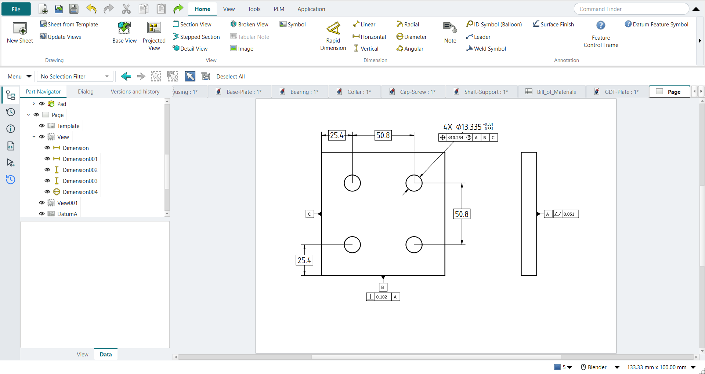
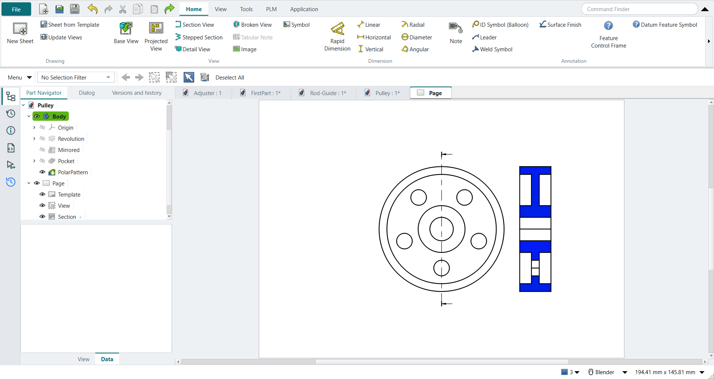
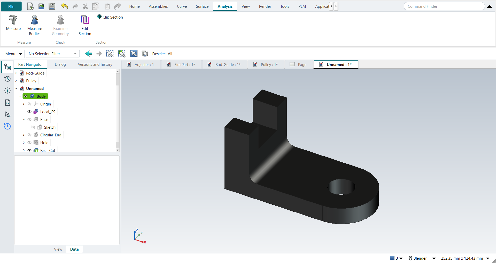
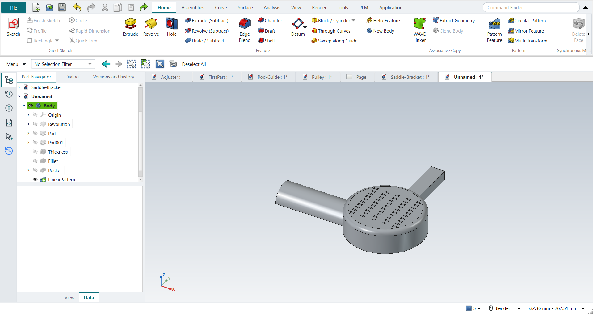
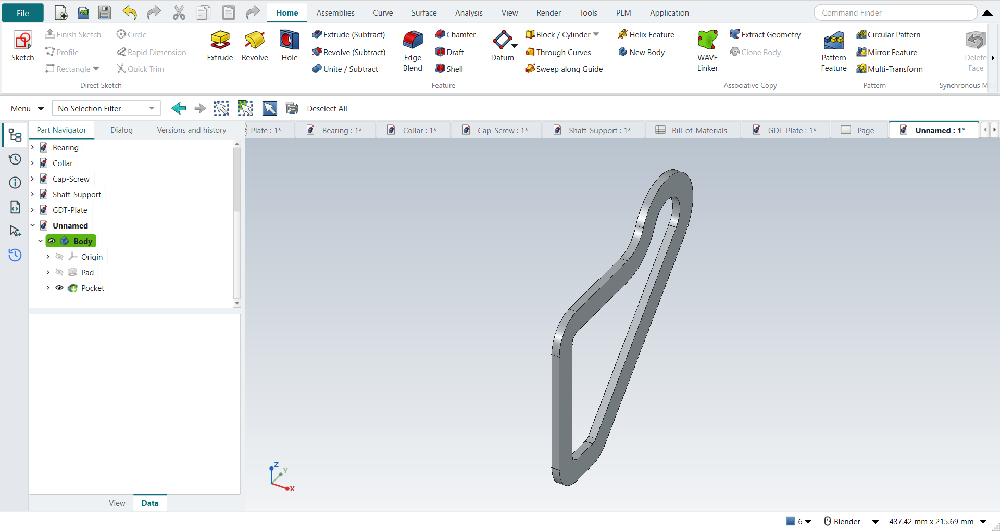
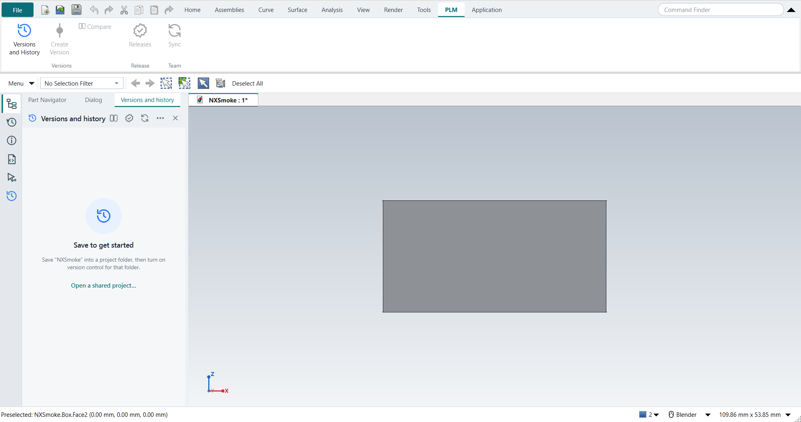

# FreeCAD NX-Style

Run your normal, unmodified FreeCAD with a user interface laid out and behaving like Siemens NX: ribbon, Top Border Bar, Resource Bar, NX mouse buttons, NX shortcuts, NX names. Data management, the job Teamcenter does next to NX, comes from [Strata](https://github.com/Foadsf/freecad-strata): every save recorded, versions, workspaces, releases. There is no fork, no patch, and your usual FreeCAD settings are never touched.

**Documentation: [foadsf.github.io/freecad-nxstyle](https://foadsf.github.io/freecad-nxstyle)**: installation, a five-minute first part, step-by-step tutorials (textbook exercises and precision-engineering work), every keyboard shortcut and every setting.

```bash
git clone --recursive https://github.com/Foadsf/freecad-nxstyle
```

```bash
python launch_nx.py
```

Strata (`vendor/freecad-strata`), Katydid (`vendor/Katydid`), FreeCAD's SheetMetal add-on (`vendor/FreeCAD_SheetMetal`) and LCInterlocking (`vendor/LCInterlocking`) are git submodules. In a copy cloned without `--recursive`, fetch them with `git submodule update --init`; until then NXStyle starts without them and the launcher says so.

## How it stays out of your normal FreeCAD

FreeCAD reads its user folders from `FREECAD_USER_HOME`, `FREECAD_USER_DATA` and `FREECAD_USER_TEMP` (the folders must already exist; FreeCAD ignores the variables otherwise). The launcher points them at a private profile: `%LOCALAPPDATA%\FreeCAD-NXStyle\profile-<version>` on Windows, `~/.local/share/freecad-nxstyle/…` on Linux, `~/Library/Application Support/FreeCAD-NXStyle/…` on macOS. It loads the `NXStyle` module from this folder with FreeCAD's `-M` switch, and Strata from `vendor/freecad-strata` the same way (unless a Strata is already installed in the NX profile's own `Mod` folder, so it never loads twice). Nothing is installed into FreeCAD or into your normal `%APPDATA%\FreeCAD`. The launcher refuses any profile path that overlaps that folder. Your normal add-ons do not load in the NX profile, by design.

Delete the profile folder (or run `--reset-profile`) and it is gone.

## What you get

| NX | Here |
|---|---|
| Ribbon: File, Home, Assemblies, Curve, Surface, Analysis, View, Render, Tools, Application | Same tabs (plus PLM, see Teamcenter below) and groups, with NX command names (Extrude, Edge Blend, Pattern Feature, WAVE Linker, …) driving FreeCAD's real commands. Tooltips also show the FreeCAD name. |
| Quick Access Toolbar, Command Finder | Left and right of the tab row. The finder searches NX and FreeCAD names and shows where each command lives. |
| Top Border Bar | Menu button (all FreeCAD menus), Type Filter that really restricts picking, selection tools |
| Resource Bar | Part Navigator, History (recent parts), Information, Journal (Python console), Selection, Versions and history (Strata) |
| Teamcenter (data management) | [Strata](https://github.com/Foadsf/freecad-strata), on by default: every save is recorded with a plain-language entry, versions are named snapshots, workspaces hold alternatives, Compare shows what changed (also in 3D), releases carry a part number, revision letter and approval, and Sync shares a project through a shared folder or a Git server. Its panel sits with the navigators on the left; the PLM ribbon tab has Versions and History, Create Version, Compare, Releases and Sync. Needs `git` on the PATH. A Strata installed separately joins the NX layout from freecad-strata 1f71005 on (its embedding API); an older one runs beside it. |
| Algorithmic Modeling | [Katydid](https://github.com/Foadsf/Katydid), on by default: a node-based design canvas with data trees and a live 3D preview, baked into ordinary FreeCAD objects and saved in the `.FCStd`. Application › Algorithmic Modeling opens it; `--no-katydid` or `"algorithmic_modeling": "none"` turns it off. |
| Applications | Modeling (PartDesign), Drafting (TechDraw), Assemblies, Shape Studio, Pre/Post (FEM, a guided ribbon: analysis, material, loads, mesh, solve, results), Manufacturing (CAM), … Applications without a hand-made ribbon get one generated from their workbench toolbars. |
| A narrow window | The ribbon fits the window: small buttons go icon-only, then groups collapse into one button with a menu, then into a More menu, with the main commands last. Every command stays reachable. The self-test measures this at 1366x768 and 1920x1080 at 100–200 % scaling. Right-click a group to keep it expanded or collapsed; the choice is saved with the profile. |
| Feature workflow | Extrude (X) or Revolve with nothing selected: pick a plane, sketch, and Finish Sketch (Ctrl+Q) carries straight on into the feature dialog. A new part starts with a Body ready to sketch on. |
| Sketch task environment | Contextual **Sketch** tab with Finish Sketch, Profile, Rapid Dimension, constraints; MB2 ends the active curve tool |
| Mouse | MB2 rotate; hold MB2 to rotate about the point under the cursor; Shift+MB2 / MB2+MB3 pan; Ctrl+MB2 / MB1+MB2 zoom; wheel zoom; **MB2 click = OK**; **hold MB3 = radial menu** (view menu, or object menu over a part) |
| Keys | All 65 bindings from [NXtips](https://github.com/Foadsf/NXtips): file, edit, view (Home, End, Ctrl+Alt+F/T/R/L, F5–F8, W, Ctrl+H), selection (Ctrl+B, Ctrl+Shift+I/K/U/B, Ctrl+J, Ctrl+I), sketch (Z, R, L, A, O, P, S, T, E, F, D, C, Ctrl+Q), applications (Ctrl+M, Ctrl+Shift+D/M/Y, Ctrl+Alt+S), Ctrl+1/2/E/L, F4 Touch Mode. Each one is pressed by the self-test; see [docs/SHORTCUTS.md](docs/SHORTCUTS.md) |
| Graphics window | Light-grey gradient background (five NX presets on View › Background), red preselection, orange selection, grey bodies with dark edges, view triad bottom-left (drawn by NXStyle; FreeCAD 1.0 can only put its own bottom-right), no view cube |
| Cue line | NX-style prompt at the bottom left |
| Assemblies | NX's Assembly template (a new document in Assemblies starts with an empty Assembly) and NX constraint names: Touch Align, Concentric, Align Axes, Align/Lock, Fix, Bond, Parallel, Perpendicular, Angle |
| Drafting › Feature Control Frame, Datum Feature Symbol | NX's GD&T dialogs: characteristic, Ø zone, tolerance, material condition, datums with modifiers; placed against the selected edge or under the selected dimension; values stay editable (FreeCAD itself has only fixed GD&T pictures) |
| Analysis › Measure Bodies | Volume, surface area, assigned material, density, mass and centre of mass in an NX Information window (FreeCAD's own Measure has no mass) |
| PMI tab (Product and Manufacturing Information) | 3D PMI to ISO GPS (default) or ASME Y14.5: Tolerancing (standard, ISO 2768 general tolerances), Rapid Dimension with ISO 286 classes (H7, g6 …) and the envelope Ⓔ, Feature Control Frame, Datum Feature Symbol, all measured from and attached to faces; NX's model views (Front, Top … Trimetric: PMI goes into the work view and lies in its plane, double-click a view to switch, Display in Views to move or copy); Inspection Plan (numbered characteristics, limits, methods, functional gauge sizes at virtual condition, ISO 8015 and Y14.5 checks). Drafting › Inherit PMI puts it on drawing views |
| PMI › STEP with PMI, Import STEP with PMI | STEP AP242 with semantic PMI (datums and datum systems, sizes and locations with deviations and ISO 286 classes, geometrical tolerances with Ⓜ/Ⓛ), written through OpenCASCADE's XCAF tools and read back to check; and the other way: an AP242 file's parts and PMI become NX-Style PMI on their faces. FreeCAD's own STEP export and import drop PMI. Release packages use it too |
| Inspection Plan: datum reference frames | The degrees of freedom each datum system arrests (3-2-1, an axis 4) and what stays free, named (Drake 5.9.7) |
| Analysis › Tolerance Stackup | One-dimensional stack-ups measured from the model or taken from PMI and ISO 286 classes: worst case, RSS, adjusted RSS, MRSS, Monte Carlo, Cp/Cpk/ppm against a requirement; associative (it follows design changes). Checked against Fischer's and Drake's worked examples |
| Analysis › Pin Location | Two dowel pins in two holes or a hole and a slot, from their PMI: worst-case fit, translation, rotation, pointing error at a target, and the thermal mismatch of two materials (Drake ch. 24, Fischer ch. 15) |
| Composite position frames | Feature Control Frame › Frame Style: ASME Y14.5 composite frames (PLTZF over FRTZF) and stacked single-segment frames, with the rule checks, one inspection plan row and one functional gauge per row, the two-row label in 3D and on drawings (Cogorno ch. 12 and 13) |
| Analysis › Position Evaluation | A measured hole or pin pattern against its position frame, from CMM data: the upper row against the datums with each feature's bonus, the composite lower row best-fit (a minimax fit that translates and turns as its datums allow); accept or reject |
| Measurement capability | Each PMI's measurement uncertainty U gives the TUR and ISO 14253-1 acceptance limits in the inspection plan; Analysis › Gauge Study: gauge repeatability by the range method against the PMI's tolerance (Drake ch. 25, AIAG) |
| Drafting › Populate Title Block | The ISO 7200 title block from the part's Strata release (or its DB_PART_NO / DB_PART_REV attributes) and its PMI's general tolerances; a revision block from the release history |
| Sheet Metal (Ctrl+Shift+M) | FreeCAD's SheetMetal add-on, bundled, with NX's ribbon: Tab, Flange, Bend, Hem Flange, Normal Cutout, Convert to Sheet Metal; Sheet Metal Preferences (thickness, bend radius, neutral factor, with bend allowance and deduction) and a Flat Pattern that uses them. Checked against Shih's hand-calculated flat length |
| Laser Cut (Application tab) | The LCInterlocking add-on, bundled, on its own ribbon (NX has no laser-cut application): Panel Box, Tabs and Slots, Cross Halving, Living Hinge, Export Flat Parts. Flat panels joined by tabs and slots, then laid flat for the laser cutter |
| Assemblies › Clearance Analysis, Simple Interference | NX's Assembly Clearance: clearance sets saved in the part, hard / containment / touching / soft interference, penetration depth, Clearance Browser with Study Interference, Restore Visibility, Exclude Pair and New/Gone status |
| Assemblies › Volume Claim, Check Volume Claims | Space reservations for system layouts: keep-in and keep-out claims with margins; finds parts outside their claim, intrusions and space claimed twice |
| PLM › Publish Release Package | NX's Publish Technical Data Package role: the released part (from Strata's release, not the working copy) as STEP, native file, drawing PDFs, PMI, inspection plan, stack-ups and mass properties, with a SHA-256 manifest (`python -m nxstyle.package verify`) |
| Units | Metric by default: mm, kg (FreeCAD's Standard schema) |

**Look:** one NX-light theme layered on FreeCAD's own *FreeCAD Light* stylesheet, with a single accent colour and its tints, original line icons on the Resource Bar, the left panels as one tab strip, and document tabs above the graphics window. Each colour is a token defined once in `NXStyle/nxstyle/theme.py`, which the stylesheets and the Python code both use. Set `"theme": "none"` to keep FreeCAD's look.

**Tools › FreeCAD Menus and Toolbars** brings back FreeCAD's own menu bar and toolbars at any time.

## Screenshots

All taken by the tutorial replay and the self-test on a hidden desktop, in FreeCAD 1.1.4 with NXStyle (see [docs/TUTORIAL-REPLAY.md](docs/TUTORIAL-REPLAY.md) for how each part was built).


| | |
|---|---|
|  |  |
| GD&T drawing with NXStyle's Feature Control Frame and Datum Feature Symbol | Drafting: base view and section view |
|  |  |
| Modeling: renamed features, design changes, material and mass | Shell, Edge Blend and Pattern Feature |
|  |  |
| Sketch Extend, Trim, Fillet and an associative offset | Strata: versions and history, PLM tab |

## What it is not

It is not identical to NX, and cannot be. Icons, feature dialogs and modelling semantics are FreeCAD's: Pocket is not an Extrude with a Boolean option, and there is no synchronous modelling beyond Defeaturing. No Siemens assets are used. See [docs/FACT-CHECK.md](docs/FACT-CHECK.md) for what is and is not achievable and why.

## Options

```bash
python launch_nx.py --list
```

```bash
python launch_nx.py --freecad "C:\Program Files\FreeCAD 1.1\bin\freecad.exe" part.FCStd
```

```bash
python launch_nx.py --reset-profile
```

```bash
python launch_nx.py --no-strata
```

Settings live in `nxstyle.json` inside the profile's `config` folder, which is created on first start. You can change the navigation (`"nx"` = this project's mouse handling on any FreeCAD version, `"native"` = FreeCAD 1.1's own Siemens NX style), labels (`"nx"` or `"freecad"`), units (`"metric"`, the default: millimetres and kilograms, and an imperial schema is switched back; `"freecad"` leaves FreeCAD's choice alone), colours, background, hold delays, whether the feature dialog floats over the graphics window, and data management (`"plm": "strata"`, the default, or `"none"`).

Ribbons are plain JSON in `NXStyle/nxstyle/resources/ribbons/`. A command entry can list several candidate names (the first one that exists wins), so one file serves FreeCAD 1.0 and 1.1. Entries marked `"optional": true` exist only in newer FreeCAD versions.

## Self-test

```bash
python launch_nx.py --smoke-test out
```

This starts FreeCAD in a throwaway profile, on a hidden Windows desktop so nothing appears on your screen (`--visible` to watch). The test drives the real UI with synthetic mouse and key events and checks the behaviours listed in [docs/testing](https://foadsf.github.io/freecad-nxstyle/nxstyle/testing.html): Strata's start and placement, Katydid's canvas, a STEP AP242 file with PMI written and read back, the PMI model views, and that broken references make PMI, stack-ups and clearance results say so instead of keeping old values. It writes `out/smoke.json` plus screenshots and ends with a count of checks passed, failed and skipped (a check the FreeCAD build cannot run, such as AP242 without pythonocc, is counted as skipped, never as passed; `--require-all` fails on it). The launcher believes only a complete result of the run it started, carrying that run's ID; a result left by an earlier run, an empty or truncated one, or a FreeCAD that crashed or exited with an error fails the run. Exit codes: 0 all passed, 1 a check or step failed, 2 no result, 3 timed out, 4 memory ceiling, 5 another run is going, 6 the result is not this run's or is incomplete, 7 FreeCAD exited with an error.

```bash
python launch_nx.py --tutorial out
```

Replays the tutorials through the UI (`--tutorials G,H` picks some). S to Z are precision-engineering work (Y: PMI in model views and drawings from them; Z: STEP AP242 with PMI out and back in, datum reference frames): Fischer's pin stack-up (the book's numbers reproduced), a guide bush documented to ISO GPS in 3D with its drawing inherited from the PMI and its STEP AP242 with PMI, volume claims and assembly clearance in a system layout, a release with an engineering change and release packages, Shih's sheet metal actuator bracket with its flat length checked against the book, and a laser module located by two pins (fit, rotation, pointing error at 2 m, thermal mismatch). A to N are exercises from NX, GD&T and engineering-graphics textbooks: keys, ribbon clicks, MB1 sketch clicks, MB2 to finish. They cover sketch and extrude, revolve, datum planes, holes, mirror, circular and rectangular patterns, renaming and design changes, materials and mass, edge blend, shell, an assembly with its constraints and degrees of freedom, a drawing with a section view, a GD&T drawing, sketch Extend/Trim/Fillet and an associative offset, constraints with the solver's degree-of-freedom messages and dimension formulas, a part driven by a table of expressions, CSG with placed features, parent/child relations with Suppress, and an associative drawing that follows a model change. It checks every feature by its volume and that the part is actually drawn. Results: [docs/TUTORIAL-REPLAY.md](docs/TUTORIAL-REPLAY.md).

Each run uses a fresh throwaway profile. To test what a second start sees (settings saved by the first), give both runs the same `--profile DIR`; it is kept between runs.

Self-test and tutorial runs are capped at 4 GB of memory (`--max-memory-gb`), run one at a time, and end with exit code 4 if FreeCAD asks for more.

```bash
python -m unittest discover -s tests
```

Unit tests (launcher, ISO 286 and ISO 2768, PMI, stack-ups, clearance, release packages, AP242 mapping, sheet metal, pin location); FreeCAD is not needed. These and a lint run on every push (GitHub Actions).

## Requirements

FreeCAD 1.0 or newer. Tested on Windows 11 with FreeCAD 1.0.2 (Qt 5.15) and 1.1.4 (Qt 6). Also tested on Linux Mint 22.2 with the FreeCAD 1.1.4 AppImage (put it in a folder such as `~/Applications`; the self-test passes, run on an Xvfb display). macOS has not been tested yet. The hidden-desktop test mode is Windows-only; on Linux the self-test runs on whatever `DISPLAY` it is given. Any Python 3.8+ runs the launcher, including FreeCAD's own.

Known FreeCAD 1.1.4 issue: a PartDesign Body whose origin planes stay visible disappears from the 3D view after a view fit (plain FreeCAD does this too). NXStyle therefore keeps the origin hidden; FreeCAD shows it while you pick a sketch plane.

## Licence and trademarks

[LGPL-2.1-or-later](LICENSE), matching FreeCAD. Strata and Katydid are separate projects under the same licence, included as submodules; so is FreeCAD's [SheetMetal add-on](https://github.com/shaise/FreeCAD_SheetMetal) (LGPL-2.1), unmodified, and [LCInterlocking](https://github.com/execuc/LCInterlocking) (LGPL-2.1), as [a fork](https://github.com/Foadsf/LCInterlocking) with two fixes for FreeCAD 1.1 (Qt 6). Siemens, NX and Teamcenter are trademarks of Siemens; this project is not affiliated with or endorsed by Siemens and uses no Siemens software, icons or documentation text.
