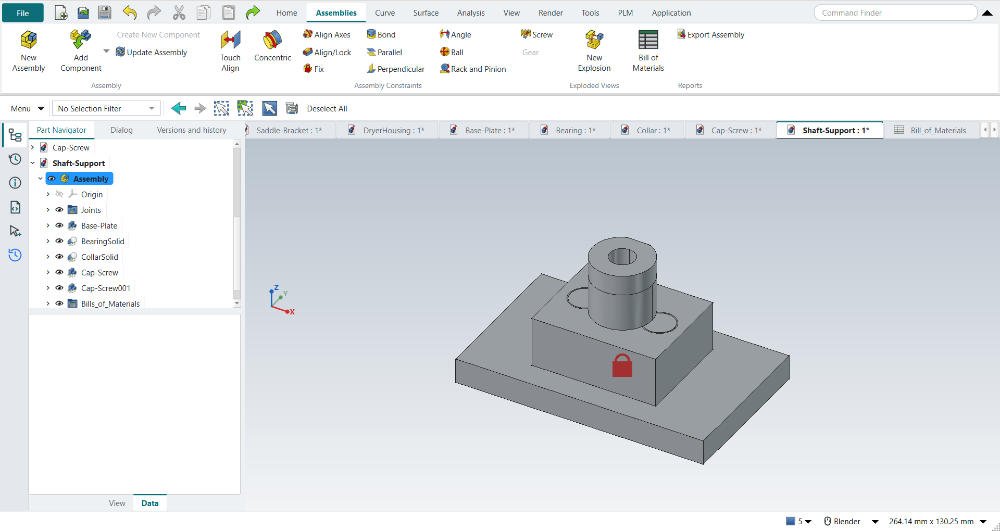

# FreeCAD NX-Style

Run your normal, unmodified FreeCAD with a user interface laid out and behaving like Siemens NX: ribbon, Top Border Bar, Resource Bar, NX mouse buttons, NX shortcuts, NX names. Data management, the job Teamcenter does next to NX, comes from [Strata](https://github.com/Foadsf/freecad-strata): every save recorded, versions, workspaces, releases. There is no fork, no patch, and your usual FreeCAD settings are never touched.

```bash
git clone --recursive https://github.com/Foadsf/freecad-nxstyle
```

```bash
python launch_nx.py
```

Strata is a git submodule (`vendor/freecad-strata`). In a copy cloned without `--recursive`, fetch it with `git submodule update --init`; until then NXStyle starts without it and the launcher says so.

## How it stays out of your normal FreeCAD

FreeCAD reads its user folders from `FREECAD_USER_HOME`, `FREECAD_USER_DATA` and `FREECAD_USER_TEMP` (the folders must already exist; FreeCAD ignores the variables otherwise). The launcher points them at a private profile: `%LOCALAPPDATA%\FreeCAD-NXStyle\profile-<version>` on Windows, `~/.local/share/freecad-nxstyle/…` on Linux, `~/Library/Application Support/FreeCAD-NXStyle/…` on macOS. It loads the `NXStyle` module from this folder with FreeCAD's `-M` switch, and Strata from `vendor/freecad-strata` the same way (unless a Strata is already installed in the NX profile's own `Mod` folder, so it never loads twice). Nothing is installed into FreeCAD or into your normal `%APPDATA%\FreeCAD`. The launcher refuses any profile path that overlaps that folder. Your normal add-ons do not load in the NX profile, by design.

Delete the profile folder (or run `--reset-profile`) and it is gone.

## What you get

| NX | Here |
|---|---|
| Ribbon: File, Home, Assemblies, Curve, Surface, Analysis, View, Render, Tools, Application | Same tabs (plus PLM, see Teamcenter below) and groups, with NX command names (Extrude, Edge Blend, Pattern Feature, WAVE Linker, …) driving FreeCAD's real commands. Tooltips also show the FreeCAD name. |
| Quick Access Toolbar, Command Finder | Left and right of the tab row. The finder searches NX and FreeCAD names and shows where each command lives. |
| Top Border Bar | Menu button (all FreeCAD menus), Type Filter that really restricts picking, selection tools |
| Resource Bar | Part Navigator, History (recent parts), Information, Journal (Python console), Selection, Versions and history (Strata) |
| Teamcenter (data management) | [Strata](https://github.com/Foadsf/freecad-strata), on by default: every save is recorded with a plain-language entry, versions are named snapshots, workspaces hold alternatives, Compare shows what changed (also in 3D), releases carry a part number, revision letter and approval, and Sync shares a project through a shared folder or a Git server. Its panel sits with the navigators on the left; the PLM ribbon tab has Versions and History, Create Version, Compare, Releases and Sync. Needs `git` on the PATH. |
| Applications | Modeling (PartDesign), Drafting (TechDraw), Assemblies, Shape Studio, Pre/Post (FEM), Manufacturing (CAM), … Applications without a hand-made ribbon get one generated from their workbench toolbars. |
| Feature workflow | Extrude (X) or Revolve with nothing selected: pick a plane, sketch, and Finish Sketch (Ctrl+Q) carries straight on into the feature dialog. A new part starts with a Body ready to sketch on. |
| Sketch task environment | Contextual **Sketch** tab with Finish Sketch, Profile, Rapid Dimension, constraints; MB2 ends the active curve tool |
| Mouse | MB2 rotate; hold MB2 to rotate about the point under the cursor; Shift+MB2 / MB2+MB3 pan; Ctrl+MB2 / MB1+MB2 zoom; wheel zoom; **MB2 click = OK**; **hold MB3 = radial menu** (view menu, or object menu over a part) |
| Keys | All 65 bindings from [NXtips](https://github.com/Foadsf/NXtips): file, edit, view (Home, End, Ctrl+Alt+F/T/R/L, F5–F8, W, Ctrl+H), selection (Ctrl+B, Ctrl+Shift+I/K/U/B, Ctrl+J, Ctrl+I), sketch (Z, R, L, A, O, P, S, T, E, F, D, C, Ctrl+Q), applications (Ctrl+M, Ctrl+Shift+D/M/Y, Ctrl+Alt+S), Ctrl+1/2/E/L, F4 Touch Mode. Each one is pressed by the self-test; see [docs/SHORTCUTS.md](docs/SHORTCUTS.md) |
| Graphics window | Light-grey gradient background (five NX presets on View › Background), red preselection, orange selection, grey bodies with dark edges, view triad bottom-left (drawn by NXStyle; FreeCAD 1.0 can only put its own bottom-right), no view cube |
| Cue line | NX-style prompt at the bottom left |
| Assemblies | NX's Assembly template (a new document in Assemblies starts with an empty Assembly) and NX constraint names: Touch Align, Concentric, Align Axes, Align/Lock, Fix, Bond, Parallel, Perpendicular, Angle |
| Drafting › Feature Control Frame, Datum Feature Symbol | NX's GD&T dialogs: characteristic, Ø zone, tolerance, material condition, datums with modifiers; placed against the selected edge or under the selected dimension; values stay editable (FreeCAD itself has only fixed GD&T pictures) |
| Analysis › Measure Bodies | Volume, surface area, assigned material, density, mass and centre of mass in an NX Information window (FreeCAD's own Measure has no mass) |
| Units | Metric by default: mm, kg (FreeCAD's Standard schema) |

**Look:** one NX-light theme layered on FreeCAD's own *FreeCAD Light* stylesheet, with a single accent colour and its tints, original line icons on the Resource Bar, the left panels as one tab strip, and document tabs above the graphics window. The colour tokens are listed at the top of `NXStyle/nxstyle/resources/nx_theme.qss`. Set `"theme": "none"` to keep FreeCAD's look.

**Tools › FreeCAD Menus and Toolbars** brings back FreeCAD's own menu bar and toolbars at any time.

## Screenshots

All taken by the tutorial replay and the self-test on a hidden desktop, in FreeCAD 1.1.4 with NXStyle (see [docs/TUTORIAL-REPLAY.md](docs/TUTORIAL-REPLAY.md) for how each part was built).



| | |
|---|---|
|  |  |
| GD&T drawing with NXStyle's Feature Control Frame and Datum Feature Symbol | Drafting: base view and section view |
|  |  |
| Modeling: renamed features, design changes, material and mass | Shell, Edge Blend and Pattern Feature |
|  |  |
| Sketch Extend, Trim, Fillet and an associative offset | Strata: versions and history, PLM tab |

## What it is not

It is not identical to NX, and cannot be. Icons, feature dialogs and modelling semantics are FreeCAD's: Pocket is not an Extrude with a Boolean option, and there is no synchronous modelling beyond Defeaturing. No Siemens assets are used. See [docs/FACT-CHECK.md](docs/FACT-CHECK.md) for what is and is not achievable and why.

## Options

```bash
python launch_nx.py --list
```

```bash
python launch_nx.py --freecad "C:\Program Files\FreeCAD 1.1\bin\freecad.exe" part.FCStd
```

```bash
python launch_nx.py --reset-profile
```

```bash
python launch_nx.py --no-strata
```

Settings live in `nxstyle.json` inside the profile's `config` folder, which is created on first start. You can change the navigation (`"nx"` = this project's mouse handling on any FreeCAD version, `"native"` = FreeCAD 1.1's own Siemens NX style), labels (`"nx"` or `"freecad"`), units (`"metric"`, the default: millimetres and kilograms, and an imperial schema is switched back; `"freecad"` leaves FreeCAD's choice alone), colours, background, hold delays, whether the feature dialog floats over the graphics window, and data management (`"plm": "strata"`, the default, or `"none"`).

Ribbons are plain JSON in `NXStyle/nxstyle/resources/ribbons/`. A command entry can list several candidate names (the first one that exists wins), so one file serves FreeCAD 1.0 and 1.1. Entries marked `"optional": true` exist only in newer FreeCAD versions.

## Self-test

```bash
python launch_nx.py --smoke-test out
```

This starts FreeCAD in a throwaway profile, on a hidden Windows desktop so nothing appears on your screen (`--visible` to watch). The test drives the real UI with synthetic mouse and key events and checks 57 behaviours, Strata's start and placement among them. It writes `out/smoke.json` plus screenshots, and exits non-zero on any failure.

```bash
python launch_nx.py --tutorial out
```

Replays eleven exercises from NX, GD&T and engineering-graphics textbooks through the UI (`--tutorials G,H` picks some): keys, ribbon clicks, MB1 sketch clicks, MB2 to finish. They cover sketch and extrude, revolve, datum planes, holes, mirror, circular and rectangular patterns, renaming and design changes, materials and mass, edge blend, shell, an assembly with its constraints and degrees of freedom, a drawing with a section view, a GD&T drawing, sketch Extend/Trim/Fillet and an associative offset, constraints with the solver's degree-of-freedom messages and dimension formulas, and a part driven by a table of expressions. It checks every feature by its volume and that the part is actually drawn. Results: [docs/TUTORIAL-REPLAY.md](docs/TUTORIAL-REPLAY.md).

Self-test and tutorial runs are capped at 4 GB of memory (`--max-memory-gb`), run one at a time, and end with exit code 4 if FreeCAD asks for more.

```bash
python -m unittest discover -s tests
```

Launcher unit tests; FreeCAD is not needed. These and a lint run on every push (GitHub Actions).

## Requirements

FreeCAD 1.0 or newer. Tested on Windows 11 with FreeCAD 1.0.2 (Qt 5.15) and 1.1.4 (Qt 6). The launcher also looks for FreeCAD on Linux and macOS, but those platforms have not been tested yet, and the hidden-desktop test mode is Windows-only. Any Python 3.8+ runs the launcher, including FreeCAD's own.

Known FreeCAD 1.1.4 issue: a PartDesign Body whose origin planes stay visible disappears from the 3D view after a view fit (plain FreeCAD does this too). NXStyle therefore keeps the origin hidden; FreeCAD shows it while you pick a sketch plane.

## Licence and trademarks

[LGPL-2.1-or-later](LICENSE), matching FreeCAD. Strata is a separate project under the same licence, included as a submodule. Siemens, NX and Teamcenter are trademarks of Siemens; this project is not affiliated with or endorsed by Siemens and uses no Siemens software, icons or documentation text.
