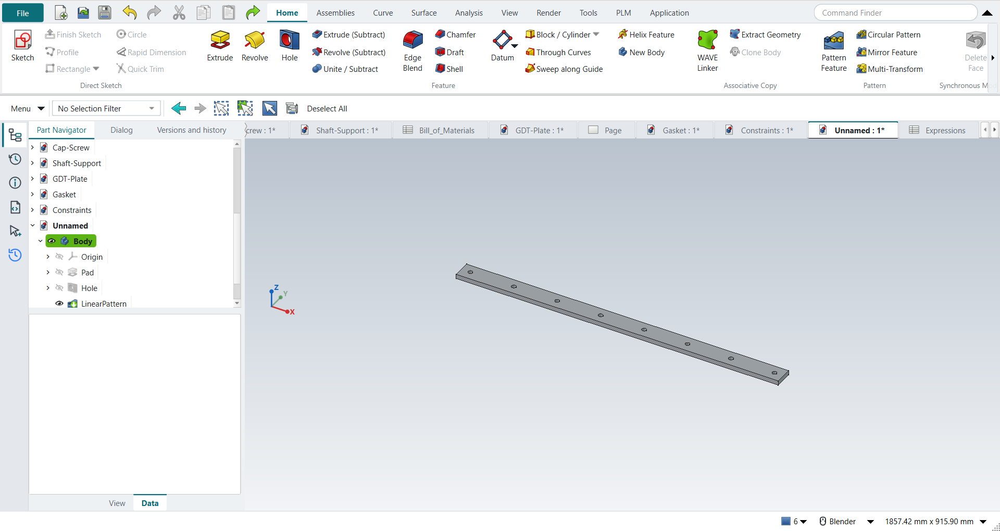
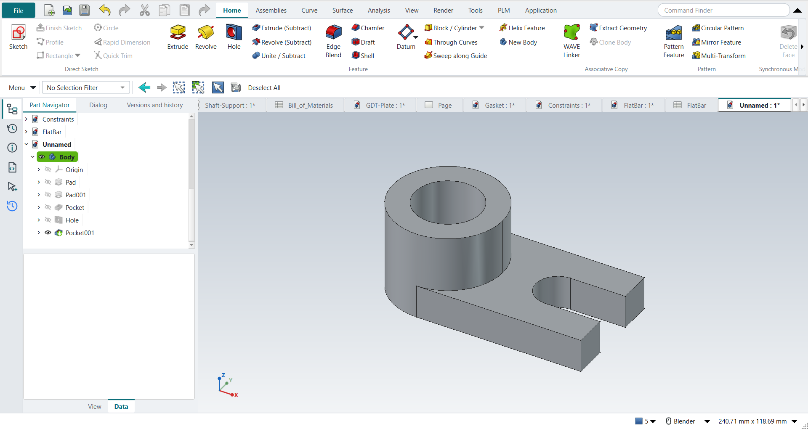
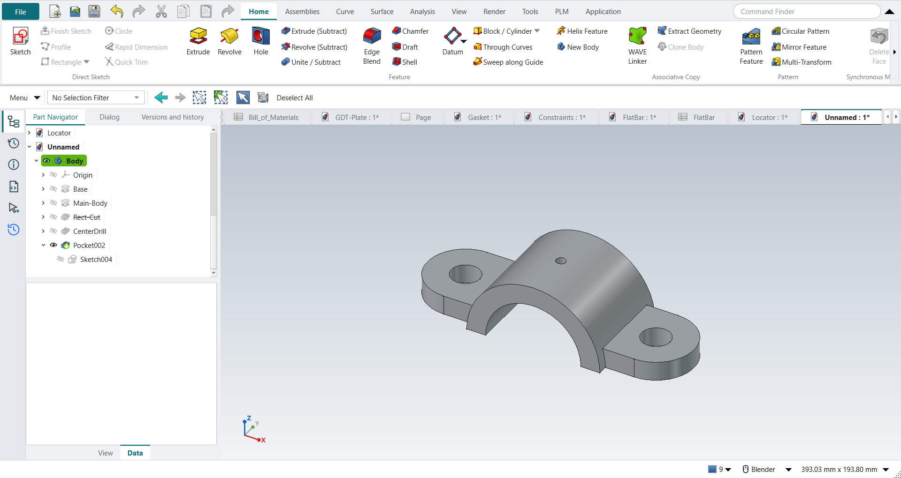
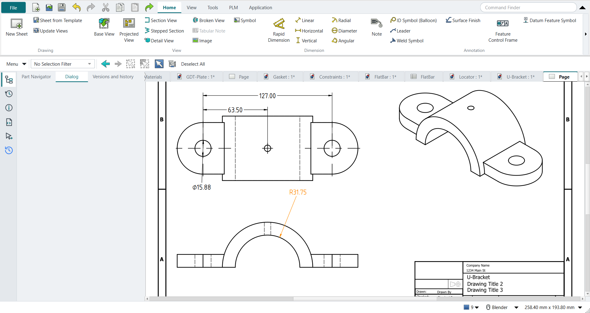

# Tutorial replay: NX textbook exercises in FreeCAD NX-Style

Fourteen exercises from two notebooks were replayed inside FreeCAD 1.1.4 with `python launch_nx.py --tutorial OUTDIR` (`--tutorials G,H` picks some), the way the books tell an NX user to work. The replay presses the same keys, clicks the NX-named ribbon buttons, clicks sketch points with MB1 in the graphics window, ends tools and accepts dialogs with MB2, and checks each feature by its volume.

Every part is metric, NXStyle's default (FreeCAD's Standard schema: mm, kg). The books work in inches; their sizes are typed in millimetres (2.5 in = 63.5 mm), and volumes are reported in mm³.

- **A, The Adjuster** (Shih, *Parametric Modeling with Siemens NX*, ch. 2). The step list came from NotebookLM; its slot placement was ambiguous, so the replay cuts a 1.00 in (25.4 mm) wide, 0.75 in (19.05 mm) deep slot into the top of the vertical leg (the part stays one solid).
- **B, First part**: a hollow cylinder (Ø50/Ø30 × 50 mm) and a revolved cone (R25 × 50 mm). NotebookLM attributed it to the KIT course but cited Shih and Tickoo; treat it as a synthesised exercise.
- **C, Rod-Guide** (Shih ch. 9): a filleted 3.00 × 2.00 × 0.75 block with four holes, an At Angle datum plane, an offset datum plane, and a hole drilled from that datum. The step order follows the book's text; its sizes appear only in figures, so they are NotebookLM's reading. The angled upper block (C9) is skipped because its profile is figure-only.
- **D, Pulley with drawing** (Shih ch. 11): a revolved half section, Mirror Feature, a pattern leader hole, a 5× circular pattern, then a drawing with a right base view and a section view. The profile sizes (Ø4.00 × 1.00, hub Ø1.50, bore Ø0.75, web 0.25, five Ø0.50 holes on a 2.50 pitch circle) are again NotebookLM's reading of the figures.
- **E, Saddle Bracket** (Shih ch. 4): the BORN technique (Datum CSYS first), a symmetric extrude, a circular end tied to a projected edge, renaming features in the Part Navigator, three design changes (width 2.5 → 2.0, Until Next → Through All, a fillet added to the first sketch), Assign Materials (steel) and the physical properties. The text gives 2.5, 0.5, 2.0, Ø0.75 and R0.25; the profile and the notch are figure-only, so the L-profile (3.00 long, 0.50 base, 0.75 × 2.00 upright, 1.00 × 0.75 notch) is the replay's own. NotebookLM's reading of these figures came back without citations and contradicted the text, so it was not used. Siemens documents that since NX 1926 a Symmetric Value distance is the total width ([KB PL8613151](https://support.sw.siemens.com/en-US/okba/PL8613151/Extrude-feature-is-not-generated-with-a-distance-value-specified-by-Symmetric-Value/index.html)); the book uses NX 2212.
- **F, Dryer Housing** (Shih ch. 12): revolve, extrudes, Edge Blend, Shell, a pattern leader and a two-direction rectangular pattern. The text gives R0.25, 0.5, 5.5, R0.15, 0.125, 0.15 and the pattern (5 × −0.58, 10 × −0.25); every profile is figure-only, so the housing is a simplified one of the replay's own (an R2.00 × 1.25 drum, a 0.75 wide handle, an R0.75 half nozzle). The swept cut along the rim (F27) is skipped: its guide and section are figure-only.
- **G, Shaft Support assembly** (Shih ch. 14): Add Component with the Fixed (ground) question, Touch Align on faces and hole axes with the book's degree-of-freedom results checked at each step, Parallel, Align/Lock and Touch Align for two cap screws, a part edit that reaches the assembly, and the parts list. The four parts' sizes are figure-only, so they are the replay's own (metric), built to fit the book's constraint sequence. NX's Show Degrees of Freedom has no FreeCAD equivalent: the replay displaces a part, solves, and checks whether it stays (free) or snaps back (constrained).
- **H, GD&T plate drawing** (Cogorno, *Geometric Dimensioning and Tolerancing for Mechanical Design* 3e, from the second notebook "precision engineering": ch. 12.2 and ch. 8): datum features A (back face), B (bottom edge), C (left edge); 4X Ø.510–.540 holes with position Ø.010 at MMC to A|B|C; perpendicularity .004 to A on datum B; flatness .002 on A (Prob. 12-3); basic 1.000 and 3.000 from B and C. The text's inch values are converted to mm exactly (Ø12.954–13.716, Ø0.254, 0.102, 0.051, basic 25.4 / 50.8). The plate's size is figure-only: 101.6 × 101.6 × 12.7 mm here.
- **I, The Gasket** (Shih ch. 6, a millimetre part): an outline, a circle and a line tangent to it; Extend and Quick Trim; the book's dimensions (the circle's centre in line with the top line by a 0.0 location dimension, its horizontal location, the radius, the corner on the origin) until the sketch is fully defined; Fillet R20; a 5 mm extrude; then Project Curve on the front face, Offset Curve 15 mm inwards, a through-all subtract with only the inner loop, and the book's design change: the overall height to 150 mm, with the offset following. The outline's sizes are figure-only: an 80 mm left side and an R30 boss here.
- **J, Parametric constraints** (Shih ch. 5): a triangle constrained step by step, with FreeCAD's solver message compared to NX's status line at every step (Perpendicular, a length and an angle, Fix, undo and Coincident, location dimensions, relaxing Perpendicular, Vertical, a tangent circle); a 3.5 in plate; then dimensions driven by the book's formulas (p8/5*1.6, p10/4*1.2, hole = 1/3 of the height) and two size changes (25 × 15 and 25 × 20) that the hole follows. The triangle's own sizes are figure-only.
- **K, Parameter-driven flat bar** (Leake & Borgerson, *Engineering Design Graphics*, ch. 7, Fig. 7-30; second notebook): a bar with N equally spaced holes driven by L, N, D and hole_spacing = (L − 2D)/(N − 1), typed into the Expressions table (Ctrl+E); the bar's length, the first hole and the hole pattern are tied to those names; then configuration B (L 36, N 8, D 1) is typed into the same table. The book gives L, N, D for both configurations (inches, typed in mm); the bar's width and thickness and the hole size are not given: 50.8 × 12.7 mm and Ø12.7 here.
- **L, The Locator** (Shih ch. 3, a millimetre part): Constructive Solid Geometry with sketched and placed features: a 75 × 50 × 15 block, a boss whose circle runs through an edge's midpoint and corner (R25), 40 high and united, a Ø30 bore through all, a Ø20 hole, and a 20 mm slot from the right face cut Until Next. The text gives every size; where the hole and the slot sit is in the figures: here the hole is 25 mm from the right edge on the slot's centre line, the slot 15 mm from the front edge and as wide as the hole, so it runs into it.
- **M, The U-Bracket** (Shih ch. 7): parent/child relations. A plate with two Ø0.75 holes, a half-round body across it (−1.25 to 1.25), a 2.0 × 1.0 cut under it and a Ø0.25 drill sketched on the cut's face; renaming; Suppress and Unsuppress; deleting the drill and sketching it again on the datum XY plane (the BORN technique) so it no longer depends on the cut; then an R1.25 round opening instead of the rectangular one. The plate's end radius (R1.00) and the body's radius (R1.75) are NotebookLM's reading of the figures (uncited).
- **N, The U-Bracket drawing** (Shih ch. 8, after M): an A-size third-angle sheet changed to B size; front, top and isometric views with hidden lines; ANSI horizontal text; the model's dimensions on the views; smooth edges off; arrows out on a diameter; Hide and Show; center marks; a radial dimension; two decimals; and the associative change Ø0.750 → Ø0.625 in the model, which the drawing follows.

- **S, Tolerance stack-up of a grooved pin** (Fischer, *Mechanical Tolerance Stackup and Analysis* 2e, Example 7.1 / 8.1): the pin revolved, then Analysis › Tolerance Stackup with three measured contributors; the results equal the book's (worst case 0.6 to 3.0, RSS ±0.74, adjusted RSS ±1.1); a DIN 471 groove requirement (≥ 1.1) that fails; the groove's width dimensioned directly instead (1.7 to 1.9); and a model change the stack-up follows. The pin's diameters are ours.
- **T, A guide bush documented to ISO GPS** (the PMI workflow of Wünsch et al., *NX für Einsteiger* 6.10, on a part of ours): Tolerancing (ISO GPS, ISO 2768-mK), Rapid Dimension with Ø25 k6 Ⓔ and Ø16 H7, datums A and B, coaxiality and perpendicularity, an untoleranced length; the inspection plan finds H7 without the envelope (ISO 8015); the fit H7/g6 as a stack-up equals ISO 286's clearance; PMI › STEP with PMI writes STEP AP242 with the semantic PMI (datums A and B, H7 and k6, the frames), which OpenCASCADE reads back; a drawing at 2:1 inherits the PMI.
- **U, Volume claims and assembly clearance** (our layout; NX's Assembly Clearance): four claims, one a keep-out for a beam path; the check finds an overlap, a part outside its claim and two intrusions; fixed; then Clearance Analysis finds one each of hard (penetration 4.00), containment and soft, and two touching pairs; Study Interference, Exclude Pair.
- **V, Release and engineering change** (runs T first): Strata's version control turned on, V1 released as BUSH-100 rev A, its release package published and verified (STEP AP242 with the PMI, the bore's fit in it), ECO-001 (H7 → F7) with the fit's stack-up following, V2 compared, rev B released, rev A obsolete; rev A's package published again after the change still documents H7.
- **W, The actuator bracket in sheet metal** (Shih, *Parametric Modeling with Siemens NX*, ch. 13): Ctrl+Shift+M (FreeCAD's SheetMetal add-on, bundled); Sheet Metal Preferences 0.0625 in thick, bend radius 0.0625, neutral factor 0.41; Tab from a 1.633 × 1.620 in rectangle; two Flanges 0.615 in outside, Material Inside; Flat Pattern 67.0523 mm long against the book's hand calculation 2 × 1.31992 in = 67.0519 mm; a drawing of the flat pattern with its overall sizes. The tab's rectangle is drawn by script.
- **X, Locating a laser module with two pins** (Drake, *Dimensioning and Tolerancing Handbook*, ch. 24; Fischer ch. 15; our layout): steel bench, aluminium module, Ø6 holes G6 on pins h6 80 apart; Analysis › Pin Location from the PMI: two holes do not assemble (−0.006 mm); a slot: assembles, but 0.50 mm pointing error at 2 m; pins 200 apart: 0.20 mm; G5/h5: 0.14 mm, within ±0.15; 10 K warm, aluminium on steel: the slot takes up 0.0252 mm. The model changes are made by script.
- **Y, PMI in model views** (the model views of Wünsch et al. 6.10 and Tickoo ch. 12; our plate): Tolerancing brings the Model Views folder (Front … Trimetric); double-click Top: 4X Ø8 H11 and the width 60 go into Top; double-click Front: Top's PMI hidden, thickness 10 ±0.1, datum A and flatness 0.05 go into Front; Top again shows only its two; Display in Views copies datum A into Top; Isometric shows none, Show All PMI all five; a drawing's top and front views inherit, From Model View, Top's and Front's PMI. The plate is made by script; a model view's double-click calls the Part Navigator's handler.
- **Z, MBD exchange through STEP AP242** (Drake 5.9.7 for the datum reference frames; our plate): datums A, B, C, the hole Ø8 H11 positioned Ø0.2 Ⓜ to A|B|C, B perpendicular to A, thickness 10 ±0.1; the Inspection Plan reports A|B|C arresting 6 of 6 degrees of freedom (3, 2, 1) and A alone 3 with the slide and turn on A free; STEP with PMI; a new part; Import STEP with PMI gives the same seven PMI on the same faces, and the same plan. The plate and its PMI are made by script.
- **AA, Composite position, evaluated from CMM data** (Cogorno ch. 12 and 13; the layout of his graphic analysis example in mm, our measurements): 4X Ø5 +0.2/0 with Frame Style Composite Frame, Ø0.2 Ⓜ to A|B|C over Ø0.04 Ⓜ to A; the Inspection Plan lists PLTZF and FRTZF with their bonus and two gauges (pins Ø4.8 on A|B|C, Ø4.96 floating on A); a lower row repeating B is an error; Analysis › Position Evaluation with the CMM's 12 values typed: ACCEPT, PLTZF 63 %, FRTZF 72 % after the best fit; Translate only: REJECT, 103 %. The plate, its datums and the size are made by script.
- **AB, Measurement capability** (Drake ch. 20 and 25; ISO 14253-1; our plate and uncertainties): the bore Ø20 H7 (U 0.002), the thickness 12 ±0.05 (U 0.01) and a flatness 0.01 (U 0.004) through the PMI dialogs; the Inspection Plan gives TUR 5.2, 5.0 and 1.2 and the acceptance limits 20.002 to 20.019, 11.960 to 12.040 and 0.006 max; Gauge Study with Drake's ranges at 3σ: 42.6 %, unacceptable, as in the book; an air gauge on the bore at 6σ: acceptable.
- **AC, Title block and revision block from the release** (runs T and V first; Drake ch. 4, ISO 7200): Drafting › Populate Title Block on the guide bush's sheet gives it the A4 ISO 5457 template and fills BUSH-100, revision B, Guide bush, Released, the general tolerances ISO 2768-mK (Inherit PMI's separate note removed); the revision block lists A and B from the releases.
- **AD, A laser-cut tray with tabs and slots** (our design; the LCInterlocking add-on's own workflow, since NX has no laser-cut application): Application › Laser Cut (LCInterlocking, bundled); five 3 mm Blocks (a 120 × 80 base, two 120 × 40 walls, two short walls between them); Tabs and Slots with the add-on's own task panel, Add parts (thickness 3 mm found for each), eight faces as Tab joints, MB2 = OK: five joined parts, each one solid, 14.4 mm³ more in all (each tab 0.2 mm wider than its slot, the kerf); Export Flat Parts: the five lying flat, apart, with their outlines; the outlines exported as SVG. The panels' sizes are typed into their properties.

Dimension values are applied through FreeCAD's API, the equivalent of typing them into Rapid Dimension. Everything else is real UI input. In E and F each feature is checked against the same operation done directly with FreeCAD's Part API. The shell is the exception: `Part.makeThickness` returned shapes reaching outside the original part, so the shell is measured directly instead (outer box unchanged, points 1.6 mm inside every wall are material, points deeper in are hollow).

**same** = NX steps work as written. **differs** = it works, but the FreeCAD way is different (explained). **limit** = the book's way fails in FreeCAD itself; a workaround follows in the next steps. **missing** = FreeCAD has no such function (a stand-in follows). **skipped** = not replayed (reason given). **FAILED** = did not work. The final run (all fourteen in one FreeCAD session, Strata loaded, peak 3.3 GB) had no FAILED steps: A 13 same / 5 differs, B 13 / 2, C 11 / 3 / 1 skipped, D 13 / 7, E 15 / 10, F 16 / 9 / 2 limit / 1 skipped, G 12 / 5 / 1 limit / 1 skipped, H 3 / 14, I 11 / 3, J 15 / 2, K 6 / 5, L 14 / 9 / 1 limit, M 18 / 11 / 1 limit, N 10 / 8 / 1 missing. S to AD have no FAILED steps: S 12 same / 4 differs, T 2 / 15, U 4 / 8, V 7 / 6, W 5 / 3, X 1 / 6, Y 6 / 8, Z 1 / 5, AA 2 / 5, AB 1 / 7, AC 1 / 1, AD 2 / 6.

| # | NX step | How it was replayed | Result | Detail |
|---|---|---|---|---|
| A1 | File > New (Ctrl+N), Model template | Ctrl+N | **same** | new document ['Unnamed'] with a Body; its datum planes appear when a plane is picked (kept hidden otherwise: FreeCAD 1.1.4 hides the part when they stay on) |
| A2 | Units in the New dialog (the book picks inches) | metric part kept; book sizes typed in mm | **differs** | FreeCAD sets units in Preferences, not in the New dialog; NXStyle defaults to millimetres (document: Standard (mm, kg, s, °); 25.4 mm shows as 25.40 mm) |
| A3 | Extrude (X) with nothing selected | X key | **same** | FreeCAD asks for the sketch plane in the Dialog panel; NX asks in the graphics window |
| A4 | Pick the XY plane, accept with MB2 | plane row in the Dialog panel + MB2 click | **same** | picked XY-plane (Base plane); sketch in edit: Sketch |
| A5 | Profile (Z), six MB1 clicks for the L outline | Z key + MB1 clicks in the graphics window | **same** | tool active True; 6 curves drawn |
| A6 | MB2 ends Profile | MB2 click | **same** | tool ended = True |
| A7 | Rapid Dimension (D): 2.5 width, 2.5 height, 0.75 legs | D key, values applied | **differs** | D starts FreeCAD's Dimension tool. FreeCAD does not show NX's dynamic dimensions on click, and there is no 'scale the whole sketch to the first dimension?' prompt |
| A8 | Finish Sketch (Ctrl+Q) returns to the Extrude dialog | Ctrl+Q | **same** | Extrude dialog open = True; modals [] |
| A9 | Extrude: End = Value 2.5, Boolean None, OK | typed into 'lengthEdit', MB2 = OK | **same** | volume 130584.4 mm^3, expected 130584.4; same solid as the reference: 0 mm³ differ, box within 0 mm, 8 faces (8 in the reference) |
| A10 | Extrude, pick the top face as sketch plane, Boolean Subtract | select face + ribbon 'Home › Feature > Extrude (Subtract)' | **differs** | the Extrude dialog's Boolean list has Subtract (tutorial AE uses it); this replay uses the Extrude (Subtract) button, which starts the same command with Subtract chosen |
| A11 | Rectangle (R), two MB1 clicks, MB2 | R key + MB1 clicks + MB2 | **same** | tool active True; 4 curves |
| A12 | Rapid Dimension: 0.50 from edge, 1.00 wide, 0.75 deep | values applied | **differs** | as in step 6: same tool, no NX dynamic dimensions |
| A13 | Finish Sketch returns to the (subtract) Extrude dialog | Ctrl+Q | **same** | dialog open = True |
| A14 | Reverse Direction into the solid | - | **differs** | not needed: FreeCAD's subtracting extrude cuts into the solid by default |
| A15 | Slot depth 0.75, OK | 'lengthEdit' = 19.05 mm, MB2 = OK | **same** | volume 121366.7 mm^3, expected 121366.7; 1 solid(s); same solid as the reference: 0 mm³ differ, box within 0 mm, 12 faces (12 in the reference) |
| A16 | The finished part is shown in the graphics window | render of the graphics window | **same** | 26.7% of the view shows the part (an occupancy check: something is drawn; the shape itself is checked by its geometry) |
| A17 | Save (Ctrl+S) | file name given once by script (the system file dialog is not driven); a change, then the Ctrl+S key | **same** | Adjuster.FCStd rewritten by Ctrl+S (1.1 s later), part unmodified afterwards (modified before the key: True); FreeCAD format, not .prt |
| A18 | Reopened part is shown | render of the graphics window | **same** | 26.7% of the view shows the part (an occupancy check: something is drawn; the shape itself is checked by its geometry) |
| B1 | File > New (Ctrl+N), Model template, mm | Ctrl+N | **same** | new document ['Unnamed'] |
| B2 | Extrude (X), pick the XC-YC plane | X key, plane row + MB2 | **same** | picked XY-plane (Base plane) |
| B3 | Circle (O): two circles at the origin, MB2 | O key + MB1 clicks + MB2 | **same** | tool True; 2 circles; ended True |
| B4 | Rapid Dimension: diameters 50 and 30 | values applied | **differs** | same tool; values typed in FreeCAD's dimension field |
| B5 | Finish Sketch, Extrude 0 to 50 mm, OK | Ctrl+Q, 'lengthEdit' = 50, MB2 = OK | **same** | volume 62831.9 mm^3, expected 62831.9 |
| B6 | Revolve (ribbon) | ribbon 'Home › Feature > Revolve' | **same** | nothing selected: sketch first, as with Extrude |
| B7 | Pick the YC-ZC plane | plane row + MB2 | **same** | picked YZ-plane (Base plane) |
| B8 | Line (L): right triangle on the axis, MB2 | L key + MB1 clicks + MB2 | **same** | tool True; 3 lines |
| B9 | Rapid Dimension: height 50, radius 25 | values applied | **differs** | same tool |
| B10 | Finish Sketch returns to Revolve; axis = Z, 0..360 deg | Ctrl+Q | **same** | dialog open True; default axis ['V_Axis'] (sketch V axis = Z) |
| B11 | Boolean Unite, OK | MB2 = OK | **same** | volume 95556.8 mm^3, expected 95556.8; features in one Body unite automatically |
| B12 | Hold MB2 and drag to rotate | MB2 drag | **same** |  |
| B13 | F8 snaps to the nearest standard view | F8 key | **same** | view Vector (-0.000180843286216259, 0.9999647736549377, -0.008388462476432323) |
| B14 | The finished part is shown in the graphics window | render of the graphics window | **same** | 11.3% of the view shows the part (an occupancy check: something is drawn; the shape itself is checked by its geometry) |
| B15 | Save (Ctrl+S) | file name given once by script (the system file dialog is not driven); a change, then the Ctrl+S key | **same** | FirstPart.FCStd rewritten by Ctrl+S (1.1 s later), part unmodified afterwards (modified before the key: True); FreeCAD format, not .prt |
| C1 | File > New (Ctrl+N), Model template | Ctrl+N | **same** |  |
| C2 | Extrude (X), pick the XY plane | X key, plane row + MB2 | **same** | picked XY-plane (Base plane) |
| C3 | Rectangle (R) by 2 points around the origin | R key + 2 MB1 clicks + MB2 | **same** | tool True; 4 curves; ended True |
| C4 | Sketch Fillet (F), R0.25 on the four corners | F key; corners applied as values | **differs** | F starts FreeCAD's sketch fillet; the radius is typed after picking, not before as in NX |
| C5 | Circle (O): four Ø0.25 circles on the arc centres, Equal Radius | O key; values applied | **same** | Equal constraint exists in both |
| C6 | Finish Sketch, Extrude 0.75, OK | Ctrl+Q, 'lengthEdit' = 19.05 mm, MB2 = OK | **same** | volume 70669.2 mm^3, expected 70669.2; 1 solid(s) |
| C7 | Datum Plane, At Angle: front face | select face + ribbon 'Home > Datum > Datum Plane' | **same** | the datum is attached to the face; FreeCAD's attachment dialog opens |
| C8 | Angle -30° about the vertical axis, OK | 'attachmentOffsetPitch' = -30°, MB2 = OK | **differs** | plane at 30.00° to the face. NX picks the Z axis as hinge; FreeCAD rotates in the attachment offset about the face's own axes |
| C9 | Extrude the angled upper block on the datum plane (Unite, Symmetric 1.0) | - | **skipped** | the profile's dimensions are only in the book's figures |
| C10 | Datum Plane, At Distance: top face | select face + ribbon 'Home > Datum > Datum Plane' | **same** |  |
| C11 | Distance 0.75, OK | 'attachmentOffsetZ' = 19.05 mm, MB2 = OK | **same** | datum plane at z = 38.10 mm (top face 19.05 + 19.05) |
| C12 | Hole, placed on the offset datum plane | select plane + ribbon 'Home › Feature > Hole' | **differs** | FreeCAD's Hole drills at circle centres in a sketch, so Hole starts a sketch on the plane (NX picks the point directly) |
| C13 | Place the hole centre at the WCS origin | O key + MB1 at the origin + MB2 | **same** | tool True; 1 curves; ended True |
| C14 | Hole: Simple, Ø0.25, Through Body, OK | dialog open True; 'Diameter' = 6.35 mm, 'Through all', MB2 = OK | **same** | volume 70065.9 mm^3, expected 70065.9; 1 solid(s) |
| C15 | The finished part is shown in the graphics window | render of the graphics window | **same** | 21.6% of the view shows the part |
| D1 | File > New (Ctrl+N), Model template | Ctrl+N | **same** |  |
| D2 | Revolve, nothing selected | ribbon 'Home › Feature > Revolve' | **same** |  |
| D3 | Pick the XY plane of the datum CSYS | plane row + MB2 | **same** | XY-plane (Base plane) |
| D4 | Profile (Z): closed half cross-section, MB2 | Z key + 9 MB1 clicks + MB2 | **same** | tool True; 8 curves; ended True |
| D5 | Rapid Dimension: profile sizes | values applied | **differs** | same tool; no dynamic dimensions |
| D6 | Specify Vector = X axis through the origin, 0..360°, OK | axis 'Base X-axis', MB2 = OK | **same** | volume 51079.3 mm^3, expected 51079.3; 1 solid(s); NX picks the axis in the graphics window, FreeCAD lists it in the dialog |
| D7 | Mirror Feature: select the revolved feature, MB2 to proceed | feature selected + ribbon 'Home › Pattern > Mirror Feature' | **differs** | selecting first and then starting Mirror Feature replaces NX's 'select, then MB2' |
| D8 | Plane = the back face (on the YZ plane), OK; Unite | plane 'Base YZ-plane', MB2 = OK | **same** | volume 102158.6 mm^3, expected 102158.6; 1 solid(s); inside a Body the mirror unites by itself, so NX's separate Unite step is not needed |
| D9 | Pattern leader: Extrude on the front face of the web, Subtract | select face + ribbon 'Home › Feature > Extrude (Subtract)' | **differs** | subtracting extrude is its own button in FreeCAD |
| D10 | Circle Ø0.50 on the 2.50 pitch circle | O key + MB1 clicks + MB2; values applied | **same** | tool True; 1 curves |
| D11 | Reverse Direction, End = Through All, OK | 'Through all', MB2 = OK | **same** | volume 101354.2 mm^3, expected 101354.2; 1 solid(s); no Reverse needed in FreeCAD |
| D12 | Pattern Feature, Layout = Circular | leader selected + ribbon 'Home › Pattern > Circular Pattern' | **differs** | NX has one Pattern Feature with a Layout list; FreeCAD has separate linear and circular buttons |
| D13 | Axis X, Count and Span: 5 over 360°, OK | axis 'Base X-axis', 'spinOccurrences' = 5, MB2 = OK | **same** | volume 98136.6 mm^3, expected 98136.6; 1 solid(s) |
| D14 | The finished part is shown in the graphics window | render of the graphics window | **same** | 12.6% of the view shows the part |
| D15 | File > Drafting (Ctrl+Shift+D) | Ctrl+Shift+D | **same** | TechDrawWorkbench |
| D16 | New sheet, A-size, 1:1 | ribbon 'Home › Drawing > New Sheet' | **differs** | FreeCAD's default template Default_Template_A4_Landscape.svg; an ANSI A sheet is one template choice away (Sheet from Template) |
| D17 | Base View: Right view of the pulley | body selected + ribbon 'Home › View > Base View'; dialog closed with MB2 | **same** | 1 view(s) on the sheet; direction set to Right (+X) |
| D18 | Add a projected view, select it, Delete key | Base View again + Delete key | **differs** | views 2 -> 1. NX drags projected views off the base view; FreeCAD's Projected View is a projection group, so a second Base View stood in for it |
| D19 | Section View through the centre of the base view | base view selected + ribbon 'Home › View > Section View', direction 'pbLeft', MB2 = OK | **same** | 1 section view(s), 42 visible edges |
| D20 | Drag the section to the right of the base view, MB1 to place | X/Y of the section set | **differs** | FreeCAD places the section on top of the base view; it is moved afterwards (placed at x = 224.7 mm, base at 148.5 mm) |
| E1 | File > New | Ctrl+N | **same** |  |
| E2 | BORN: Datum CSYS at the WCS, OK | ribbon 'Home > Datum > Datum CSYS', MB2 = OK, Yes to FreeCAD's question | **differs** | a FreeCAD Body already starts with its own origin (the BORN idea built in). With nothing selected FreeCAD asks 'no attachment mode fits the references, continue?'; NX places the CSYS at the WCS without asking |
| E3 | Extrude (X), XZ plane, OK | X key, plane row + MB2 | **same** | picked XZ-plane (Base plane) |
| E4 | Profile (Z): the L-shaped outline, MB2 | Z key + 7 MB1 clicks + MB2; sizes applied | **same** | tool True; 6 curves; ended True |
| E5 | Start = Symmetric Value, distance 2.5, OK | 'Symmetric', 'lengthEdit' = 63.5 mm, MB2 = OK | **same** | volume 107540.1 mm^3, expected 107540.1; 1 solid(s); width -31.75 .. 31.75 mm (NX 1926+ and FreeCAD both treat the symmetric distance as the total) |
| E6 | Extrude, bottom face as the sketch plane | select face + ribbon 'Home › Feature > Extrude' | **same** | Face1 |
| E7 | Project Curve: the bottom right edge, OK | ribbon 'Project Curve' + MB1 on the edge + MB2 | **same** | picked Edge2 in the graphics window |
| E8 | Circle: centre at the edge midpoint, through the top corner | O key + 2 MB1 clicks + MB2; midpoint and corner as constraints | **same** | solver result 0 (0 = solved); NX snaps to the midpoint and corner while drawing, FreeCAD records them as constraints |
| E9 | Finish the section: circle and projected edge | select the projected line + ribbon 'Convert To/From Reference' | **differs** | FreeCAD 1.1 projects a picked edge as defining geometry, so the profile had 2 curves and Extrude would report 'Wire is not closed'. NX builds regions from the circle and its diameter; in FreeCAD the projected line has to become construction geometry first |
| E10 | Reverse Direction, distance 0.5, Boolean Unite, OK | 'checkBoxReversed' on, 'lengthEdit' = 12.7 mm, MB2 = OK | **same** | volume 127650.1 mm^3, expected 127650.1; 1 solid(s); lowest point z = -0.00 mm |
| E11 | Rename in the Part Navigator: Base, Circular_End | select + F2, type, Enter | **differs** | NX: click the name twice or MB3 > Rename; FreeCAD: F2 or MB3 > Rename |
| E12 | Design change: Base distance 2.5 -> 2.0, OK, F5 | Base selected + ribbon 'Home › Edit Feature > Edit Parameters' (dialog True), 'lengthEdit' = 50.8 mm, MB2 = OK, F5 | **same** | volume 98902.5 mm^3, expected 98902.5; 1 solid(s); NX edits the value from MB3 > Show Dimensions, FreeCAD reopens the Extrude dialog. Circular_End follows the narrower base (its circle is tied to the projected edge) |
| E13 | Hole: Simple, Normal to Face, on the top face | select face + ribbon 'Home › Feature > Hole' | **differs** | FreeCAD's Hole drills at circle centres in a sketch on the face |
| E14 | Point: the centre of the top arc | O key + MB1 clicks + MB2; centre tied to the arc | **differs** | NX picks the arc centre directly; FreeCAD sketches a circle on it (Edge19 projected) |
| E15 | Diameter 0.75, Depth Limit = Through Body, OK | 'Diameter' = 19.05 mm, 'Through all', MB2 = OK | **same** | volume 95282.7 mm^3, expected 95282.7; 1 solid(s) |
| E16 | Extrude on the right vertical face of the upright | select face + ribbon 'Home › Feature > Extrude (Subtract)' | **differs** | Face5; the button starts Extrude with Boolean Subtract chosen |
| E17 | Rectangle at the upper edge, MB2; three dimensions | R key + 2 MB1 clicks + MB2; sizes applied | **same** | tool True; 4 curves; ended True |
| E18 | Boolean Subtract, End = Until Next, OK | 'To first', MB2 = OK | **same** | volume 86064.9 mm^3, expected 86064.9; 1 solid(s); FreeCAD calls Until Next 'To first' |
| E19 | Rename the cut Rect_Cut | select + F2, type, Enter | **differs** |  |
| E20 | Edit with Rollback: End = Through All, OK | Rect_Cut selected + ribbon 'Home › Edit Feature > Edit Parameters', 'Through all', MB2 = OK | **same** | volume 86064.9 mm^3, expected 86064.9; 1 solid(s); FreeCAD's edit shows the model before the feature, like NX's rollback |
| E21 | Edit the Base sketch: Fillet (F) R0.25 on the inside corner, MB2 | sketch selected + ribbon 'Edit Parameters', F key; corner filleted at 0.25 | **differs** | NX: Edit with Rollback > Sketch Section; FreeCAD opens the sketch directly. The radius is typed after picking the corner |
| E22 | Finish Sketch, OK: the whole part updates | Ctrl+Q | **same** | volume 86504.5 mm^3, expected 86504.5; 1 solid(s); later features (Circular_End, hole, Rect_Cut) follow the edited sketch |
| E23 | Tools > Assign Materials: Steel, select the body, OK | body selected + ribbon 'View › Visualization > Assign Material', 'Steel-Generic', Close | **differs** | material Steel-Generic, density 7900.0 kg/m^3; the panel applies the choice at once and has Close instead of OK |
| E24 | Analysis > Measure, Solid Body, physical properties in the Information window | body selected + ribbon 'Analysis › Measure > Measure Bodies' | **differs** | mass 0.6834 kg from 7900 kg/m^3; FreeCAD's own Measure has no mass, so NXStyle adds Measure Bodies |
| E25 | The finished part is shown in the graphics window | render of the graphics window | **same** | 21.7% of the view shows the part (an occupancy check: something is drawn; the shape itself is checked by its geometry) |
| F1 | File > New, Model template | Ctrl+N | **same** |  |
| F2 | Revolve, YZ plane of the datum CSYS | ribbon 'Home › Feature > Revolve', plane row + MB2 | **same** | picked YZ-plane (Base plane) |
| F3 | Profile, then Fillet R0.25 between the top line and the side | Z key + MB1 clicks + MB2, F key; sizes applied | **differs** | the book's profile (an arc and stepped lines) is figure-only; a filleted rectangle stands in. The fillet radius is typed after picking in FreeCAD |
| F4 | Specify Vector = Z axis, 0..360°, OK | axis 'Base Z-axis', MB2 = OK | **same** | volume 254722.5 mm^3, expected 254722.5; 1 solid(s) |
| F5 | Dryer handle: Extrude (X), XY plane | X key, plane row + MB2 | **same** | picked XY-plane (Base plane) |
| F6 | Handle outline, seven dimensions | R key + 2 MB1 clicks + MB2; sizes applied | **differs** | the book's handle (three inclined lines, seven dimensions) is figure-only; a 0.75 x 3.5 bar stands in |
| F7 | Boolean Unite, End = 0.5, OK | 'lengthEdit' = 12.7 mm, MB2 = OK | **same** | volume 273230.4 mm^3, expected 273230.4; 1 solid(s) |
| F8 | Sketch on the YZ plane | ribbon 'Home › Direct Sketch > Sketch', plane row + MB2 | **same** | picked YZ-plane (Base plane) |
| F9 | Arc by centre and endpoints (180°), then a Line closing it | A key + 3 MB1 clicks + MB2, L key + 2 MB1 clicks + MB2; sizes applied | **same** | arc tool True, line tool True; the book projects the bottom edge first (shown in tutorial E); here the arc sits on the bottom line by its coordinates |
| F10 | Reverse Direction, End 5.5, Boolean Unite, OK | sketch selected + ribbon 'Home › Feature > Extrude', 'checkBoxReversed' on, 'lengthEdit' = 139.7 mm, MB2 = OK | **same** | volume 324426.0 mm^3, expected 324425.9; 1 solid(s) |
| F11 | Edge Blend, Circular, select the handle's edges | 4 edges selected + ribbon 'Home › Feature > Edge Blend' | **differs** | the book's 13 edges are picked from a figure; the outer edges of the handle's end stand in (FreeCAD's unrefined shape may split one). FreeCAD takes the edges selected before the command |
| F12 | Radius 1 = 0.15, OK | 'filletRadius' = 3.81 mm, MB2 = OK | **same** | volume 324249.4 mm^3, expected 324249.3; 1 solid(s) |
| F13 | Shell: pick the two flat open faces | bottom ['Face2'] + nozzle end ['Face9'] selected + ribbon 'Home › Feature > Shell' | **same** | FreeCAD calls Shell 'Thickness' |
| F14 | Thickness 0.125, OK | 'Value' = 3.175 mm, 'Make thickness inwards' on (default), MB2 = OK | **limit** | FreeCAD 1.1.4 does not shell the part after the edge blend (FreeCAD: 'Input error: Failed to make thick solid'); the same faces and thickness work before the blend (next steps). NX shells it in the book's order |
| F15 | Workaround: undo the shell and the blend | Ctrl+Z x2 | **differs** | back to the part before the edge blend |
| F16 | Workaround: Shell first, the same two faces | bottom ['Face10'] + nozzle end ['Face9'] selected + ribbon 'Home › Feature > Shell' | **same** | FreeCAD calls Shell 'Thickness' |
| F17 | Thickness 0.125, OK (before the blend) | 'Value' = 3.175 mm, 'Make thickness inwards' on (default), MB2 = OK | **same** | volume 75365.9 mm^3 (solid 324425.9); outer box kept True; 1.6 mm inside each wall is material [True, True, True, True], deeper in is hollow [True, True, True, True, True] |
| F18 | Workaround: Edge Blend after the shell, the handle's outer end edges | 4 edges selected + ribbon 'Home › Feature > Edge Blend' | **differs** | the book's 13 edges are picked from a figure; the outer edges of the handle's end stand in (FreeCAD's unrefined shape may split one). FreeCAD takes the edges selected before the command |
| F19 | Radius 1 = 0.15, OK (after the shell) | 'filletRadius' = 3.81 mm, MB2 = OK | **limit** | volume 75352.7 mm^3, 13.24 mm^3 rounded off; inside the previous box True; feature valid False; no Part API reference (it failed: class StdFail_NotDone BRep_API: command not done); FreeCAD 1.1.4 refuses this round on the shelled walls |
| F20 | Workaround: Edge Blend again with a smaller radius | 4 edges selected + ribbon 'Home › Feature > Edge Blend' | **differs** | the book's 13 edges are picked from a figure; the outer edges of the handle's end stand in (FreeCAD's unrefined shape may split one). FreeCAD takes the edges selected before the command |
| F21 | Radius 1 = 0.10, OK (after the shell) | 'filletRadius' = 2.54 mm, MB2 = OK | **differs** | volume 75284.3 mm^3, expected 75284.3; 1 solid(s); the workaround changes the design: R0.10 instead of the book's R0.15 |
| F22 | Pattern leader: Extrude on the top face, Subtract | select ['Face26'] + ribbon 'Home › Feature > Extrude (Subtract)' | **differs** | the book orients the view to Top first; FreeCAD's sketch opens looking at the face |
| F23 | Rectangle to the right of the CSYS: the small vent | R key + 2 MB1 clicks + MB2; sizes applied | **same** | the slot size is figure-only: 0.20 x 0.08 here |
| F24 | Reverse Direction into the solid, End 0.15, OK | 'lengthEdit' = 3.81 mm, MB2 = OK | **same** | volume 75251.5 mm^3, expected 75251.5; 1 solid(s); no Reverse needed: the subtracting extrude cuts inwards |
| F25 | Pattern Feature, Layout = Linear, select the cut, MB2 | leader selected + ribbon 'Home › Pattern > Pattern Feature' | **differs** | FreeCAD's Linear Pattern is the Linear layout of NX's Pattern Feature |
| F26 | Direction 1: X, Count 5, Pitch -0.58; Use Direction 2: Y, Count 10, Pitch -0.25; OK | X axis {'axis': 'Base X-axis', 'mode': 'Spacing', 'count typed': 5, 'spacing': 0.58, 'reversed': True}; 'enableCheckbox'; Y axis {'axis': 'Base Y-axis', 'mode': 'Spacing', 'count typed': 10, 'spacing': 0.25, 'reversed': True}; MB2 = OK | **same** | volume 73645.6 mm^3, expected 73645.6; 1 solid(s); feature counts {'Occurrences': 5, 'Occurrences2': 10, 'Offset': 14.732, 'Offset2': 6.35, 'SpacingPattern': '[14.732]', 'SpacingPattern2': '[6.35]', 'Spacings': '[-1.0, -1.0, -1.0, -1.0]', 'Spacings2': '[-1.0, -1.0, -1.0, -1.0, -1.0, -1.0, -1.0, -1.0, -1.0]'}; NX's negative pitch is FreeCAD's spacing with Reverse |
| F27 | Swept cut along the rim (section rectangle, Line-Arc guide), Subtract | - | **skipped** | the guide curves and section sizes are figure-only |
| F28 | The finished part is shown in the graphics window | render of the graphics window | **same** | 8.3% of the view shows the part (an occupancy check: something is drawn; the shape itself is checked by its geometry) |
| G1 | Create the parts Collar, Bearing, Base-Plate, Cap-Screw and save them | modelled by script (the book's sizes are figure-only; earlier tutorials cover modelling) | **same** | Base-Plate 58995 mm^3, Bearing 41202 mm^3, Collar 2939 mm^3, Cap-Screw 1999 mm^3 |
| G2 | File > New, Assembly template, name Shaft-Support | ribbon 'Application › Design > Assemblies', Ctrl+N; saved as Shaft-Support | **differs** | NXStyle's Assembly template starts the document with an empty Assembly (like NX's); NX names the file in the New dialog, FreeCAD on the first save |
| G3 | Add Component: Base-Plate at the origin; Yes to the Fixed constraint | ribbon 'Assemblies › Assembly > Add Component', click Base-Plate in the list, Yes, MB2 = OK | **same** | grounded True; FreeCAD asks 'Ground Part?' like NX's question about the Fixed constraint |
| G4 | Add Component: Bearing, placed with Move | ribbon 'Assemblies › Assembly > Add Component', click Bearing, MB2 | **differs** | FreeCAD places it beside the last part; NX lets you drag it to a spot first |
| G5 | Touch Align: Bearing bottom face to the Base-Plate top face | ribbon 'Assemblies › Assembly Constraints > Touch Align', Face5 + Face3, MB2 = OK | **same** | joint Distance; Bearing now from z = 0.000 mm |
| G6 | Touch Align: the right hole axes (Bearing counterbore hole, Base-Plate hole) | ribbon 'Assemblies › Assembly Constraints > Align Axes', Face12 + Face8, MB2 = OK | **same** | hole axes coincide True; rotated 25° about that axis and solved: it stays (still free to rotate, as the book says). NX's Show Degrees of Freedom has no FreeCAD equivalent: the replay moves the part and solves |
| G7 | Touch Align: the left hole axes; Move: it cannot move | ribbon 'Assemblies › Assembly Constraints > Align Axes', Face10 + Face7, MB2 = OK | **same** | rotated 25° and solved: back in place True (fully constrained, as in the book) |
| G8 | Add Component: Collar, Constrain, Touch Align on the boss's top face | ribbon 'Assemblies › Assembly > Add Component' + 'Assemblies › Assembly Constraints > Touch Align', Face2 + Face15 | **same** | Collar from z = 35.000 mm |
| G9 | Touch Align: the outer cylinders of Collar and Bearing | ribbon 'Assemblies › Assembly Constraints > Align Axes', Face1 + Face7 | **same** | centred True; still free to rotate True |
| G10 | Parallel: Collar to the Base-Plate front face | ribbon 'Assemblies › Assembly Constraints > Parallel', Face3 (the collar's flat) + Face2 | **limit** | joint made, solver 'converged', but the collar did not turn (flat normal Vector (1.0, 0.0, -0.0)). FreeCAD 1.1.4's solver drops a Parallel constraint whose faces start exactly perpendicular ('ParallelAxesJoint ... constraint(s) removed: RedundantConstraintDirectionCosineConstraintIzJy'); reproduced without NXStyle; the same joint works when the faces start 20° apart. The book uses the Collar's datum plane (Replace Reference Set > Entire Part); here the flat on the collar stands in |
| G11 | Workaround: delete the joint, turn the Collar 20°, Parallel again | joint selected + Delete (gone), Collar turned, ribbon 'Assemblies › Assembly Constraints > Parallel' | **differs** | flat normal now (-0.000, 1.000, 0.000); rotated 30° and solved: back True. NX drags the part with Move Component; here it is turned by its placement |
| G12 | Add Component: Cap-Screw, Align/Lock on the right hole axis | ribbon 'Assemblies › Assembly > Add Component' + 'Assemblies › Assembly Constraints > Align/Lock', Face4 + Face12 | **same** | on the axis True; slides along it True; turns False (the book: one DOF, along the axis) |
| G13 | Touch Align: the head on the counterbore's seat | 'Assemblies › Assembly Constraints > Touch Align', Face2 + Face16 | **same** | head underside at z = 15.000 mm; moved 7 mm and solved: back True |
| G14 | Add Component: Cap-Screw, Align/Lock on the left hole axis | ribbon 'Assemblies › Assembly > Add Component' + 'Assemblies › Assembly Constraints > Align/Lock', Face4 + Face10 | **same** | on the axis True; slides along it True; turns False (the book: one DOF, along the axis) |
| G15 | Touch Align: the head on the counterbore's seat | 'Assemblies › Assembly Constraints > Touch Align', Face2 + Face16 | **same** | head underside at z = 15.000 mm; moved 7 mm and solved: back True |
| G16 | Exploded view: New Explosion, Collar 1.5 in and a Cap-Screw 2.0 in up; Auto-explode | - | **skipped** | FreeCAD 1.1's New Explosion moves parts only by dragging a 3D handle (no distance field like NX's); the replay does not drag 3D handles |
| G17 | Edit the Bearing: hole Ø0.25 in (6.35 mm), save; the assembly updates | Bearing document: the bore's Radius in its properties, recompute, save | **differs** | cylinder radii in the assembly's Bearing [3.175, 4.0, 6.5, 12.0]; NX: Open in Window, double-click the hole, edit the sketch value. The replay's parts are scripted, so the value is a property here |
| G18 | Parts List | ribbon 'Assemblies › Reports > Bill of Materials', MB2 = OK | **differs** | spreadsheet rows 5; Cap-Screw row ['4', 'Cap-Screw', '', '2', '', 'quantity 2']; NX puts the parts list on the drawing, FreeCAD makes a spreadsheet (a drawing can show it as a Tabular Note) |
| G19 | The assembly is shown in the graphics window | render of the graphics window | **same** | 20.0% of the view shows the part |
| H1 | The plate: 101.6 x 101.6 x 12.7 mm, 4 holes on a 50.8 mm square | modelled by script (the exercise is the drawing) | **same** | volume 124001.7 mm^3; back face (z = 0) is datum A, bottom edge (y = 0) B, left edge (x = 0) C |
| H2 | File > Drafting, New Sheet | Ctrl+Shift+D + ribbon 'Home › Drawing > New Sheet' | **same** |  |
| H3 | Drafting Preferences: ASME standard | Preferences > TechDraw > Dimensions > Standard and Style = ASME Inlined | **differs** | was ISO Oriented; NX sets the drafting standard in Drafting Preferences |
| H4 | Base View: the plate's face, scale 1:1 | body selected + ribbon 'Home › View > Base View', MB2 on the sheet | **same** | direction set to look at the face (the book's front view) |
| H5 | Projected view to the right: the plate's edge, back face A | second Base View, MB2 | **differs** | as in tutorial D, a second Base View stands in for a view projected off the base view |
| H6 | Arc centres for the dimensions | cosmetic vertex on each hole centre | **differs** | 4 holes, 4 cosmetic vertices, found as ['Vertex6', 'Vertex9', 'Vertex12', 'Vertex15']; NX snaps dimensions to arc centres, TechDraw needs vertices there first |
| H7 | Basic dimension 25.4 (C to the hole) | two vertices + ribbon 'Home › Dimension > Horizontal', then basic | **differs** | measured 25.4; NX: Basic is a Tolerance type in the dimension dialog, TechDraw: the Theoretical Exact property draws the box |
| H8 | Basic dimension 50.8 (hole spacing) | two vertices + ribbon 'Home › Dimension > Horizontal', then basic | **differs** | measured 50.800000000000004; NX: Basic is a Tolerance type in the dimension dialog, TechDraw: the Theoretical Exact property draws the box |
| H9 | Basic dimension 25.4 (B to the hole) | two vertices + ribbon 'Home › Dimension > Vertical', then basic | **differs** | measured 25.4; NX: Basic is a Tolerance type in the dimension dialog, TechDraw: the Theoretical Exact property draws the box |
| H10 | Basic dimension 50.8 (hole spacing) | two vertices + ribbon 'Home › Dimension > Vertical', then basic | **differs** | measured 50.800000000000004; NX: Basic is a Tolerance type in the dimension dialog, TechDraw: the Theoretical Exact property draws the box |
| H11 | Hole note: 4X Ø12.954-13.716 (.510-.540 in) | hole edge + ribbon 'Home › Dimension > Diameter'; 4X and ±0.381 in the dimension's properties | **differs** | diameter 13.335; FreeCAD shows Ø13.335 ±0.381 (NX can also show the limits 13.716/12.954) |
| H12 | Datum Feature Symbol A on the back face (right edge of the edge view) | edge Edge2 + ribbon 'Home › Annotation > Datum Feature Symbol', 'A', MB2 = OK | **differs** | triangle 0.0 mm from the edge; editable letter ['A']; FreeCAD 1.1 has no datum feature symbol, NXStyle adds NX's |
| H13 | Datum Feature Symbol B on the bottom edge | edge Edge0 + ribbon 'Home › Annotation > Datum Feature Symbol', 'B', MB2 = OK | **differs** | triangle 0.0 mm from the edge; editable letter ['B']; FreeCAD 1.1 has no datum feature symbol, NXStyle adds NX's |
| H14 | Datum Feature Symbol C on the left edge | edge Edge3 + ribbon 'Home › Annotation > Datum Feature Symbol', 'C', MB2 = OK | **differs** | triangle 0.0 mm from the edge; editable letter ['C']; FreeCAD 1.1 has no datum feature symbol, NXStyle adds NX's |
| H15 | Flatness 0.051 on datum A (.002 in, Prob. 12-3) | selection + ribbon 'Home › Annotation > Feature Control Frame'; dialog filled; MB2 = OK | **differs** | frame 'flatness / 0.051'; editable values ['0.051']; FreeCAD 1.1 has only fixed GD&T pictures, NXStyle adds NX's Feature Control Frame dialog |
| H16 | Perpendicularity 0.102 to A on datum B (.004 in) | selection + ribbon 'Home › Annotation > Feature Control Frame'; dialog filled; MB2 = OK | **differs** | frame 'perpendicularity / 0.102 / A'; editable values ['0.102', 'A']; FreeCAD 1.1 has only fixed GD&T pictures, NXStyle adds NX's Feature Control Frame dialog |
| H17 | Position Ø0.254 (M) to A, B, C under the hole note (.010 in at MMC) | selection + ribbon 'Home › Annotation > Feature Control Frame'; dialog filled; MB2 = OK | **differs** | frame 'position / Ø0.254 (M) / A / B / C'; editable values ['0.254', 'A', 'B', 'C']; FreeCAD 1.1 has only fixed GD&T pictures, NXStyle adds NX's Feature Control Frame dialog |
| I1 | File > New, Model template, millimetres | Ctrl+N | **same** |  |
| I2 | Extrude (X), YZ plane | X key, plane row + MB2 | **same** | picked YZ-plane (Base plane) |
| I3 | Profile (outline), Circle, Line ending on the bottom line, tangent to the circle | Z key + 4 MB1 clicks, O key + 2 clicks, L key + 2 clicks, MB2 after each | **same** | geometry ['GeomCircle', 'GeomLineSegment', 'GeomLineSegment', 'GeomLineSegment', 'GeomLineSegment']; tangent picked up while drawing True |
| I4 | Extend: the top line up to the circle, MB2 | E key, MB1 near the line's end, MB1 on the circle, MB2 | **same** | line now ends at x = 94.949 (meets the circle at 94.953) |
| I5 | Quick Trim: the bottom line past the slanted line, the lower part of the circle, MB2 | T key, MB1 on each part to remove, MB2 | **same** | bottom line now ends at x = 88.798 (slanted line at 88.798); 1 arc, 0 full circle; outline closed True; geometry 5 -> 5 |
| I6 | The book's dimensions: centre in line with the top line (0.0), its horizontal location, the radius, the corner on the origin; horizontal/vertical constraints confirmed; fully defined | constraints: centre on the top line, radius, horizontal location of the centre, height of the centre, angle of the slanted line; H/V: Vertical 1 implied, Horizontal 2 | **same** | centre -1.287 -> -0.000 mm from the top line; outline closed True; solver: 'Fully constrained' (0 DoF). NX sets a 0.0 location dimension; FreeCAD has a point-on-object constraint for it; implied already: left edge on the origin, bottom edge on the origin |
| I7 | Fillet R20 at the corners | F key; radius 20 at each corner where two curves meet at an angle | **differs** | 4 fillets of 4 corners ((95, 78), (0, 78), (0, 0), (89, 0)); outline closed True; constraints re-confirmed after the fillets: Vertical 1, left edge on the origin, bottom edge on the origin; 4 R20 dimensions added (FreeCAD's sketch fillet constrains tangency, not the radius); solver 'Fully constrained' (0 DoF). The book makes five, the arc-to-slanted-line join being tangent here leaves four; the radius is typed after picking in FreeCAD |
| I8 | Finish Sketch, End 5 mm, OK | Ctrl+Q, 'lengthEdit' = 5 mm, MB2 = OK | **same** | volume 56106.6 mm^3, expected 56106.6; 1 solid(s); outline area 11221.3 mm^2 |
| I9 | Extrude, Sketch Section on the front face | select Face11 + ribbon 'Home › Feature > Extrude (Subtract)' | **differs** | subtracting extrude is its own button |
| I10 | Project Curve (the whole face), Offset 15 mm, Reverse Direction to the inside, OK | 9 edges projected; ribbon 'Sketch › Edit Curve > Offset Curve', 'Add offset constraint', MB1 15 mm inside; Select Redundant Constraints + Delete; offset dimension typed 15 | **differs** | 9 projected curves, 9 offset curves; the click gave 14.802 mm. FreeCAD's own offset constraints left the sketch unsolvable (solver: 'Redundant constraints:'; selected ['Constraint17']); after deleting it the sketch solves (True). NX types the distance and flips the side with Reverse Direction; FreeCAD takes the side and distance from the click, the exact value from its offset dimension |
| I11 | Offset loop: 15 mm inside the outline; only the inside loop is the section | measured in the sketch; profile edges 9, offset curves 9: the projected outline is reference geometry, as the book selects only the inside loop | **same** | closed True; nearest distance to the projected outline 15.0 mm |
| I12 | Boolean Subtract, Reverse Direction, Through All, inner loop only, OK | 'Through all', MB2 = OK | **same** | volume 29310.1 mm^3, expected 29310.1; 1 solid(s); the projected outline is reference geometry here, so only the inner loop cuts |
| I13 | Change the overall height to 150 mm: the offset follows | the centre's height dimension: 78.39 -> 119.99 (+ R30.01 = 150) | **same** | overall height 108.398 -> 150.0000 mm; inner loop 15.0 mm inside the outline |
| I14 | The part is shown in the graphics window | render of the graphics window | **same** | 5.2% of the view shows the part |
| J1 | File > New, Model template | Ctrl+N | **same** |  |
| J2 | Extrude (X), YZ plane of the datum CSYS | X key, plane row + MB2 | **same** | picked YZ-plane (Base plane) |
| J3 | Profile: a triangle with a horizontal base | Z key + 4 MB1 clicks + MB2 | **same** | 3 lines; implicit constraints ['Coincident', 'Horizontal']; DoF 5; FreeCAD says 'Under-constrained: / 5 Degrees of Freedom' |
| J4 | Perpendicular: the two inclined lines, OK | both lines selected + ribbon 'Sketch › Constraints > Perpendicular' | **same** | angle between them 90.000° (90 wanted); DoF 4; 'Under-constrained: / 4 Degrees of Freedom' |
| J5 | Dimensions: base length, angle to the right line; the triangle still moves | line + ribbon 'Sketch › Constraints > Distance' = 120 mm, two lines + 'Angle' = 60° (typed in FreeCAD's dimension dialog) | **same** | base 120.000 mm; DoF 2 (size fixed, position free, as in the book); 'Under-constrained: / 2 Degrees of Freedom' |
| J6 | Fix Curve on one line: fully defined | line + ribbon 'Sketch › Constraints > Fully Fixed' | **same** | DoF 0, fully constrained True; NX turns the sketch black and says it is fully defined, FreeCAD says 'Fully constrained' |
| J7 | Undo, then Coincident: the left corner on the sketch origin | Ctrl+Z (DoF back to 2); Vertex1 + origin + ribbon 'Sketch › Constraints > Coincident' | **same** | corner at (0.000, 0.000); DoF 0; 'Fully constrained' |
| J8 | Undo, then location dimensions from the Y axis and the X axis | Ctrl+Z (DoF 2); corner + Y axis, corner + X axis, ribbon 'Sketch › Constraints > Distance', 25.4 each | **same** | corner at (25.400, 25.400); DoF 0; 'Fully constrained' |
| J9 | Delete the angle, relax Perpendicular, Vertical on the right line | angle + Delete; Perpendicular + ribbon 'Sketch › Constraints > Relax Constraint'; line + 'Sketch › Constraints > Vertical' | **same** | DoF after each: 1, 2, 1 (the book: one more constraint needed); 'Under-constrained: / 1 Degrees of Freedom' |
| J10 | Vertical dimension: fully constrained | right line + ribbon 'Sketch › Constraints > Distance' = 72 mm | **same** | DoF 0; 'Fully constrained' |
| J11 | Circle inside, Tangent to the left inclined line | O key + 2 MB1 clicks + MB2; circle + line + ribbon 'Sketch › Constraints > Tangent' | **same** | DoF 2 (centre still slides along the line); 'Under-constrained: / 2 Degrees of Freedom' |
| J12 | Match the figure: circle located from the right side and the base, a diameter | values applied | **differs** | DoF 0; 'Fully constrained'; the figure's values are not in the text |
| J13 | Extrude, plate thickness 3.5 in | Ctrl+Q, 'lengthEdit' = 88.9 mm, MB2 = OK | **same** | thickness 88.900 mm; sketch Sketch |
| J14 | Show the dimension names; enter p8/5*1.6 and p10/4*1.2; hole = 1/3 of the height | constraints renamed (width, height, hx, vy, dia) and given formulas | **differs** | FreeCAD names a dimension in its properties (NX: p0, p1 ... automatically) and takes a formula after '=' in the dimension dialog: {'hx': 'Constraints.width / 5 * 1.6', 'vy': 'Constraints.height / 4 * 1.2', 'dia': 'Constraints.height / 3'} |
| J15 | Change the triangle to 25 x 15 in: the hole follows | width = 635 mm, height = 381 mm | **same** | circle from the right side, from the base, diameter: 203.200, 114.300, 127.000 mm (formulas: 203.200, 114.300, 127.000) |
| J16 | Change it to 25 x 20 in: location and size follow | width = 635 mm, height = 508 mm | **same** | circle from the right side, from the base, diameter: 203.200, 152.400, 169.333 mm (formulas: 203.200, 152.400, 169.333) |
| J17 | The part is shown in the graphics window | render of the graphics window | **same** | 6.4% of the view shows the part |
| K1 | Tools > Expressions (Ctrl+E): L = 48, N = 5, D = 2 (in) | Ctrl+E opens NXStyle's Expressions sheet; names and values typed into its cells | **differs** | cells {'A2': "'L", 'B2': '=1219.2 mm', 'A3': "'N", 'B3': '5', 'A4': "'D", 'B4': '=50.8 mm'}; NX lists expressions in a dialog, FreeCAD keeps them in a spreadsheet |
| K2 | Names L, N, D and the equation hole_spacing = (L - 2D)/(N - 1) | alias per value cell (cell properties); equation typed into B5 | **differs** | hole_spacing = 279.400 mm (279.400 expected, the book's 11 in); names refused: N (Invalid alias: a unit symbol, newton); used {'L': 'L', 'N': 'N_holes', 'D': 'D'} |
| K3 | Create the flat bar: Extrude (X), XY plane | X key, plane row + MB2 | **same** | picked XY-plane (Base plane) |
| K4 | Rectangle, its length = L | R key + 2 MB1 clicks + MB2; length tied to the expression | **differs** | DoF 0; NX types 'L' in the dimension, FreeCAD types '=Expressions.L' (f(x)) in it |
| K5 | Extrude the bar, 0.5 in thick | Ctrl+Q, 'lengthEdit' = 12.7 mm, MB2 = OK | **same** | volume 786579.1 mm^3, expected 786579.1; 1 solid(s) |
| K6 | Create a hole at one end of the bar | top face + ribbon 'Home › Feature > Hole' | **differs** | FreeCAD's Hole drills at circle centres in a sketch on the face |
| K7 | Hole centre at D from the end, on the centre line | O key + 2 MB1 clicks + MB2; distance from the projected end tied to D | **same** | DoF 0; 50.800 mm from the end, 25.400 mm from the edge |
| K8 | Hole Ø0.5 through | 'Diameter' = 12.7 mm, 'Through all', MB2 = OK | **same** | volume 784970.3 mm^3, expected 784970.3; 1 solid(s) |
| K9 | Rectangular array of the hole: count N, spacing hole_spacing | hole + ribbon 'Home › Pattern > Pattern Feature', X axis, {'axis': 'Base X-axis', 'mode': 'Spacing', 'count typed': 5, 'spacing': 11.0}; count and spacing tied to N and hole_spacing (f(x)) | **differs** | length 1219.200 mm, 5 holes, first at 50.800 mm, last 1168.400 mm, pitch 279.4000 mm (279.4000 wanted); volume 778535 mm^3 (778535 wanted); NX: the array's count and pitch fields take the expression names directly |
| K10 | Configuration B: L 36, N 8, D 1 | values typed into the sheet's cells | **same** | length 914.400 mm, 8 holes, first at 25.400 mm, last 889.000 mm, pitch 123.3714 mm (123.3714 wanted); volume 577064 mm^3 (577064 wanted) |
| K11 | The part is shown in the graphics window | render of the graphics window | **same** | 2.9% of the view shows the part |
| L1 | File > New, Millimeters, Blank template, name Locator | Ctrl+N | **differs** | NXStyle's New is NX's Model template (a part with a Body to sketch on); there is no Blank template, so the part is in Modeling already; the name is given at the first save |
| L2 | File > Applications > Modeling | ribbon 'Application › Design > Modeling' | **same** | application modeling; the new part stays the active one: True (Unnamed1 : 1[*]) |
| L3 | Extrude, Sketch Section, the default XY plane, OK | X key, plane row + MB2 | **same** | picked XY-plane (Base plane) |
| L4 | Rectangle (R): two corners, MB2 | R key + 2 MB1 clicks + MB2 | **same** | tool True; 4 curves; ended True |
| L5 | Dimensions 75 and 50 ('scale the sketch?': Yes) | values applied | **differs** | DoF 0; FreeCAD has no prompt to scale the whole sketch to the first dimension; the corner is put on the origin here (the book leaves the rectangle where it was drawn) |
| L6 | Finish Sketch, distance 15, OK | Ctrl+Q, 'lengthEdit' = 15 mm, MB2 = OK | **same** | volume 56250.0 mm^3, expected 56250.0; 1 solid(s) |
| L7 | Extrude, the bottom face as the sketch plane | select Face5 + ribbon 'Home › Feature > Extrude' | **same** |  |
| L8 | More > Project Curve: the bottom left edge, OK | ribbon 'Project Curve' + MB1 on each edge + MB2 | **same** | 1 of 1 edges picked in the graphics window |
| L9 | Circle: centre on the edge's midpoint, through the left corner, MB2 | O key + 2 MB1 clicks + MB2; midpoint and corner as constraints | **same** | DoF 0; the book: no dimension needed, the circle is defined by the midpoint and the corner. NX snaps while drawing, FreeCAD records the same as constraints |
| L10 | (FreeCAD) the projected edge to reference | ribbon 'Convert To/From Reference' | **differs** | profile edges 2 -> 1. FreeCAD 1.1 projects a picked edge as defining geometry, which would leave an open wire; NX makes regions |
| L11 | End 40, Boolean Unite, Flip (upward), OK | 'lengthEdit' = 40 mm, 'checkBoxReversed' on, MB2 = OK | **same** | volume 120063.6 mm^3, expected 120063.6; 1 solid(s); height 0.0 .. 40.0 mm. Features in a Body unite by themselves (no Boolean option) |
| L12 | Extrude, the top face of the cylinder | select Face6 + ribbon 'Home › Feature > Extrude (Subtract)' | **differs** | the subtracting extrude is its own button |
| L13 | Circle on the sketch origin, MB2; diameter 30 | O key + 2 MB1 clicks + MB2; diameter applied | **differs** | centre tied to the cylinder's edge (Edge10): the sketch origin is not at the centre; DoF 0 |
| L14 | Boolean Subtract, Through All, Flip (downward), OK | 'Through all', MB2 = OK | **same** | volume 91789.3 mm^3, expected 91789.3; 1 solid(s); FreeCAD's subtracting extrude goes into the part without a flip |
| L15 | Hole (a placed feature): Simple, a point on the base's top face | select Face5 + ribbon 'Home › Feature > Hole' | **differs** | FreeCAD's Hole drills at circle centres in a sketch on the face: not placed without a sketch |
| L16 | Location dimensions 25 and 30 | O key + 2 MB1 clicks + MB2; centre placed by values | **differs** | centre at (50, 25): 25 from the right edge, on the slot's centre line. NX adds the two location dimensions by itself |
| L17 | Diameter 20, Depth Limit = Through Body, OK | 'Diameter' = 20 mm, 'Through all', MB2 = OK | **same** | volume 87076.9 mm^3, expected 87076.9; 1 solid(s) |
| L18 | Extrude, the right vertical face of the base | select Face3 + ribbon 'Home › Feature > Extrude (Subtract)' | **differs** |  |
| L19 | More > Project Curve: the top and bottom edges, OK | ribbon 'Project Curve' + MB1 on each edge + MB2 | **same** | 2 of 2 edges picked in the graphics window |
| L20 | Rectangle aligned to the top and bottom edges; dimensions 15 and 20 | R key + 2 MB1 clicks + MB2; on the projected edges; values applied | **same** | 15 from the front edge, 20 wide, full height; DoF 12 |
| L21 | (FreeCAD) the projected edges to reference | ribbon 'Convert To/From Reference' | **differs** | profile edges 6 -> 4 |
| L22 | Subtract, End = Until Next (into the hole), OK | 'To first' (FreeCAD's Until Next), MB2 = OK | **limit** | removed 300.0 mm^3 of the 5143.8 the slot holds: FreeCAD 1.1.4's 'To first' stops 1 mm into the part instead of at the hole's wall (measured headless too, the same with 'Up to face' on the hole's face); NX stops at the next face. Workaround next |
| L23 | Workaround: the slot's depth = 25 (to the hole's axis) | slot selected + ribbon 'Home › Edit Feature > Edit Parameters', 'Dimension', 'lengthEdit' = 25 mm, MB2 = OK | **same** | volume 81933.1 mm^3, expected 81933.1; 1 solid(s); the same part as NX's Until Next here, because the slot is as wide as the hole and on its centre line |
| L24 | The finished Locator is shown in the graphics window | render of the graphics window | **same** | 22.5% of the view shows the part |
| M1 | File > New, Model template, name U-Bracket | Ctrl+N | **same** | named at the first save |
| M2 | Units in the New dialog (the book picks inches) | metric part kept; book sizes typed in mm | **differs** | FreeCAD sets units in Preferences, not in the New dialog; NXStyle defaults to millimetres (document: Standard (mm, kg, s, °); 25.4 mm shows as 25.40 mm) |
| M3 | Extrude, the XY plane of the WCS | X key, plane row + MB2 | **same** | picked XY-plane (Base plane) |
| M4 | Profile: two horizontal lines and two tangent arcs, MB2 twice | Z key + MB1 clicks + MB2; the arcs and sizes applied | **differs** | 4 curves clicked; NX switches Profile to an arc by dragging MB1, FreeCAD's polyline by pressing M while drawing |
| M5 | Two circles on the arcs' centres; dimensions (Equal Radius if needed) | O key + 2 MB1 clicks + MB2, twice; centres, Equal and the sizes applied | **same** | solver 'Fully constrained' (0 DoF); R1.00 ends 5.00 apart, Ø0.75 holes, centred on the origin |
| M6 | Extrude 0.5 in, OK | Ctrl+Q, 'lengthEdit' = 12.7 mm, MB2 = OK | **same** | volume 100436.5 mm^3, expected 100436.5; 1 solid(s) |
| M7 | Extrude, the XZ plane of the datum coordinate system | X key, plane row + MB2 | **same** | picked XZ-plane (Base plane) |
| M8 | Arc: centre on the sketch origin, end points on the edge; Line closing it; one radius dimension: fully constrained | A key + 3 MB1 clicks + MB2, L key + 2 clicks + MB2; R1.75 | **same** | solver 'Fully constrained' (0 DoF); the book asks why one dimension is enough: the centre and the end points sit on the datum axes |
| M9 | Limits: Start -1.25, End 1.25, Boolean Unite, OK | 'Two sided', 'lengthEdit' = 'lengthEdit2' = 31.75 mm, MB2 = OK | **same** | volume 240949.5 mm^3, expected 240949.5; 1 solid(s); across -31.75 .. 31.75 mm. NX's two limits are FreeCAD's 'Two sided' (a length each way); features in a Body unite by themselves |
| M10 | Extrude, the front vertical face | select Face7 + ribbon 'Home › Feature > Extrude (Subtract)' | **differs** |  |
| M11 | Rectangle, dimensions 2.0 x 1.0 | R key + 2 MB1 clicks + MB2; sizes applied | **same** | centred on the body, on the base plane |
| M12 | Subtract, Through All both ways, OK | 'Through all', MB2 = OK | **same** | volume 159014.2 mm^3, expected 159014.2; 1 solid(s); from the front face one way is all of it |
| M13 | Extrude, the underside face of the cut | select Face15 + ribbon 'Home › Feature > Extrude (Subtract)' | **differs** |  |
| M14 | More > Project Curve: the datum origin; Circle Ø0.25 on it | the origin point projected (API: it is hidden in the view); O key + 2 clicks + MB2; Ø applied | **differs** | origin projected: True; NX picks the datum origin in the graphics window, FreeCAD's origin point is hidden unless the Body's origin is shown |
| M15 | Subtract, Through All, OK | 'Through all', MB2 = OK | **same** | volume 158411.0 mm^3, expected 158411.8; 1 solid(s) |
| M16 | Rename the features: Base, Main-Body, Rect-Cut, CenterDrill | select + F2, type, Enter (4 times) | **differs** | NX: click the name twice; FreeCAD: F2 |
| M17 | Part Navigator > Dependencies: the parents of CenterDrill | the feature's links (sketch attachment, base feature) | **differs** | sketched on ['Rect-Cut'], cut from Rect-Cut: Rect-Cut is its parent, as in the book. FreeCAD shows these in the feature's properties (Attachment, Base Feature) rather than a Dependencies panel |
| M18 | Suppress Rect-Cut: NX warns that CenterDrill cannot be placed | Rect-Cut selected + ribbon 'Home › Edit Feature > Suppress' | **differs** | Rect-Cut suppressed True; FreeCAD cannot place the child either: its sketch says 'AttachEngine3D: subshape not found Pocket.Face15'. No message box: the error marks the sketch in the Part Navigator, and the part keeps its last shape (volume 158411.0 mm^3). NXStyle's Suppress is new: FreeCAD 1.1 has the property but no command (its Freeze is different) |
| M19 | Suppress CenterDrill as well: the part shows the plate and the body only | CenterDrill selected + ribbon 'Home › Edit Feature > Suppress' | **limit** | volume 158411.0 mm^3 (the plate and the body: 240949.5). FreeCAD 1.1.4 still recomputes the suppressed drill's sketch, which cannot find its face, and stops there: Body, Sketch003, CenterDrill stay out of date. NX leaves a suppressed child alone. Unsuppressing the parent (the book's next steps) brings the model back |
| M20 | Unsuppress CenterDrill: NX brings its parent Rect-Cut back too | CenterDrill selected + ribbon 'Home › Edit Feature > Suppress' (a toggle) | **differs** | Rect-Cut back by itself: False. FreeCAD unsuppresses only the selected feature |
| M21 | Unsuppress Rect-Cut too: both back | Rect-Cut selected + ribbon 'Suppress' | **same** | volume 158411.0 mm^3, expected 158411.8; 1 solid(s) |
| M22 | Delete CenterDrill (MB3 > Delete) | CenterDrill selected + Delete key; its sketch deleted too | **same** | volume 159014.2 mm^3, expected 159014.2; 1 solid(s); feature gone True; FreeCAD keeps the feature's sketch (True), NX removes it |
| M23 | A different approach (BORN): Extrude on the datum XY plane | XY plane selected + ribbon 'Home › Feature > Extrude (Subtract)' | **differs** |  |
| M24 | Circle Ø0.25 on the datum origin | O key + 2 MB1 clicks + MB2; on the origin, Ø applied | **same** | DoF 0 |
| M25 | Subtract, Through All, OK | 'Through all', 'checkBoxReversed' on (up from the plane), MB2 = OK | **same** | volume 158411.0 mm^3, expected 158411.8; 1 solid(s); FreeCAD cuts away from the plane's normal by default, so it is reversed to go up |
| M26 | Dependencies: the new drill's parents are the XY plane and the base; Suppress Rect-Cut: the drill stays | Rect-Cut selected + ribbon 'Home › Edit Feature > Suppress' | **same** | sketched on ['Origin']; drill valid True; volume 239541.9 mm^3 (expected 239542.7). In FreeCAD each feature is cut from the one before (Rect-Cut); a suppressed feature passes its input on, so that link does not break |
| M27 | Extrude, the front vertical face (circular cut) | select Face8 + ribbon 'Home › Feature > Extrude (Subtract)' | **differs** |  |
| M28 | Circle R1.25 centred on the datum origin | O key + 2 MB1 clicks + MB2; R applied | **same** | the book's text says 'rectangle', its figure and the design change a circle of radius 1.25 |
| M29 | Subtract, Through All, OK: the bracket with a round opening | 'Through all', MB2 = OK | **same** | volume 139996.8 mm^3, expected 139997.2; 1 solid(s); two design options now live in one model (Rect-Cut suppressed) |
| M30 | The U-Bracket is shown in the graphics window | render of the graphics window | **same** | 13.1% of the view shows the part |
| N1 | File > Drafting | Ctrl+Shift+D | **same** | TechDrawWorkbench |
| N2 | Sheet: Inches, Third Angle, A-8.5X11, scale 1:1, OK | ribbon 'Home › Drawing > New Sheet'; the sheet's template, projection and scale | **differs** | template ANSIA_Landscape.svg, projection Third angle. NX asks in one Sheet dialog; FreeCAD's New Sheet uses the default template, and size, projection and scale are the sheet's properties. Units follow the preferences (mm here) |
| N3 | Base View: Front; View Style: hidden lines dashed 0.35, visible lines 0.70; place it low on the sheet | body selected + ribbon 'Home › View > Base View', MB2; the view's style properties | **differs** | 16 visible, 34 hidden edges. NX sets the style in the view's Settings dialog; TechDraw has Hard Hidden and the line widths in the view's properties |
| N4 | Projected Top view above the Front view | a second Base View, direction Top, aligned above | **differs** | as in tutorials D and H: NX drags projected views off the base view; FreeCAD's Projected View is a projection group, so a Base View looking down stands in, lined up with the front view |
| N5 | MB3 > Edit Sheet: B-11X17 | the sheet's template set to ANSI B | **differs** | template ANSIB_Landscape.svg; the views keep their places. NX changes the size in Edit Sheet; FreeCAD swaps the template |
| N6 | Base View: Isometric, to the right | body selected + ribbon 'Home › View > Base View', isometric direction | **same** |  |
| N7 | Hide the Datum Coordinate System and the view's cross hair | - | **same** | nothing to hide: TechDraw draws only the solid, and NXStyle keeps the Body's origin hidden (origin shown: False) |
| N8 | Drafting Preferences: dimension text Horizontal (ANSI) | Preferences > TechDraw > Dimensions > Standard and Style = ASME Inlined | **differs** | was ASME Inlined |
| N9 | Command Finder > Feature Parameters: the model's dimensions on the views | - | **missing** | TechDraw has no command that brings a feature's sketch dimensions onto a view; its dimensions are reference dimensions measured from the view (next steps). NX's feature dimensions also drive the model from the drawing |
| N10 | Instead: reference dimensions on the top view (5.000, 2.500, Ø0.750 in) | cosmetic vertices on the hole centres; ribbon 'Horizontal' (twice) and 'Diameter' | **differs** | measured (mm): {'centres': 127.0, 'to the middle': 63.5, 'hole': 19.05}, the book's 127.00, 63.50 and Ø19.05. TechDraw dimensions need vertices at arc centres (as in tutorial H) |
| N11 | Isometric view: Settings > Smooth Edges off | the view's Smooth Visible property | **same** | smooth (tangent) edges were shown, as in NX, and are now off |
| N12 | Edit the diameter dimension: Arrow Out | the dimension's 'FlipArrowheads' property | **differs** | arrow properties: ['ArrowStyle', 'Arrowsize', 'FlipArrowheads'] |
| N13 | Immediate Hide: the two dimensions in the top view | both selected + Ctrl+B (Hide) | **same** | hidden [True, True] |
| N14 | Show (Ctrl+Shift+K): the two dimensions back | selected in the Part Navigator + Ctrl+Shift+K | **same** | shown [True, True]; NX picks hidden objects in a list, here they are picked in the Part Navigator |
| N15 | Center Mark: the two outer arcs and the drill in the top view | 3 arcs selected + ribbon 'Home › Centerline and Hatch > Center Mark' | **same** | center lines 0 -> 0, cosmetic edges 0 -> 6; the book deletes NX's automatic centre lines first: TechDraw adds none by itself |
| N16 | Radial dimension on the bottom arc of the front view | arc selected + ribbon 'Home › Dimension > Radial' | **same** | R31.75 mm (the book's R1.250 in) |
| N17 | Edit Settings: the 5 and 2.5 dimensions with 2 decimals and trailing zeros | the dimensions' Format Spec = %.2f | **differs** | NX: Edit Settings > Text > decimals; TechDraw: the format spec (shown in the preferences units) |
| N18 | Modeling: Base feature > Sketch Section, the diameter 0.750 -> 0.625, Finish Sketch, OK | Ctrl+M; the base sketch's diameter typed (0.625 in = 15.875 mm) | **same** | volume 142208.8 mm^3 (expected 142209.3) |
| N19 | Drafting: MB3 on the drawing > Update; the diameter shows 0.625 in | Ctrl+Shift+D; the sheet updates by itself | **same** | diameter dimension now Ø15.875 mm; TechDraw keeps the sheet up to date (the page's Keep Updated), NX marks it out of date and asks for Update |
| O1 | Open Grasshopper from Rhino's toolbar; the canvas floats beside the viewports | ribbon 'Application › Design > Algorithmic Modeling' | **same** | Katydid's canvas opens as a floating window over the graphics window (floating True); the document is Unnamed |
| O2 | Display > Draw Full Names, so components show 'Sphere', 'Radius' ... | - | **differs** | Katydid draws each component's short name on it (Sph, Cyl ...) and shows the full name, every input's name and its type in the tooltip; there is no names/icons switch. Tabs ['Params', 'Maths', 'Sets', 'Vector', 'Curve', 'Surface', 'Transform', 'Intersect', 'Tolerance'] |
| O3 | Double-click the canvas, type Sphere, Enter: a preview sphere at the origin | double-click + 'Sphere' + Enter | **same** | sphere volume 523.6 mm^3 = R 5 (Katydid's default; Grasshopper's is 1); inputs ['R (Radius)']. Grasshopper's Sphere also has a Base plane (B) input; Katydid's sits at the origin |
| O4 | Reference a Rhino point (Point > Set one Point) into the sphere's Base; drag it with the Gumball | stand-in: 'Move' after the sphere, a slider 'X' into its X; the sphere's own preview off | **missing** | sphere centre x = 20.0. Katydid has no Point parameter that follows a FreeCAD point yet (asked for); dragging the slider moves the sphere live, as the Gumball does in Rhino |
| O5 | Number Slider into the sphere's Radius (R); double-click the slider's name for its range: 0 to 10 | double-click + 'Number Slider'; double-click the slider: Name, Minimum 0, Maximum 10, Value; MB1 drag from the slider to R | **same** | radius 7.5 -> volume 1767.1 mm^3 (expected 1767.1) |
| O6 | Two points (Set Multiple Points) give two spheres; copy the slider and Shift-wire both into R | stand-in: a second X slider Shift-wired into Move's X; a second radius slider Shift-wired into R | **differs** | spheres (centre x, radius): [(-20.0, 3.0), (20.0, 7.5)]. Shift + MB1 drag adds a wire, as in Grasshopper; lists pair up item by item |
| O7 | Right-click the sphere's output > Bake...: real Rhino objects | ribbon 'Home › Algorithm > Bake' (Katydid's own Bake on the canvas does the same) | **same** | baked ['Move 0', 'Move 1'], volumes [113.1, 1767.1] mm^3; they are ordinary Part features in the Part Navigator and stay when the canvas closes. Baked 2 object(s) into the document |
| O8 | Exercise: Cylinder with sliders 5 for the radius and 8 for the length | double-click + 'Cylinder'; two sliders typed 5 and 8; wired to R and L | **same** | volume 628.3 mm^3 (expected 628.3). Grasshopper makes a slider when you type '5' into the search box; Katydid's search finds components only (asked for) |
| O9 | An orange component: an input is missing; its balloon says why | a 'Move' with nothing in G | **same** | state warning: ['Input parameter G failed to collect data']; Katydid colours it orange and shows the message in the tooltip (hover the component) |
| O10 | Save the Rhino model (.3dm) and the Grasshopper definition (.gh), and open both together | one save (Save As, named by the replay): the canvas is saved inside the part | **differs** | Katydid_Basics.FCStd holds the parts and the canvas (a Katydid object in the Part Navigator); there is no separate definition file to keep next to it |
| P1 | Rhino's Front view; open Grasshopper | Ctrl+N + Application > Algorithmic Modeling | **same** | an empty canvas on the new part |
| P2 | Draw half of the profile in Rhino's Front view; Curve > Set one Curve | stand-in: five Construct Points (X and Z typed with Set value...) Shift-wired into Interpolate | **missing** | profile from Vector (0.0, 0.0, 0.0) to Vector (58.0, 0.0, 70.0), length 108.4 mm. Katydid has no Curve parameter that follows a FreeCAD sketch yet (asked for): the points are typed instead of drawn |
| P3 | Two Rhino points, Bottom and Top, referenced into Point parameters (moved with the Gumball) | stand-in: two Construct Points driven by sliders | **missing** | bottom Vector (14.0, 45.0, 0.0), top Vector (44.0, 20.0, 84.0); sliders move them, as the Gumball does in Rhino |
| P4 | XZ Plane at the Bottom point; Mirror the curve in it | Mirror: G = the profile, P = the Bottom point, N typed 0, 1, 0 (Katydid's Mirror takes the plane as a point and a normal) | **differs** | mirrored profile at y = 90.0; the span is twice the Bottom point's Y |
| P5 | End Points of both curves | stand-in: Evaluate Curve at t = 0 and t = 1 on each | **missing** | {'s0': (0.0, 0.0, 0.0), 'e0': (58.0, 0.0, 70.0), 's1': (0.0, 90.0, 0.0), 'e1': (58.0, 90.0, 70.0)}. Katydid has no End Points component yet (asked for); Evaluate Curve's t runs from 0 to 1 along the curve |
| P6 | Bottom arch: Merge (start, Bottom point, mirrored start) into Interpolate; top arch the same through the Top point Projected onto the mirror plane | Merge: the three points Shift-wired into Interpolate's V in order; Project stand-in: Deconstruct the Top point, its Y replaced by the Bottom point's | **differs** | arches pass through the Bottom point and the projected Top point at (0.0, 0.0) mm. Shift-wiring several sources into one input merges them in order (Grasshopper does the same); Katydid has no Merge or Project component yet |
| P7 | Edge Surface from the four boundary curves (a loft would ignore the arches) | stand-in: Loft through the profile, a middle section (Bottom point, the profile's midpoint on the mirror plane, the projected Top point) and the mirrored profile | **missing** | surface area 9023 mm^2; it passes through the Bottom point and the projected Top point ((0.0, 0.0) mm), so it follows the arches at their middle. Katydid has no Edge Surface yet (asked for) |
| P8 | Contour the surface along Unit Y; distance = span / count (Distance, Division); edge fix x - 0.001 | Contour with N typed 0, 1, 0 and D = a Series of offsets: 1 mm, then (span - 2) / count apart, count + 1 of them, so the first and last planes sit 1 mm inside the edges | **differs** | 13 contour curves for count 12, 7.333333333333333 mm apart; per plane [1, 1, 1, 1, 1, 1, 1, 1, 1, 1, 1, 1, 1]. Katydid's Contour takes one plane offset per item, so a Series lists them; Division is an Expression here |
| P9 | Offset Curve by the rib depth; Ruled Surface between each contour and its offset (both Flattened) | Offset Curve with a 'Rib depth' slider; Ruled Surface: A = the contours, B = their offsets, both inputs Flattened (right-click > Flatten) | **same** | 13 flat rib strips, 19395 mm^2 in all |
| P10 | Extrude the strips along Y by spacing x a thickness ratio (Multiplication, Unit Y) | Multiplication (spacing x 'Thickness ratio' 0.3) into Vector XYZ's Y, into Extrude's D | **same** | 13 solid ribs, 41284 mm^3; thickness [2.2] mm (spacing 7.333333333333333 x 0.3 = 2.2000) |
| P11 | Custom Preview with a Colour Swatch | - | **missing** | Katydid previews everything in one colour (red, green when selected); per-component colours are not there yet (asked for) |
| P12 | Bake the ribs; Internalise the referenced curve | select Extrude + ribbon 'Home › Algorithm > Bake' | **same** | 13 rib solids in the Part Navigator, 41284 mm^3. Nothing to internalise: the profile's points are typed on the canvas, not referenced |
| Q1 | Open Grasshopper | Ctrl+N + Application > Algorithmic Modeling | **same** | an empty canvas on the new part |
| Q2 | Polygon on the XY plane; sliders for Radius (10-50) and Segments (3-8) | Regular Polygon with 'Radius' 30 and 'Segments' 5 | **same** | 5 edges, corners 30.000 mm from the centre |
| Q3 | Move it up by Unit Z x height; Rotate 3D by 360 / N / 2 degrees (two Divisions) | Move with 'Height' in Z; Rotate with A = Expression 360/x/2 (x = Segments); Katydid's Rotate takes degrees | **differs** | top polygon at z = 60.0, first corner at 36.0 degrees (360 / 5 / 2 = 36): each top corner sits over the middle of a base edge |
| Q4 | Explode both polygons; Shortest List drops the repeated closing vertex; Shift List by 1 | stand-in for Explode: Divide Curve into Segments (corners, without the repeated closing one, so no Shortest List is needed); Shift List with its input Flattened; the lists for the facets Grafted, one corner per branch | **missing** | corners per list {'bv': 5, 'tv': 5, 'bs': 5, 'ts': 5}. Katydid has no Explode or Shortest List yet (asked for) |
| Q5 | Extrude Point: each base edge to a top corner, then each top edge to the shifted base corner | stand-in for Extrude Point: a closed Polyline through each branch's three corners (base, next base, top / top, next top, next base), then Planar Surface | **missing** | 10 triangular facets, 10628 mm^2; Shift List keeps them from twisting. Katydid has no Extrude Point yet (asked for) |
| Q6 | Boundary Surfaces for the top and bottom caps; everything Flattened into Brep Join: a closed solid | Solid Union with its input Flattened joins the ten facets into one shell; Cap Holes closes the top and bottom | **differs** | valid solid, 12 faces, 138495.8 mm^3 (the same faces made directly with FreeCAD's Part API: 138495.8). Cap Holes makes both caps, so no separate Boundary Surfaces are needed |
| Q7 | Bake the solid | select Cap Holes + ribbon 'Home › Algorithm > Bake' | **same** | Cap 0, 138495.8 mm^3 |
| Q8 | Shell: Rhino's Shell command, the top face picked, thickness 5 (or Pufferfish's Shell Polysurface) | the top face selected + ribbon 'Surface › Surface Operations > Thicken' (FreeCAD's Part Thickness), '-3 mm' typed, Intersection ticked, MB2 = OK | **differs** | hollow planter 35097.5 mm^3 of 138495.8, outside unchanged True, 23 faces; value -3.0 mm. Option B (Pufferfish's parametric Shell) has no Katydid component yet |
| R1 | Install Bifocals, LunchBox and Weaverbird (Components Folder, Unblock) | - | **missing** | Katydid has no plugins: everything below uses its own components |
| R2 | Display > Draw Icons, Full Names, Fancy Wires | - | **same** | Katydid always draws its wires 'fancy': solid for one item, double for a list, dashed for a tree of several branches |
| R3 | Circle rail; Perp Frame at t (Reparameterize: 0 to 1); a section Circle on that frame; Sweep 1 | Circle (rail), Evaluate Curve at 'Frame t' (its point and tangent are the frame: Katydid's t always runs 0 to 1), Circle CNR (centre, normal, radius) for the section; Pipe for the sweep; a Panel shows the result | **differs** | tube 63955 mm^3 (a torus, 2 pi^2 R r^2 = 63955). No Perp Frame or Sweep 1 component yet: a circle section swept along a rail is Katydid's Pipe |
| R4 | Divide Domain2 into U x V; IsoTrim the surface into panels (or LunchBox Quad Panels) | stand-in: U section circles along the rail (Series of t, Evaluate Curve, Circle CNR), each divided into V points: the corners of U x V panels | **missing** | 72 panel corners, all on the tube (within 0.0000 mm). Katydid has no Divide Domain2, IsoTrim or panelling components yet |
| R5 | Mesh Surface; Weaverbird Picture Frame, Weld, Catmull-Clark (level 1-3), Thicken | - | **missing** | no mesh components or Weaverbird counterpart in Katydid: the next step frames each opening with a ring instead of insetting mesh faces |
| R6 | Attractor: Evaluate Surface at an MD Slider's uv; Closest Point distances; Bounds; Construct Domain; Remap Numbers into the opening sizes | Construct Point with X/Y/Z sliders (no MD Slider yet); Distance from every panel corner; Bounds (input Flattened); Remap Numbers into 'Smallest' .. 'Largest' (two sliders for the target domain) | **differs** | 72 opening radii from 0.6000000000000001 to 2.6 mm; the corner nearest the attractor gets 2.6 ('Largest' into T0, 'Smallest' into T1). Katydid has no MD Slider or Construct Domain yet |
| R7 | Graft the remapped sizes into Weaverbird's Picture Frame distance: the openings grow near the attractor; Weld, Catmull-Clark and Thicken round and thicken the frames | a second ring of corners 3 mm further in (Expression x - 3, Circle CNR, Divide Curve); Vector 2Pt from each corner to its inner twin as the opening's axis; Circle CNR with the remapped radii; Pipe with a 'Frame width' slider makes each opening's frame | **differs** | 72 frames (72 valid solids) on the tube (centres within 1.6e-14 mm), openings 0.6 to 2.6 mm in radius, the largest nearest the attractor; drag the attractor sliders and they follow. Katydid has no mesh components: the frames are rings, not inset mesh faces |
| R8 | Deconstruct Brep, List Item and Aligned Dimension for live dimensions; Custom Preview colours | - | **missing** | no drawing dimensions or preview colours on Katydid's canvas yet |
| R9 | Right-click > Bake to a Rhino layer | select the tube's Pipe and the frames' Pipe + ribbon 'Home › Algorithm > Bake' | **same** | 73 objects baked (the tube and 72 frames), 73 valid; FreeCAD has no layers here: they go into the Part Navigator |
| S1 | File > New (Ctrl+N), Model template | Ctrl+N | **same** |  |
| S2 | Revolve, nothing selected | ribbon 'Home › Feature > Revolve' | **same** |  |
| S3 | Sketch on the XY plane | plane row + MB2 | **same** | XY-plane (Base plane) |
| S4 | Profile (Z): the pin's half section, 10 lines, MB2 | Z key + 11 MB1 clicks + MB2 | **same** | tool True; 10 curves; ended True |
| S5 | Rapid Dimension: 45 overall, groove 30 from the head and 1.8 wide; Ø14 head, Ø10 shank, Ø8.6 groove root | values applied (the groove width named GrooveWidth) | **differs** | solver 0 (0 = fully constrained) |
| S6 | Revolve about the X axis, 360°, OK | axis 'Base X-axis', MB2 = OK | **same** | volume 3874.5 mm^3, expected 3874.5; 1 solid(s) |
| S7 | Analysis > Tolerance Stackup | ribbon 'Analysis › Tolerance > Tolerance Stackup' | **differs** | NXStyle's own command: FreeCAD has no stack-up tool (NX's is the separate Tolerance Stackup Validation) |
| S8 | Pick groove side A to the head end, Add Measured | two MB1 picks + 'Add Measured' | **same** | measured -30.000 mm along (1.0, 0.0, 0.0) |
| S9 | Pick head end to tip, Add Measured | two MB1 picks + 'Add Measured' | **same** | measured +45.000 mm along (1.0, 0.0, 0.0) |
| S10 | Pick tip to groove side B, Add Measured | two MB1 picks + 'Add Measured' | **same** | measured -13.200 mm along (1.0, 0.0, 0.0) |
| S11 | Tolerances ±0.2, ±0.5, ±0.5: worst case 0.6 to 3.0, RSS ±0.74, adjusted RSS ±1.1 (0.7 to 2.9) | typed into the table's cells | **same** | nominal 1.8000; worst case 0.6000 to 3.0000; RSS ±0.7348; adjusted 0.6977 to 2.9023: Fischer's figures 7.12 and 8.17 |
| S12 | Requirement: the groove takes a DIN 471 ring for a Ø10 shaft, so A-B >= 1.1 | Minimum ticked, 1.1 typed | **differs** | verdict: worst case FAILS, adjusted RSS FAILS; Monte Carlo 2,230 ppm out (100000 assemblies). The book states no requirement: this one shows what the numbers mean |
| S13 | OK: the stack-up report | MB2 = OK; the report in the Information window | **same** | the stack-up stays in the Part Navigator and recomputes with the part |
| S14 | Change the dimensioning: the groove's width dimensioned directly, 1.8 ±0.1 | three rows removed, A to B added, ±0.1 typed | **differs** | worst case 1.700 to 1.900; worst case OK, adjusted RSS OK. One contributor instead of three (Fischer: dimension what the function needs, with the fewest dimensions in the loop) |
| S15 | Design change: the groove widened to 2.0 in the model | the sketch's GrooveWidth = 2.0 | **same** | the stack-up follows: nominal 2.000, worst case 1.900 to 2.100 (it measures the faces, not a copy of the numbers) |
| S16 | The pin and its stack-up loop in the graphics window | render of the graphics window | **same** | 10.9% of the view shows the part (an occupancy check: something is drawn; the shape itself is checked by its geometry) |
| T1 | The guide bush: flange Ø40 x 8, body Ø25 x 30, bore Ø16 | modelled by script (the exercise is the documentation) | **same** | volume 17139.0 mm^3, expected 17139.0 |
| T2 | PMI tab > Tolerancing: ISO GPS, general tolerances ISO 2768-mK | ribbon 'PMI › Standard > Tolerancing', 'ISO 2768-mK' typed, MB2 = OK | **differs** | standard ISO, general ISO 2768-mK: what a drawing's title block says (NX keeps it in the drafting standard and a general note); stored with the PMI folder of the part |
| T3 | Rapid Dimension on the body's cylinder: Ø25 k6 with the envelope Ⓔ (it is pressed into the housing) | body selected + ribbon 'PMI › Dimension > Rapid Dimension'; 'k6' typed, Envelope ticked; MB2 = OK | **differs** | Ø25.000 k6 (+0.015/+0.002) Ⓔ; NX: the cylindrical face is picked in the graphics window and the PMI placed with a click; here it is placed beside the face |
| T4 | Datum Feature Symbol A on the Ø25 body (its axis) | body selected + ribbon 'PMI › Annotation > Datum Feature Symbol'; letter A; MB2 = OK | **differs** | datum feature A |
| T5 | Datum Feature Symbol B on the shoulder that seats on the housing | shoulder selected + ribbon 'PMI › Annotation > Datum Feature Symbol'; letter B; MB2 = OK | **differs** | datum feature B |
| T6 | Rapid Dimension on the bore: Ø16 H7 (no envelope yet) | bore selected + ribbon 'PMI › Dimension > Rapid Dimension'; 'H7' typed; MB2 = OK | **differs** | Ø16.000 H7 (+0.018/0) |
| T7 | Coaxiality of the bore Ø0.02 to A (ISO 1101; the symbol ASME calls concentricity) | bore selected + ribbon 'PMI › Annotation > Feature Control Frame'; concentricity, Ø0.02, datum A; MB2 = OK | **differs** | concentricity / Ø0.020 / A |
| T8 | Perpendicularity of the shoulder 0.02 to A | shoulder selected + ribbon 'PMI › Annotation > Feature Control Frame'; perpendicularity, 0.02, datum A; MB2 = OK | **differs** | perpendicularity / 0.020 / A |
| T9 | Rapid Dimension: the body's length 30, no tolerance of its own (ISO 2768-m, over 6 up to 30: ±0.2) | shoulder, top selected + ribbon 'PMI › Dimension > Rapid Dimension'; nothing typed; MB2 = OK | **differs** | 30.000 |
| T10 | Rapid Dimension: the flange 8 ±0.05 | under, shoulder selected + ribbon 'PMI › Dimension > Rapid Dimension'; +0.05 and −0.05 typed; MB2 = OK | **differs** | 8.000 ±0.050 |
| T11 | Inspection Plan: the characteristics, numbered, and the checks | ribbon 'PMI › Inspection > Inspection Plan' | **differs** | the check finds the bore's H7 without the envelope: under ISO 8015 a size controls only local two-point sizes, so the fit is not guaranteed. NX has no such check |
| T12 | The bore gets the envelope Ⓔ; the plan again | the PMI's Envelope property; Inspection Plan | **differs** | 6 characteristics, no errors or warnings; the length 30 inspected at 29.8 to 30.2 (ISO 2768-m); bore Ø16.000 H7 (+0.018/0) Ⓔ |
| T13 | The fit Ø16 H7/g6 as a stack-up: bore from the PMI, shaft by its ISO 286 class | Add from PMI (the bore's dimension) + Add Typed: 16, '-', class g6 | **differs** | clearance 0.006 to 0.035 mm worst case, as ISO 286 gives for 16 H7/g6 (0.006 to 0.035); a later change of the PMI's class follows |
| T14 | The bush with its PMI in the graphics window | render of the graphics window | **same** | 5.3% of the view shows the part (an occupancy check: something is drawn; the shape itself is checked by its geometry) |
| T15 | PMI > STEP with PMI: the bush and its PMI as STEP AP242 data | ribbon 'PMI › Exchange > STEP with PMI', the file name typed, MB2 = OK | **differs** | schema AP242_MANAGED_MODEL_BASED_3D_ENGINEERING_MIM_LF; datums A, B (2 datum systems); sizes: 2 diameter, 1 thickness; locations: 1; with ± tolerances: 3; fits: H7, k6; geometric tolerances: 1 coaxiality, 1 perpendicularity; read back by OpenCASCADE: {'datums': 2, 'dimensions': 4, 'geometric_tolerances': 2}. NX writes PMI to STEP AP242 too; FreeCAD's own STEP export drops it. The envelope Ⓔ and the ISO 2768 note have no semantic AP242 form in OpenCASCADE and are listed as not written |
| T16 | Drafting: New Sheet, a top view and a front view at 2:1 | Ctrl+Shift+D, ribbon 'New Sheet', twice 'Base View' with the body selected | **differs** | the second Base View stands in for a projected view, as in tutorial H |
| T17 | Inherit PMI on each view: the dimensions with their ISO classes and the envelope, the frames, the datum symbols, and the tolerancing note | each view selected + ribbon 'Drafting > Inherit PMI' | **differs** | 4 dimensions [8.0, 16.0, 25.0, 30.0] (⌀%.3w k6 Ⓔ; ⌀%.3w H7 Ⓔ; %.2w; %.2w), 4 symbols, note ['Tolerancing ISO 8015', 'General tolerances ISO 2768-mK']. NX inherits PMI from a model view into a drawing view; FreeCAD has no PMI, NXStyle adds both |
| U1 | The layout: frame, stage, sensor housing with its cover screw and cable bracket, a dowel | modelled by script (the exercise is the space management) | **same** | boxes and cylinders stand in for the modules' parts |
| U2 | Claim for the structure: frame and dowel | Frame, Dowel selected + ribbon 'Assemblies › Volume Claims > Volume Claim'; owner, size, corner typed; MB2 = OK | **differs** | Claim Structure: Keep-in, 400 x 300 x 20 at (0, 0, 0); NX has no volume claims (its Assembly Clearance checks parts against parts) |
| U3 | Claim for the stage module | Stage selected + ribbon 'Assemblies › Volume Claims > Volume Claim'; owner, size, corner typed; MB2 = OK | **differs** | Claim Stage: Keep-in, 180 x 170 x 80 at (30, 30, 20); NX has no volume claims (its Assembly Clearance checks parts against parts) |
| U4 | Claim for the sensor module: housing, cover screw, cable bracket | Sensor housing, Cover screw, Cable bracket selected + ribbon 'Assemblies › Volume Claims > Volume Claim'; owner, size, corner typed; MB2 = OK | **differs** | Claim Sensor: Keep-in, 100 x 100 x 120 at (250, 100, 20); NX has no volume claims (its Assembly Clearance checks parts against parts) |
| U5 | Keep-out for the optical path, with a 2 mm margin | nothing selected + ribbon 'Assemblies › Volume Claims > Volume Claim'; owner, size, corner, margin typed; MB2 = OK | **differs** | Claim Optics: Keep-out, 60 x 20 x 20 at (190, 140, 90), margin 2.0; NX has no volume claims (its Assembly Clearance checks parts against parts) |
| U6 | Check Volume Claims | ribbon 'Assemblies › Volume Claims > Check Volume Claims' | **differs** | Cable bracket (Claim Sensor) enters Claim Stage: 6000.0 mm³; Cable bracket sticks out of Claim Sensor: 24000.0 mm³ outside; Cable bracket (Claim Sensor) enters Claim Optics or its 2 mm margin: 4800.0 mm³; Claim Stage and Claim Optics claim the same 4000.0 mm³. The offending volumes are drawn in red |
| U7 | The optics designer raises the beam path to 110 mm; the sensor team moves its cable bracket into its own claim | the keep-out's and the bracket's Placement | **differs** | in NX the bracket would be moved with Move Component; the claim's placement is a property |
| U8 | Check Volume Claims again: every part inside its claim, no intrusion, no space claimed twice | ribbon 'Assemblies › Volume Claims > Check Volume Claims' | **differs** | no findings |
| U9 | Assemblies > Clearance Analysis: a clearance set of every part, zone 3 mm, Perform Analysis | ribbon 'Assemblies › Clearance Analysis > Clearance Analysis', 3 typed, 'Perform Analysis' | **differs** | {'hard': 1, 'containment': 1, 'touching': 2, 'soft': 1}; Cable bracket/Sensor housing soft (2.39 mm); Cover screw/Sensor housing hard (penetration 4.00, 62.8 mm³); Dowel/Frame containment (penetration 6.00, 424.1 mm³); Frame/Sensor housing touching (0.00 mm); Frame/Stage touching (0.00 mm). NX: the same four kinds; FreeCAD had only Part > Check Geometry and booleans |
| U10 | Study Interference on the dowel in the frame, then Restore Visibility | row picked in the browser + 'Study Interference', 'Restore Visibility' | **same** | shown while studying: ['Clearance interferences', 'Dowel', 'Frame']; NX: MB3 > Study Interference and Restore Component Visibility |
| U11 | Exclude Pair: the screw's thread engagement is intended; the analysis runs again | hard row picked + 'Exclude Pair' | **same** | {'hard': 0, 'containment': 1, 'touching': 2, 'soft': 1}; gone since the last run: [{'gone': 'Part003/Part004'}]; the rule ['Part003/Part004=exclude'] is kept in the set's PairRules by object name (a renamed part keeps it), so the next check after a design change skips it too |
| U12 | OK: the clearance report | MB2 = OK | **same** | the clearance set stays in the Part Navigator; double-click it to run it again |
| V1 | The guide bush of tutorial T, saved in a project folder; Versions and history | the Versions and history tab of the navigators | **same** | Strata's panel among the navigators (Teamcenter's place in NX); the ribbon button shows or hides it |
| V2 | Turn on version control for the project folder | 'Turn on version control', folder and name, 'Turn on' | **same** | project V_project: every save is now recorded |
| V3 | Create Version V1 | ribbon 'PLM › Versions > Create Version', name and description, 'Create version' | **same** | versions ['V1'] |
| V4 | Release V1 as part number BUSH-100: revision A | the version's MB3 menu > Release; part number typed; 'Release' | **differs** | releases [('BUSH-100', 'A', 'Released')]; the menu item's action is called (the replay does not open the context menu) |
| V5 | Publish the release package of rev A | ribbon 'PMI › Exchange > Publish Release Package', release 'BUSH-100 rev A (Released)', folder typed, MB2 = OK | **differs** | 9 files (analysis/ToleranceStackup.csv, analysis/ToleranceStackup.txt, analysis/mass_properties.csv, drawings/Page.pdf, model/BUSH-100_A.FCStd, model/BUSH-100_A.step, pmi/checks.txt, pmi/inspection_plan.csv, pmi/pmi.json); STEP schema AP242_MANAGED_MODEL_BASED_3D_ENGINEERING_MIM_LF with PMI: schema AP242_MANAGED_MODEL_BASED_3D_ENGINEERING_MIM_LF; datums A, B (2 datum systems); sizes: 2 diameter, 1 thickness; locations: 1; with ± tolerances: 3; fits: H7, k6; geometric tolerances: 1 coaxiality, 1 perpendicularity; standard ISO GPS (ISO 8015); checksums verified OK. NX: File > Export > Publish Technical Data Package |
| V6 | ECO-001: the bore Ø16 H7 becomes F7 (the shaft runs warmer); save | the PMI's Fit property; Ctrl+S | **differs** | Ø16.000 F7 (+0.034/+0.016) Ⓔ; the fit's stack-up follows: clearance 0.022 to 0.051; the drawing's inherited bore dimension follows too (['⌀%.3w F7 Ⓔ'], one, where it was); the save is recorded in the history |
| V7 | Create Version V2 | ribbon 'PLM › Versions > Create Version' | **same** | versions ['V2', 'V1'] |
| V8 | Compare V1 with V2 | ribbon 'PLM › Versions > Compare', From V1, To V2 | **same** | 1 document changed · 7 feature changes: GuideBush / Dimension004: Added · DrawViewDimension / Dimension001: Deleted · DrawViewDimension / Diameter 16.000: 2 parameters / Callout: Ø16.000 H7 (+0.018/0) Ⓔ → Ø16.000 F7 (+0.034/+0.016) Ⓔ / Fit: H7 → F7 / ToleranceStackup: 8 parameters / AdjustedMax: 0.0363213 → 0.0523213 / AdjustedMin: 0.00467873 → 0.0206787 / Nominal: 0.0205 → 0.0365 / RSSMax: 0.0310475 → 0.0470475 |
| V9 | Release V2: the same part number, the next revision B | MB3 > Release, 'Release' | **differs** | releases [('BUSH-100', 'A', 'Released'), ('BUSH-100', 'B', 'Released')] |
| V10 | Releases: rev A marked obsolete | ribbon 'PLM › Release > Releases', row A, 'Mark obsolete', Yes | **same** | releases [('BUSH-100', 'A', 'Obsolete'), ('BUSH-100', 'B', 'Released')] |
| V11 | Publish the release package of rev B | ribbon 'PMI › Exchange > Publish Release Package', release 'BUSH-100 rev B (Released)', folder typed, MB2 = OK | **differs** | 9 files (analysis/ToleranceStackup.csv, analysis/ToleranceStackup.txt, analysis/mass_properties.csv, drawings/Page.pdf, model/BUSH-100_B.FCStd, model/BUSH-100_B.step, pmi/checks.txt, pmi/inspection_plan.csv, pmi/pmi.json); STEP schema AP242_MANAGED_MODEL_BASED_3D_ENGINEERING_MIM_LF with PMI: schema AP242_MANAGED_MODEL_BASED_3D_ENGINEERING_MIM_LF; datums A, B (2 datum systems); sizes: 2 diameter, 1 thickness; locations: 1; with ± tolerances: 3; fits: F7, k6; geometric tolerances: 1 coaxiality, 1 perpendicularity; standard ISO GPS (ISO 8015); checksums verified OK. NX: File > Export > Publish Technical Data Package |
| V12 | Publish rev A again (now obsolete), after the change | ribbon 'PMI › Exchange > Publish Release Package', release 'BUSH-100 rev A (Obsolete)', folder typed, MB2 = OK | **differs** | 9 files (analysis/ToleranceStackup.csv, analysis/ToleranceStackup.txt, analysis/mass_properties.csv, drawings/Page.pdf, model/BUSH-100_A.FCStd, model/BUSH-100_A.step, pmi/checks.txt, pmi/inspection_plan.csv, pmi/pmi.json); STEP schema AP242_MANAGED_MODEL_BASED_3D_ENGINEERING_MIM_LF with PMI: schema AP242_MANAGED_MODEL_BASED_3D_ENGINEERING_MIM_LF; datums A, B (2 datum systems); sizes: 2 diameter, 1 thickness; locations: 1; with ± tolerances: 3; fits: H7, k6; geometric tolerances: 1 coaxiality, 1 perpendicularity; standard ISO GPS (ISO 8015); checksums verified OK. NX: File > Export > Publish Technical Data Package |
| V13 | Each package documents its own revision: the inspection plans of A and B | the two packages' pmi/inspection_plan.csv | **same** | rev A bore 16.0 to 16.018; rev B 16.016 to 16.034; rev A, published again after the change, still documents H7: a package is made from what was released, not from the working copy |
| W1 | Ctrl+Shift+M: the Sheet Metal application | Ctrl+Shift+M | **same** | application sheet_metal; tabs ['Home', 'Analysis', 'PMI', 'View', 'Tools', 'PLM', 'Application']; commands not found none; Tab, Flange, Bend, Hem Flange, Normal Cutout and Flat Pattern from FreeCAD's SheetMetal add-on (bundled), Sheet Metal Preferences and Flat Pattern from NXStyle |
| W2 | Sheet Metal Preferences: 16 gauge, thickness and bend radius 0.0625 in (1.5875 mm), neutral factor 0.41 | ribbon 'Home › Flat Pattern > Sheet Metal Preferences', the three values typed, MB2 = OK | **differs** | Thickness 1.587 mm, inside radius 1.587 mm, neutral factor K 0.41 (DIN k 0.82); 90° bend: bend allowance 3.5160 mm, outside setback 3.1750 mm, bend deduction 2.8340 mm. NX: Sheet Metal Preferences > Part Properties; here they are the add-on's defaults, so Tab and Flange start from them |
| W3 | The tab's profile: 1.633 x 1.620 in (the tab 1.508 in between the flanges' inside faces, plus two thicknesses) | drawn by script (tutorials A to D show sketching) | **differs** | rectangle 41.4782 x 41.1480 mm on the XY plane of the body |
| W4 | Tab: the sketch becomes a plate of the preferred thickness | sketch selected + ribbon 'Home › Basic > Tab'; MB2 = OK | **same** | thickness field showed 1.59 mm; plate 41.4782 x 41.1480 x 1.5875 mm |
| W5 | Flange on both long edges: 0.615 in outside, material inside | the two top edges selected + ribbon 'Home › Basic > Flange'; Length 15.6210 typed, Outer Sharp, Material Inside; MB2 = OK | **same** | bracket 41.4782 x 41.1480 x 15.6210 mm; bend radius 1.5875 and K 0.41 from the preferences |
| W6 | Flat Pattern: unfolded with the neutral factor 0.41; its length against the book's hand calculation | the outside of the tab selected + ribbon 'Home › Flat Pattern > Flat Pattern'; MB2 = OK | **same** | K field showed 0.41; flat 67.0523 x 41.1480 mm; by hand (Shih p. 13-31): 2 x 1.31992 in = 67.0519 mm; bend allowance 0.13843 in (0.41 used) |
| W7 | The bracket and its flat pattern in the graphics window | render of the graphics window | **same** | 13.4% of the view shows the part |
| W8 | Drafting: the flat pattern on a sheet at 2:1 with its overall sizes | Ctrl+Shift+D, ribbon 'New Sheet', the flat pattern selected + 'Base View'; the two dimensions placed by script | **differs** | dimensions [67.052, 41.148] mm (flat length 67.052 expected; view projected before dimensioning: True); NX has a Flat Pattern view type, here the flat pattern solid is viewed from above |
| X1 | The layout: a steel bench with two Ø6 pins 80 mm apart, an aluminium laser module with two Ø6 holes, the beam; PMI: holes G6, pins h6 | modelled by script, materials Steel-1C45 and Aluminum-6061-T6 assigned, PMI made as in tutorial T | **differs** | PMI ['Ø6.000 G6 (+0.012/+0.004)', 'Ø6.000 G6 (+0.012/+0.004)', 'Ø6.000 h6 (0/-0.008)', 'Ø6.000 h6 (0/-0.008)']; the beam must hit a target 2 m away within ±0.15 mm |
| X2 | Analysis > Pin Location: two holes G6 on pins h6, spacings ±0.005 | the four PMI dimensions selected + ribbon 'Analysis › Tolerance > Pin Location'; tolerances, target 2000 mm and limit ±0.15 typed; MB2 = OK | **differs** | clearance -0.0060 mm: does NOT assemble; pointing EXCEEDS ±0.15 mm. Drake 24.2: the holes' clearance (0.004 mm) cannot absorb the 0.010 mm the spacings may differ. Expansion from the materials: 23.6 and 11 µm/m/K. NX has no pin location analysis (a variation analysis add-on does this) |
| X3 | The second hole becomes a slot 6 G6 wide, 7 long, along the line of centres | the model changed by script, the slot's width dimensioned G6; the analysis double-clicked, slot length 7 typed, MB2 = OK | **differs** | assembles; pointing EXCEEDS ±0.15 mm; clearance +0.0020 mm, translation 0.0100 mm, rotation 0.2500 mrad, pointing 0.5000 mm at 2 m (D tan a). Drake 24.12: the slot takes the spacings out of the fit |
| X4 | The pins 200 mm apart instead of 80: the same clearances turn the module less | the model changed by script; the PMI and the analysis follow | **differs** | spacings 200.000 / 200.000 mm measured from the model; rotation 0.1000 mrad, pointing 0.2000 mm: assembles; pointing EXCEEDS ±0.15 mm |
| X5 | Finer ISO 286 classes: holes and slot G5, pins h5 | the PMI's Fit properties (as in tutorial V's ECO) | **differs** | translation 0.0070 mm, rotation 0.0700 mrad, pointing 0.1400 mm: assembles; pointing within ±0.15 mm |
| X6 | Assembled 10 K above the reference temperature: aluminium on steel | the analysis double-clicked, 10 K typed, MB2 = OK | **differs** | the spacings part by 0.0252 mm (Drake 24.10: 200 mm x 10 K x (23.6 - 11.0) µm/m/K); the slot takes it up; assembles; pointing within ±0.15 mm |
| X7 | The bench, the module on its pins and the beam | render of the graphics window | **same** | 2.4% of the view shows the part |
| Y1 | The plate: 80 x 60 x 10 with four Ø8 holes | modelled by script (the exercise is the model views) | **differs** | volume 45989.4 mm^3 |
| Y2 | The part's Model Views: Front, Top, Right, Back, Bottom, Left, Isometric, Trimetric | ribbon 'PMI › Standard > Tolerancing' (ISO GPS), MB2 = OK: the PMI folder and the Model Views folder | **same** | Model Views ['Front', 'Top', 'Right', 'Back', 'Bottom', 'Left', 'Isometric', 'Trimetric']; work view None. NX's new part has them from the start; here they come with the part's first PMI |
| Y3 | Double-click Top in the Part Navigator: the work view | double-click 'Top' under Model Views | **same** | the camera looks down on the plate; new PMI goes into Top |
| Y4 | Rapid Dimension on a hole: 4X Ø8 H11 | hole selected + ribbon 'PMI › Dimension > Rapid Dimension'; 'H11' typed, quantity 4; MB2 = OK | **differs** | 4X Ø8.000 H11 (+0.090/0); in view ['Top'], its label in that view's plane |
| Y5 | Rapid Dimension: the width 60 (ISO 2768) | front, back selected + ribbon 'PMI › Dimension > Rapid Dimension'; nothing typed; MB2 = OK | **differs** | 60.000; in view ['Top'], its label in that view's plane |
| Y6 | Double-click Front: Top's PMI are hidden | double-click 'Front' under Model Views | **same** | visible PMI: none |
| Y7 | Rapid Dimension: the thickness 10 ±0.1 | bottom, top selected + ribbon 'PMI › Dimension > Rapid Dimension'; +0.1 and −0.1 typed; MB2 = OK | **differs** | 10.000 ±0.100; in view ['Front'], its label in that view's plane |
| Y8 | Datum Feature Symbol A on the underside | bottom selected + ribbon 'PMI › Annotation > Datum Feature Symbol'; letter A; MB2 = OK | **differs** | datum feature A; in view ['Front'], its label in that view's plane |
| Y9 | Flatness 0.05 on the top face | top selected + ribbon 'PMI › Annotation > Feature Control Frame'; flatness, 0.05; MB2 = OK | **differs** | flatness / 0.050; in view ['Front'], its label in that view's plane |
| Y10 | Double-click Top again: only Top's PMI show | double-click 'Top' | **same** | visible PMI: ['Diameter 8.000', 'Distance 60.000'] |
| Y11 | Display in Views: datum A also in Top | datum A selected + ribbon 'PMI › Model View > Display in Views', Top ticked beside Front, MB2 = OK | **same** | datum A in ['Front', 'Top']; visible in Top: ['Datum A', 'Diameter 8.000', 'Distance 60.000']. NX: RMB > Display > in Views |
| Y12 | Isometric has no PMI of its own; Show All PMI shows every view's | double-click 'Isometric'; ribbon 'PMI › Model View > Show All PMI' | **differs** | Isometric shows nothing; then 5 PMI, each label in its own view's plane. NX shows a view's PMI only while it is the work view; Show All PMI is NXStyle's |
| Y13 | Drafting: New Sheet, a top view and a front view | Ctrl+Shift+D, ribbon 'New Sheet', twice 'Base View' with the plate selected | **differs** | NX makes a drawing view from a model view (Base View > Model View to Use); here the view's direction is set to Top, then Front |
| Y14 | Inherit PMI on each view, From Model View: each gets its model view's PMI | each view selected + ribbon 'Drafting > Inherit PMI' (the view's NX_InheritPMI: From Model View) | **same** | top view (from model view Top): ['Diameter 8.000', 'Distance 60.000']; front view (from model view Front): ['Datum A', 'Distance 10.000', 'Flatness']. Datum A is in Top too, but a datum on the underside shows edge-on only in the front view |
| Z1 | The mounting plate and its PMI: datums A, B, C; the holes Ø8 H11 positioned Ø0.2 (M) to A/B/C; B perpendicular to A; thickness 10 ±0.1 (a count such as 4X has no AP242 form in OpenCASCADE, so it is left off) | modelled by script, the PMI made as in tutorials T and Y | **differs** | 10.000 ±0.100; datum feature A; datum feature B; datum feature C; perpendicularity / 0.050 / A; position / Ø0.200 (M) / A / B / C; Ø8.000 H11 (+0.090/0) |
| Z2 | Inspection Plan: the datum reference frames, degrees of freedom arrested (Drake 5.9.7) | ribbon 'PMI › Inspection > Inspection Plan' | **differs** | Datum reference frames (degrees of freedom, Drake 5.9.7: a plane arrests 3, 2 or 1 in order of precedence, an axis up to 4): / A / B / C arrests 6 of 6 degrees of freedom (A 3, B 2, C 1) / A arrests 3 of 6 degrees of freedom (A 3); free: translation along X; translation along Y; rotation about Z. NX has no such check; a position to A/B/C fixes all six, the perpendicularity to A alone leaves the plate free to slide and turn on A, which is all it needs |
| Z3 | PMI > STEP with PMI: the file for the supplier | ribbon 'PMI › Exchange > STEP with PMI', file name typed, MB2 = OK | **differs** | schema AP242_MANAGED_MODEL_BASED_3D_ENGINEERING_MIM_LF; datums A, B, C (2 datum systems); sizes: 1 diameter, 1 thickness; locations: 0; with ± tolerances: 2; fits: H11; geometric tolerances: 1 perpendicularity, 1 position |
| Z4 | New part, PMI > Import STEP with PMI: the same PMI on the same faces | Ctrl+N, ribbon 'PMI › Exchange > Import STEP with PMI', the file typed, MB2 = OK | **differs** | parts ['Mounting plate']; 7 PMI, identical to what was written: True. NX: File > Import > STEP with PMI; FreeCAD's own STEP import drops the PMI |
| Z5 | The supplier's Inspection Plan from the imported PMI | ribbon 'PMI > Inspection Plan' | **differs** | the same characteristics and datum reference frames as at the source: the inspection can be planned from the STEP file alone |
| Z6 | The imported plate with its PMI | render of the graphics window | **same** | 5.5% of the view shows the part |
| AA1 | The cover plate: four holes 4X Ø5 +0.2/0 on a 40 mm square; datums A (underside), B (left), C (front); ASME Y14.5 | modelled by script, the datums and the size made as in tutorial T | **differs** | datum feature A; datum feature B; datum feature C; 4X Ø5.000 +0.200/0 |
| AA2 | Feature Control Frame, Frame Style Composite: the pattern Ø0.2 (M) to A/B/C, the holes to each other Ø0.04 (M) oriented to A | 4 face(s) selected + ribbon 'PMI › Annotation > Feature Control Frame'; Position, Ø ticked, 0.2, MMC, A B C; Frame Style Composite Frame, lower row 0.04, MMC, datum A; MB2 = OK | **same** | position / Ø0.200 (M) / A / B / C / Ø0.040 (M) / A |
| AA3 | Inspection Plan: one row per segment, one functional gauge per row | ribbon 'PMI › Inspection > Inspection Plan' | **differs** | PLTZF Ø0.2 at MMC up to Ø0.4 at LMC, gauge pins Ø4.8 on A/B/C; FRTZF Ø0.04 up to Ø0.24, gauge pins Ø4.96 that float on A (Cogorno ch. 13: a composite frame takes two gauges). NX lists the frame; the plan and the gauges are NXStyle's |
| AA4 | A composite lower row may only repeat the upper row's datums, in order | the frame's LowerDatumReferences set to B in the property view; Inspection Plan; set back to A | **differs** | the check reports B as an error: the lower row orients to the datums it repeats, starting with the primary (Cogorno ch. 12, Drake ch. 5) |
| AA5 | Analysis > Position Evaluation: the measured holes against both rows | the frame selected + ribbon 'Analysis › Tolerance > Position Evaluation'; the CMM's 12 values typed into the table; MB2 = OK | **differs** | ACCEPT: the pattern-locating zones (with each hole's bonus) 63 % used; the feature-relating zones, moved and turned to fit, 72 % used. The paper gauge of Cogorno ch. 13 done numerically: a minimax fit. NX has no evaluation of measured data (that is a CMM program's job) |
| AA6 | The same holes if the lower row could not turn (as if it repeated A/B) | the evaluation double-clicked, Lower row zones 'Translate only', MB2 = OK | **differs** | REJECT: 103 % of the feature-relating zones. The datums a composite lower row repeats decide how its zones may move, and so whether the part passes |
| AA7 | The cover plate with its composite frame | render of the graphics window | **same** | 6.8% of the view shows the part |
| AB1 | The bearing plate: a bore Ø20 positioned Ø0.2 to A/B/C (RFS, as in Drake's gauge study) | modelled by script, datums and frame made as in tutorial T | **differs** | datum feature A; datum feature B; datum feature C; position / Ø0.200 / A / B / C |
| AB2 | Rapid Dimension: the bore Ø20 H7, checked with a bore gauge, U = 0.002 | 1 face(s) selected + ribbon 'PMI › Dimension > Rapid Dimension'; 'H7' typed, measurement uncertainty 0.002 typed; MB2 = OK | **differs** | Ø20.000 H7 (+0.021/0) |
| AB3 | Rapid Dimension: the thickness 12 ±0.05, measured with a micrometer, U = 0.01 | 2 face(s) selected + ribbon 'PMI › Dimension > Rapid Dimension'; ±0.05 and the uncertainty typed; MB2 = OK | **differs** | 12.000 ±0.050 |
| AB4 | Feature Control Frame: the top face flat to 0.01, on a surface plate with an indicator, U = 0.004 | 1 face(s) selected + ribbon 'PMI › Annotation > Feature Control Frame'; Flatness, 0.01, the uncertainty typed; MB2 = OK | **differs** | flatness / 0.010 |
| AB5 | Inspection Plan: each method's TUR and the ISO 14253-1 acceptance limits | ribbon 'PMI › Inspection > Inspection Plan' | **differs** | the bore is accepted only from 20.002 to 20.019, the thickness from 11.960 to 12.040: the specification less U at each limit, so no part is accepted on a doubtful reading. The flatness check uses 80 % of its tolerance (TUR 1.25): accept up to 0.006, or find a better method. NX has no measurement capability in its PMI |
| AB6 | Gauge Study on the position Ø0.2: Drake's worked example (ten parts, two readings each) | the frame selected + ribbon 'Analysis › Tolerance > Gauge Study'; gauge, 20 readings and the spread typed; MB2 = OK | **differs** | average range 0.032, σ = 0.0284, 3σ = 0.085 mm: 42.6 % of the tolerance, unacceptable (Drake: 42.6 %, over 30 %). With AIAG's 6σ it would be twice that |
| AB7 | Gauge Study on the bore Ø20 H7 with an air gauge | the bore's PMI selected + ribbon 'Analysis › Tolerance > Gauge Study'; readings typed; 6σ; MB2 = OK | **differs** | σ = 0.23 µm, 6σ uses 6.6 % of the 0.021 tolerance: acceptable. The study is kept in the part, beside the PMI it qualifies |
| AB8 | The bearing plate with its PMI | render of the graphics window | **same** | 6.5% of the view shows the part |
| AC1 | The guide bush's drawing (tutorial T) in Drafting | Ctrl+Shift+D; the sheet selected in the Part Navigator | **same** | template Default_Template_A4_Landscape.svg: FreeCAD's default sheet has no title block |
| AC2 | Drafting > Populate Title Block: from release B, the revision block from the releases | ribbon 'Home › Drawing > Populate Title Block'; the fields come filled; 'Revision block' ticked; OK button | **differs** | dialog: {'drawing_number': 'BUSH-100', 'revision_index': 'B', 'title': 'Guide bush', 'general_tolerances': 'ISO 2768-mK'}; sheet: number BUSH-100, rev B, Released, by NX-Style replay, tolerancing 'ISO 2768-mK'; revision block rows [('A', 'Guide bush', '2026-10-26', 'NX-Style replay'), ('B', 'ECO-001: bore F7', '2026-10-26', 'NX-Style replay')]. NX: Populate Title Block from DB_PART_NO and DB_PART_REV (Teamcenter); here from Strata |
| AD1 | File > New (Ctrl+N) | Ctrl+N | **same** | new document ['Unnamed'] |
| AD2 | Application > Laser Cut | ribbon 'Application > Laser Cut' | **differs** | application laser_cut; tabs ['Home', 'Analysis', 'View', 'Tools', 'PLM', 'Application']; commands not found none. NX has no laser-cut application: NX-Style adds one on the LCInterlocking add-on (bundled), with Panel Box, Tabs and Slots, Cross Halving, Living Hinge and Export Flat Parts |
| AD3 | Five 3 mm panels: a 120 x 80 base, two 120 x 40 long walls, two short walls between them | ribbon 'Home > Panel > Block' five times; sizes and positions typed into the properties | **differs** | 5 Part solids ['Back', 'Base', 'Front', 'Left', 'Right']. FreeCAD's Block makes a 10 mm cube to edit, NX's asks for the sizes first. Part solids: LCInterlocking ignores a moved PartDesign Body's placement |
| AD4 | Tabs and Slots: select the five panels, Add parts | ribbon 'Home > Joint > Tabs and Slots', the panels picked, the panel's 'Add parts' button | **differs** | 5 parts, thickness found [3.0] mm. The add-on's own task panel (its names: Add parts, Add faces); it reads each panel's thickness from its two largest faces |
| AD5 | The eight faces where panels meet: Add faces, type Tab | the four walls' bottom faces and the short walls' four ends picked, 'Tab', 'Add faces' | **differs** | 8 tab joints; one 10 mm tab per face (the panel's default). The face picked is the tab's side; the panel it touches gets the slot |
| AD6 | OK: the panels with their tabs and slots | MB2 = OK | **same** | 5 parts, each one solid: True; volume 75360.0 -> 75374.5 mm^3 (tabs add what the slots remove, plus the kerf allowance); parts overlap by 27.85 mm^3 in all, the kerf allowance of the tabs. The originals are kept, hidden, in a group |
| AD7 | Export Flat Parts: the parts laid flat, side by side, with their outlines | the joined parts selected, ribbon 'Home > Output > Export Flat Parts' | **differs** | new document ['export_shape']: 5 parts, each 3 mm thick and lying flat: True; none overlapping: True; 5 2D outlines (Draft Shape2DView). NX would flatten each body and export its face; the add-on does all of them at once |
| AD8 | Export the outlines for the laser cutter (File > Export) | the outlines exported as SVG (FreeCAD's importSVG, what File > Export > SVG runs) | **differs** | Tray_flat.svg: 108 paths for 5 outlines, 28612 bytes. NX writes DXF from File > Export; FreeCAD writes DXF the same way, SVG needs no extra library |
| AE1 | File > New (Ctrl+N), Model template | Ctrl+N | **same** | new document ['Unnamed3'] |
| AE2 | Extrude (X) with nothing selected, pick the XC-YC plane | X key, plane row + MB2 | **same** | picked XY-plane (Base plane); command controller started: True |
| AE3 | Rectangle (R) 40 x 30 from the origin, MB2 | R key + 2 MB1 clicks + MB2; sizes applied | **same** | tool True; 4 curves; ended True |
| AE4 | Finish Sketch: the Extrude dialog, Boolean inferred None (New Body) | Ctrl+Q; the NX command box above FreeCAD's Pad panel | **same** | Boolean 'New Body' (list enabled True); Intersect offered but disabled True; status 'New Body: ready (OK or MB2 commits one undo step)'; OK enabled True; not supported shown: True |
| AE5 | End = Value 20, OK | 'lengthEdit' = 20 mm, MB2 = OK | **same** | same solid as the reference: 0 mm³ differ, box within 0 mm, 6 faces (6 in the reference); controller: committed new_body, undo step 'Extrude', 1 step(s) added |
| AE6 | Top face selected, Extrude (X): circle 8 mm radius | select face + X; O key + 2 MB1 clicks + MB2; size applied | **same** | sketch on [(<PartDesign::Pad>, ('Face6',))] |
| AE7 | Boolean inferred Unite (the part has a solid) | the NX command box | **same** | Boolean 'Unite'; status 'Unite: ready (OK or MB2 commits one undo step)'; OK True |
| AE8 | Boolean Intersect | chose 'Intersect' in the Boolean list | **differs** | refused in the panel, not approximated: 'Intersect refused: Intersect is not offered: PartDesign has no intersecting extrude, and NX-Style does not approximate it.'; Boolean back to 'Unite', the Pad unchanged True |
| AE9 | End = Value 10, Boolean Unite, OK | 'lengthEdit' = 10 mm, MB2 = OK | **same** | same solid as the reference: 0 mm³ differ, box within 0 mm, 8 faces (8 in the reference); controller: committed unite, undo step 'Extrude', 1 step(s) added |
| AE10 | Top face, Extrude (X): rectangle 8 x 6 near the corner | select face + X; R key + 2 MB1 clicks + MB2; sizes applied | **same** | tool True; 4 curves |
| AE11 | Boolean Subtract (was inferred Unite) | 'Subtract' in the Boolean list | **same** | Boolean 'Unite' -> 'Subtract'; the preview Pad replaced by a Pocket (2 Pads left), no undo step added (0); status 'Subtract: ready (OK or MB2 commits one undo step)' |
| AE12 | End = Value 5 into the part, OK | 'lengthEdit' = 5 mm, MB2 = OK | **same** | same solid as the reference: 0 mm³ differ, box within 0 mm, 13 faces (13 in the reference); controller: committed subtract, undo step 'Extrude', 1 step(s) added; Subtract cuts against the sketch normal unless Reversed (NX keeps the direction and you reverse it) |
| AE13 | Extrude (X), pick the XC-ZC plane (Type Filter set to Edge before) | X key, plane row + MB2 | **same** | picked XZ-plane (Base plane); Type Filter during the command: 'Edge', gate None, enabled False |
| AE14 | Circle 6 mm radius, 100 mm from the part | O key + 2 MB1 clicks + MB2; size applied | **same** | tool True; 1 curves |
| AE15 | Inferred Unite with a section that misses the part; MB2 | MB2 = OK | **same** | error shown: 'Unite would leave a separate solid: the extrusion does not touch the part (choose New Body)'; OK enabled False; dialog still open after MB2 True (NX: 'tool body does not intersect the target') |
| AE16 | Boolean New Body | 'New Body' in the Boolean list | **same** | bodies ['Body', 'Body001']; status 'New Body: ready (OK or MB2 commits one undo step)'; OK True |
| AE17 | End = Value 15, Boolean New Body, OK | 'lengthEdit' = 15 mm, MB2 = OK | **same** | new body Body001: same solid as the reference: 0 mm³ differ, box within 0 mm, 3 faces (3 in the reference); the first body unchanged: same solid as the reference: 0 mm³ differ, box within 0 mm, 13 faces (13 in the reference); controller: committed new_body, undo step 'Extrude', 1 step(s) added; made of ['SubShapeBinder', 'Pad']; active Body still Body; Type Filter afterwards 'Edge', gate edge, enabled True |
| AE18 | MB3 on the first Extrude in the Part Navigator > Edit Parameters | MB3 menu entry | **same** | menu entries ['Edit Pad', 'Set Face Colors', 'Suppressed', 'Set Tip', 'Move Object To…', 'Move Feature After…', 'Toggle Freeze', 'Placement', 'Edit Parameters', 'Toggle Visibility', 'Show Selection', 'Hide Selection']; panel open True; Boolean 'New Body' locked True (changing it would replace the feature) |
| AE19 | Preview 35 mm, then Cancel | 'lengthEdit' = 35 mm, Cancel button | **same** | preview showed Length 35 mm (top at 35 mm); after Cancel Length 20 mm, same solid as the reference: 0 mm³ differ, box within 0 mm, 13 faces (13 in the reference); undo steps added 0; objects left to recompute [] |
| AE20 | Design change: Edit Parameters, End 20 -> 25, OK | ribbon 'Home › Edit Feature > Edit Parameters' (panel True), 'lengthEdit' = 25 mm, MB2 = OK | **same** | same solid as the reference: 0 mm³ differ, box within 0 mm, 13 faces (13 in the reference); the boss and the pocket follow the top face; the separate body unchanged True; controller: committed new_body, undo step 'Edit Extrude', 1 step(s) added |
| AE21 | Undo (Ctrl+Z) twice, Redo (Ctrl+Y) twice | Ctrl+Z, Ctrl+Z, Ctrl+Y, Ctrl+Y | **same** | first undo takes back the edit (same solid as the reference: 0 mm³ differ, box within 0 mm, 13 faces (13 in the reference)); the second the whole New Body extrude (1 body left, binders left []); redo restores both (same solid as the reference: 0 mm³ differ, box within 0 mm, 13 faces (13 in the reference); cylinder True) |
| AE22 | Command Finder: 'Extrude (Subtract)', Enter; Cancel the plane pick | typed into the Command Finder + Enter; Cancel button | **same** | command started True (Boolean asked: None); ended cancelled: no section: the plane pick was cancelled; objects +0, undo steps +0 |
| AE23 | Save (Ctrl+S) | file name given once by script (the system file dialog is not driven); a change, then the Ctrl+S key | **same** | ExtrudeAE.FCStd rewritten by Ctrl+S (1.1 s later), part unmodified afterwards (modified before the key: True); FreeCAD format, not .prt |
| AE24 | Reopen the part | close, File > Open (by script) | **same** | part: same solid as the reference: 0 mm³ differ, box within 0 mm, 13 faces (13 in the reference); cylinder: same solid as the reference: 0 mm³ differ, box within 3.6e-15 mm, 3 faces (3 in the reference); Extrudes read back as ['new_body', 'unite', 'subtract', 'new_body'] |
| AE25 | Reopened part: Edit Parameters on the pocket, 12 mm, Esc | ribbon 'Home › Edit Feature', typed 12, Esc | **same** | Boolean read back 'Subtract'; after Esc depth 5 mm, same solid as the reference: 0 mm³ differ, box within 0 mm, 13 faces (13 in the reference); undo steps added 0; popup open at Esc: QListView visible True |

## What the replay changed in NXStyle

- **Extrude-first workflow (NX):** Extrude (X) or Revolve with nothing selected starts a sketch on the plane or face you pick. Finish Sketch (Ctrl+Q) then continues straight into the Extrude or Revolve dialog. With a sketch already selected, the feature starts at once. Extrude (Subtract) and Revolve (Subtract) work the same way.
- **NX Model template:** a new, empty part starts with a Body (setting `new_part_datum`). Its datum planes appear when you pick a sketch plane.
- **MB2 ends the active sketch tool**, as in NX.
- **MB2 rotate/pan/zoom** now reads Shift/Ctrl from the mouse event. Before, a stale global modifier state after Ctrl shortcuts could turn MB2 rotate into a zoom.
- **Hole on a plane (C):** Hole with a datum plane or face selected starts a sketch there, and Finish Sketch continues into the Hole dialog, as Extrude does.
- **MB2 = OK on drawing sheets (D):** a still middle click on a TechDraw sheet now presses OK in the open dialog (Base View, Section View); MB2 drag still pans.
- **Feature Control Frame and Datum Feature Symbol (H):** FreeCAD 1.1 has only fixed GD&T pictures. These NX Drafting dialogs build the frame (characteristic, Ø zone, tolerance, material condition, up to three datums with modifiers) or the datum symbol as an editable TechDraw symbol. With a view edge selected first the symbol is placed against that edge from outside the view, a frame goes under a selected dimension. The tolerance and datum letters stay editable afterwards (EditableTexts).
- **NX Assembly template and constraint names (G):** a new document in the Assemblies application starts with an empty Assembly instead of a Body. The Assembly Constraints group uses NX's names: Touch Align (FreeCAD Distance), Concentric (Revolute), Align Axes (Cylindrical), Align/Lock (Slider), Fix (Ground), Bond (Fixed), Parallel, Perpendicular, Angle.
- **No empty tab strip over the Top Border Bar:** when a panel moved between dock areas, Qt could leave an empty tab strip painted over "Menu" and the Type Filter (visible in earlier screenshots). The shell now hides such strips; the self-test checks for them.
- **Switching application keeps the part you are in (L):** clicking an application on the ribbon rebuilt the ribbon and dropped the focus onto another open part's window, which FreeCAD then made active: File > New followed by Application > Modeling sent the next feature into the previous part (found when L ran after K). NXStyle now keeps the active window.
- **Suppress (M):** the ribbon's Suppress ran FreeCAD's Freeze on 1.1.4 (there is no PartDesign suppress command; Freeze only stops an object's recompute). NXStyle now has its own Suppress, which switches the feature's Suppressed property on and off, as NX's Suppress / Unsuppress do.
- **Center Mark (N):** now FreeCAD's centre lines for selected circles (Add Centerlines to Circles), NX's center mark, instead of the face centre line.
- **Fully Fixed and Relax Constraint (J):** the Sketch tab labels FreeCAD's Block constraint Fully Fixed and its Toggle Active Constraint Relax Constraint, NX's names for what the book does with them.
- **Measure Bodies (E):** FreeCAD's own Measure has no mass. Analysis > Measure Bodies shows volume, surface area, the assigned material and density, mass and centre of mass in an NX-style Information window, in mm³, mm² and kg as NX reports a millimetre part (for the Saddle Bracket: 86,504.5 mm³, Steel-Generic 7900 kg/m³, 0.6834 kg).

## Differences that remain (FreeCAD behaviour)

- Units are set in Preferences, not in the New dialog. NXStyle makes them metric (Standard: mm, kg) and switches an imperial schema back; set `"units": "freecad"` to leave FreeCAD's choice alone.
- Typed values keep their precision (3.175 mm stays 3.175). Setting a field's value from a script rounds it to the Decimals preference (3.17); the replay types, as a user does.
- FreeCAD asks for the sketch plane in the Dialog panel; NX lets you click it in the graphics window. Clicking the plane in the 3D view also works in FreeCAD.
- No NX dynamic dimensions on click, and no 'scale the whole sketch to the first dimension' prompt. Rapid Dimension (D) opens FreeCAD's dimension tool.
- Extrude has no Boolean option: subtracting is its own button, Extrude (Subtract). Features in one Body unite automatically. Reverse Direction is rarely needed because a subtracting extrude cuts into the solid by default.
- Files are .FCStd, not .prt.
- Datum planes: FreeCAD's At Angle plane rotates about the face's own axes in the attachment offset; NX lets you pick the hinge axis.
- Hole drills at circle centres in a sketch; NX places hole points directly.
- Mirror Feature: select the feature first, then start the command. Inside a Body the mirror unites by itself.
- NX has one Pattern Feature with a Layout list; FreeCAD has separate Linear Pattern and Circular Pattern buttons. The axis is chosen from a list in the dialog.
- Drawings: FreeCAD's default sheet is A4 (an ANSI A template is available). Projected View is a projection group rather than views dragged off the base view. A new section view lands on top of its base view and is moved afterwards.
- Datum CSYS with nothing selected: FreeCAD asks "no attachment mode fits the references, continue?"; NX places the CSYS at the WCS without asking. A FreeCAD Body already starts with its own origin.
- **Project Curve:** FreeCAD 1.1 projects a picked edge as defining geometry. A circle drawn on a projected edge then fails to extrude ("Wire is not closed") until the projected line is turned into reference geometry (Convert To/From Reference). NX builds regions from the circle and its diameter.
- Renaming: F2 or MB3 > Rename in the Part Navigator. Design changes reopen the feature's dialog (Edit Parameters) instead of editing a shown dimension. Later features follow the change, including a fillet added to the first sketch afterwards.
- Assign Material applies the choice at once and closes with Close, not OK. FreeCAD 1.1 also applies the material's appearance, so a steel body renders nearly black.
- Rectangular pattern: NX's negative pitch is FreeCAD's spacing with Reverse; Direction 2 is a tick box in the same dialog.
- Assemblies: one FreeCAD joint can do what two NX constraints do (Touch Align + axis), there is no Show Degrees of Freedom, New Explosion moves parts only by dragging a 3D handle (G16 is skipped for that reason), and the parts list is a spreadsheet (Bill of Materials) rather than a table on the drawing. NX names a new assembly in the New dialog, FreeCAD on the first save.
- GD&T drawings: TechDraw dimensions need vertices, so hole centres get cosmetic vertices before dimensioning (NX snaps to arc centres). A basic dimension is the Theoretical Exact property. Hole limits show as Ø13.335 ±0.381. TechDraw's default standard writes a hole note along its leader (ISO Oriented); for an ASME drawing the standard is set to ASME in the preferences.

- Sketch fillets (I): FreeCAD's sketch fillet makes the arc tangent but does not dimension its radius, so a later change can grow it; the replay adds the R20 dimensions the book's fillets carry. A fillet also removes its corner, and with it whatever held that corner (a right angle, a snap to the origin), so horizontal, vertical and on-origin constraints are put back afterwards.
- Offset Curve (I): FreeCAD takes the side and the distance from an MB1 click; the exact 15 mm goes into the offset dimension afterwards. NX types the distance and flips the side with Reverse Direction. The face's edges are projected through the API, the equivalent of picking each one with Project Curve; FreeCAD keeps them as reference geometry, so only the offset loop is the cut's section, as the book selects it.
- Solver messages (J): FreeCAD's sketch panel says "Under-constrained: N Degrees of Freedom" and "Fully constrained" where NX's status line reports the same states; the state matched the book's at every step (under-constrained until the last constraint, then fully constrained).
- Dimension names and formulas (J): NX numbers dimensions automatically (p0, p1, …); FreeCAD names a constraint in its properties and takes a formula after "=" in the dimension dialog (`Constraints.width / 5 * 1.6`).
- Expressions (K): NX lists expressions in a dialog; FreeCAD keeps them in a spreadsheet (NXStyle's Ctrl+E opens one). A dimension refers to a cell as `=Expressions.L`. FreeCAD refuses names that are unit symbols, so the book's N (the newton) becomes N_holes; L and D are accepted.

- New part (L): NXStyle's New is NX's Model template; there is no Blank template, so File > Applications > Modeling is already done.
- Placed features (L): FreeCAD's Hole drills at circle centres in a sketch on the face; NX places a hole by a point and adds its location dimensions itself.
- Parent/child (M): FreeCAD keeps a feature's links in its properties (Attachment, Base Feature) rather than a Dependencies panel. Each PartDesign feature is cut from the one before it; a suppressed feature passes its input on, so that link never breaks; the attachment of a sketch to a parent's face does. Unsuppressing a child does not bring its parent back (NX does). Deleting a feature keeps its sketch.
- Drawings (N): the sheet's size, projection and scale are its template and properties, not a Sheet dialog. Hidden lines, line widths, smooth edges and arrowheads are view and dimension properties. TechDraw has no Feature Parameters command: it cannot bring a feature's sketch dimensions onto a view, so reference dimensions measured from the view stand in (they follow the model, but do not drive it). The sheet updates by itself when the model changes; NX marks it out of date.

## FreeCAD limits found (Tutorials L and M)

- **Until Next into a hole (L):** a subtracting extrude from the right face with End = 'To first' (FreeCAD's Until Next) stops 1 mm into the part instead of at the hole's wall: 300 of 5143.8 mm³ removed. 'Up to face' with the hole's own face gives the same 300 mm³ (both measured headless too). With the slot partly beside the hole it splits the part in two. The workaround is a depth of 25 mm, to the hole's axis, which is the same part here because the slot is as wide as the hole and on its centre line (L23).
- **A suppressed child of a suppressed parent (M):** after Rect-Cut is suppressed, the drill's sketch cannot find its face ('subshape not found'), as NX warns. Suppressing the drill as well does not help in FreeCAD 1.1.4: it still recomputes the suppressed drill's sketch, stops there and leaves the part out of date (M19). NX shows the part without both. Unsuppressing the parent, as the book does next, brings the model back.

## FreeCAD limit found (Tutorial I)

- **Offset constraints on a closed loop:** with "Add offset constraint" on, FreeCAD 1.1.4's Offset Curve gives a closed loop one redundant constraint. The sketch then does not solve ("Redundant constraints"), has no profile, and the subtracting extrude fails. Removing any one of the offset's tangency, parallel or concentric constraints lets it solve (checked one by one on the saved file). The workaround is what the solver panel suggests: Sketch › Select Redundant Constraints, Delete (I10). Candidate for an upstream report.

## FreeCAD limits found (Tutorial F)

- **Shell after Edge Blend:** with the handle's edges rounded first, as the book does, FreeCAD 1.1.4's Thickness fails ("Failed to make thick solid"). The same faces and thickness work when the shell comes before the rounds (F17). The workaround is Ctrl+Z, shell, then round.
- **Edge Blend after the shell at R0.15:** rounding the handle's outer edges at the book's 0.15 on the 0.125 walls fails ("BRep_API: command not done"); R0.10 works. So the workaround changes the design slightly.

Both are FreeCAD/OpenCASCADE behaviour, observed in the UI. The replay does not claim why OCC refuses them.

## FreeCAD limit found (Tutorial G)

- **Parallel from a perpendicular start:** a Parallel joint between faces that start exactly perpendicular is accepted, the solver reports success, but the part does not turn. The solver log says it removed part of the constraint as redundant ("ParallelAxesJoint … constraint(s) removed: RedundantConstraintDirectionCosineConstraintIzJy"). Reproduced in plain FreeCAD 1.1.4 with two boxes and no NXStyle; the same joint works when the faces start 20° apart, and a Perpendicular joint works from the same start. The workaround is to delete the joint, turn the part a little and apply Parallel again (G11). This one is a candidate for an upstream report.

## Resolved: part missing from the 3D view

Earlier runs showed finished parts in the Part Navigator but not in the 3D view, on the hidden desktop and on a normal screen alike. Bisection traced it to the Body's origin planes. In **plain FreeCAD 1.1.4**, without NXStyle, a Body whose origin stays visible disappears from the view after a view fit. NXStyle's template had kept the origin on to mimic NX's datum CSYS. It now leaves the origin hidden, and FreeCAD still shows the planes while you pick one. The final run passes every step on the hidden desktop and on a normal screen.

A separate crash while closing a document came from a test-only probe that held Python references into FreeCAD's scene graph; that probe is gone.

## Resolved: runaway memory in Tutorial D

The first runs of Tutorial D made FreeCAD request about 19 GB at the Circular Pattern step. The cause was the replay's own field helper, not NXStyle: FreeCAD's occurrence count field is a `Gui::UIntSpinBox`, which stores unsigned values offset by 2^31 inside a Qt `QSpinBox`. Setting it from Python with `QSpinBox.setValue(5)` bypasses that mapping and stores 2^31 + 5, clamped to 2147483647 occurrences, so FreeCAD tried to build two billion pattern copies. Typing the number, as a user does, maps correctly. The replay now types and interprets the text, and refuses to press OK on a pattern whose count is not the one requested. Every `--tutorial` and `--smoke-test` run also has a 4 GB memory ceiling (`--max-memory-gb`); the full A–D replay peaks at about 2.7 GB. Each step start goes to `OUTDIR/progress.log` with FreeCAD's committed memory, so a run stopped at the ceiling still shows where it was.
