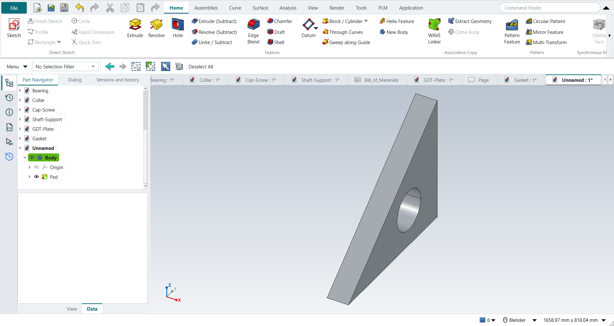

# Tutorial replay: NX textbook exercises in FreeCAD NX-Style

Eleven exercises from two notebooks were replayed inside FreeCAD 1.1.4 with `python launch_nx.py --tutorial OUTDIR` (`--tutorials G,H` picks some), the way the books tell an NX user to work. The replay presses the same keys, clicks the NX-named ribbon buttons, clicks sketch points with MB1 in the graphics window, ends tools and accepts dialogs with MB2, and checks each feature by its volume.

Every part is metric, NXStyle's default (FreeCAD's Standard schema: mm, kg). The books work in inches; their sizes are typed in millimetres (2.5 in = 63.5 mm), and volumes are reported in mm³.

- **A, The Adjuster** (Shih, *Parametric Modeling with Siemens NX*, ch. 2). The step list came from NotebookLM; its slot placement was ambiguous, so the replay cuts a 1.00 in (25.4 mm) wide, 0.75 in (19.05 mm) deep slot into the top of the vertical leg (the part stays one solid).
- **B, First part**: a hollow cylinder (Ø50/Ø30 × 50 mm) and a revolved cone (R25 × 50 mm). NotebookLM attributed it to the KIT course but cited Shih and Tickoo; treat it as a synthesised exercise.
- **C, Rod-Guide** (Shih ch. 9): a filleted 3.00 × 2.00 × 0.75 block with four holes, an At Angle datum plane, an offset datum plane, and a hole drilled from that datum. The step order follows the book's text; its sizes appear only in figures, so they are NotebookLM's reading. The angled upper block (C9) is skipped because its profile is figure-only.
- **D, Pulley with drawing** (Shih ch. 11): a revolved half section, Mirror Feature, a pattern leader hole, a 5× circular pattern, then a drawing with a right base view and a section view. The profile sizes (Ø4.00 × 1.00, hub Ø1.50, bore Ø0.75, web 0.25, five Ø0.50 holes on a 2.50 pitch circle) are again NotebookLM's reading of the figures.
- **E, Saddle Bracket** (Shih ch. 4): the BORN technique (Datum CSYS first), a symmetric extrude, a circular end tied to a projected edge, renaming features in the Part Navigator, three design changes (width 2.5 → 2.0, Until Next → Through All, a fillet added to the first sketch), Assign Materials (steel) and the physical properties. The text gives 2.5, 0.5, 2.0, Ø0.75 and R0.25; the profile and the notch are figure-only, so the L-profile (3.00 long, 0.50 base, 0.75 × 2.00 upright, 1.00 × 0.75 notch) is the replay's own. NotebookLM's reading of these figures came back without citations and contradicted the text, so it was not used. Siemens documents that since NX 1926 a Symmetric Value distance is the total width ([KB PL8613151](https://support.sw.siemens.com/en-US/okba/PL8613151/Extrude-feature-is-not-generated-with-a-distance-value-specified-by-Symmetric-Value/index.html)); the book uses NX 2212.
- **F, Dryer Housing** (Shih ch. 12): revolve, extrudes, Edge Blend, Shell, a pattern leader and a two-direction rectangular pattern. The text gives R0.25, 0.5, 5.5, R0.15, 0.125, 0.15 and the pattern (5 × −0.58, 10 × −0.25); every profile is figure-only, so the housing is a simplified one of the replay's own (an R2.00 × 1.25 drum, a 0.75 wide handle, an R0.75 half nozzle). The swept cut along the rim (F27) is skipped: its guide and section are figure-only.
- **G, Shaft Support assembly** (Shih ch. 14): Add Component with the Fixed (ground) question, Touch Align on faces and hole axes with the book's degree-of-freedom results checked at each step, Parallel, Align/Lock and Touch Align for two cap screws, a part edit that reaches the assembly, and the parts list. The four parts' sizes are figure-only, so they are the replay's own (metric), built to fit the book's constraint sequence. NX's Show Degrees of Freedom has no FreeCAD equivalent: the replay displaces a part, solves, and checks whether it stays (free) or snaps back (constrained).
- **H, GD&T plate drawing** (Cogorno, *Geometric Dimensioning and Tolerancing for Mechanical Design* 3e, from the second notebook "precision engineering": ch. 12.2 and ch. 8): datum features A (back face), B (bottom edge), C (left edge); 4X Ø.510–.540 holes with position Ø.010 at MMC to A|B|C; perpendicularity .004 to A on datum B; flatness .002 on A (Prob. 12-3); basic 1.000 and 3.000 from B and C. The text's inch values are converted to mm exactly (Ø12.954–13.716, Ø0.254, 0.102, 0.051, basic 25.4 / 50.8). The plate's size is figure-only: 101.6 × 101.6 × 12.7 mm here.
- **I, The Gasket** (Shih ch. 6, a millimetre part): an outline, a circle and a line tangent to it; Extend and Quick Trim; the book's dimensions (the circle's centre in line with the top line by a 0.0 location dimension, its horizontal location, the radius, the corner on the origin) until the sketch is fully defined; Fillet R20; a 5 mm extrude; then Project Curve on the front face, Offset Curve 15 mm inwards, a through-all subtract with only the inner loop, and the book's design change: the overall height to 150 mm, with the offset following. The outline's sizes are figure-only: an 80 mm left side and an R30 boss here.
- **J, Parametric constraints** (Shih ch. 5): a triangle constrained step by step, with FreeCAD's solver message compared to NX's status line at every step (Perpendicular, a length and an angle, Fix, undo and Coincident, location dimensions, relaxing Perpendicular, Vertical, a tangent circle); a 3.5 in plate; then dimensions driven by the book's formulas (p8/5*1.6, p10/4*1.2, hole = 1/3 of the height) and two size changes (25 × 15 and 25 × 20) that the hole follows. The triangle's own sizes are figure-only.
- **K, Parameter-driven flat bar** (Leake & Borgerson, *Engineering Design Graphics*, ch. 7, Fig. 7-30; second notebook): a bar with N equally spaced holes driven by L, N, D and hole_spacing = (L − 2D)/(N − 1), typed into the Expressions table (Ctrl+E); the bar's length, the first hole and the hole pattern are tied to those names; then configuration B (L 36, N 8, D 1) is typed into the same table. The book gives L, N, D for both configurations (inches, typed in mm); the bar's width and thickness and the hole size are not given: 50.8 × 12.7 mm and Ø12.7 here.

Dimension values are applied through FreeCAD's API, the equivalent of typing them into Rapid Dimension. Everything else is real UI input. In E and F each feature is checked against the same operation done directly with FreeCAD's Part API. The shell is the exception: `Part.makeThickness` returned shapes reaching outside the original part, so the shell is measured directly instead (outer box unchanged, points 1.6 mm inside every wall are material, points deeper in are hollow).

**same** = NX steps work as written. **differs** = it works, but the FreeCAD way is different (explained). **limit** = the book's way fails in FreeCAD itself; a workaround follows in the next steps. **skipped** = not replayed (reason given). **FAILED** = did not work. The final run (all eleven in one FreeCAD session, Strata loaded, peak 3.1 GB) had no FAILED steps: A 13 same / 5 differs, B 13 / 2, C 11 / 3 / 1 skipped, D 13 / 7, E 15 / 10, F 16 / 9 / 2 limit / 1 skipped, G 12 / 5 / 1 limit / 1 skipped, H 3 / 14, I 11 / 3, J 15 / 2, K 6 / 5.

| # | NX step | How it was replayed | Result | Detail |
|---|---|---|---|---|
| A1 | File > New (Ctrl+N), Model template | Ctrl+N | **same** | new document ['Unnamed'] with a Body; its datum planes appear when a plane is picked (kept hidden otherwise: FreeCAD 1.1.4 hides the part when they stay on) |
| A2 | Units in the New dialog (the book picks inches) | metric part kept; book sizes typed in mm | **differs** | FreeCAD sets units in Preferences, not in the New dialog; NXStyle defaults to millimetres (document: Standard (mm, kg, s, °); 25.4 mm shows as 25.40 mm) |
| A3 | Extrude (X) with nothing selected | X key | **same** | FreeCAD asks for the sketch plane in the Dialog panel; NX asks in the graphics window |
| A4 | Pick the XY plane, accept with MB2 | plane row in the Dialog panel + MB2 click | **same** | picked XY-plane (Base plane); sketch in edit: Sketch |
| A5 | Profile (Z), six MB1 clicks for the L outline | Z key + MB1 clicks in the graphics window | **same** | tool active True; 6 curves drawn |
| A6 | MB2 ends Profile | MB2 click | **same** | tool ended = True |
| A7 | Rapid Dimension (D): 2.5 width, 2.5 height, 0.75 legs | D key, values applied | **differs** | D starts FreeCAD's Dimension tool. FreeCAD does not show NX's dynamic dimensions on click, and there is no 'scale the whole sketch to the first dimension?' prompt |
| A8 | Finish Sketch (Ctrl+Q) returns to the Extrude dialog | Ctrl+Q | **same** | Extrude dialog open = True; modals [] |
| A9 | Extrude: End = Value 2.5, Boolean None, OK | typed into 'lengthEdit', MB2 = OK | **same** | volume 130584.4 mm^3, expected 130584.4 |
| A10 | Extrude, pick the top face as sketch plane, Boolean Subtract | select face + ribbon 'Home › Feature > Extrude (Subtract)' | **differs** | FreeCAD has no Boolean option in Extrude: the subtracting extrude is its own button (Home > Feature > Extrude (Subtract)) |
| A11 | Rectangle (R), two MB1 clicks, MB2 | R key + MB1 clicks + MB2 | **same** | tool active True; 4 curves |
| A12 | Rapid Dimension: 0.50 from edge, 1.00 wide, 0.75 deep | values applied | **differs** | as in step 6: same tool, no NX dynamic dimensions |
| A13 | Finish Sketch returns to the (subtract) Extrude dialog | Ctrl+Q | **same** | dialog open = True |
| A14 | Reverse Direction into the solid | - | **differs** | not needed: FreeCAD's subtracting extrude cuts into the solid by default |
| A15 | Slot depth 0.75, OK | 'lengthEdit' = 19.05 mm, MB2 = OK | **same** | volume 121366.7 mm^3, expected 121366.7; 1 solid(s) |
| A16 | The finished part is shown in the graphics window | render of the graphics window | **same** | 26.7% of the view shows the part |
| A17 | Save (Ctrl+S) | Ctrl+S is bound to Save (tested by the self-test); file saved | **same** | saved as Adjuster.FCStd (FreeCAD format, not .prt) |
| A18 | Reopened part is shown | render of the graphics window | **same** | 26.7% of the view shows the part |
| B1 | File > New (Ctrl+N), Model template, mm | Ctrl+N | **same** | new document ['Unnamed'] |
| B2 | Extrude (X), pick the XC-YC plane | X key, plane row + MB2 | **same** | picked XY-plane (Base plane) |
| B3 | Circle (O): two circles at the origin, MB2 | O key + MB1 clicks + MB2 | **same** | tool True; 2 circles; ended True |
| B4 | Rapid Dimension: diameters 50 and 30 | values applied | **differs** | same tool; values typed in FreeCAD's dimension field |
| B5 | Finish Sketch, Extrude 0 to 50 mm, OK | Ctrl+Q, 'lengthEdit' = 50, MB2 = OK | **same** | volume 62831.9 mm^3, expected 62831.9 |
| B6 | Revolve (ribbon) | ribbon 'Home › Feature > Revolve' | **same** | nothing selected: sketch first, as with Extrude |
| B7 | Pick the YC-ZC plane | plane row + MB2 | **same** | picked YZ-plane (Base plane) |
| B8 | Line (L): right triangle on the axis, MB2 | L key + MB1 clicks + MB2 | **same** | tool True; 3 lines |
| B9 | Rapid Dimension: height 50, radius 25 | values applied | **differs** | same tool |
| B10 | Finish Sketch returns to Revolve; axis = Z, 0..360 deg | Ctrl+Q | **same** | dialog open True; default axis ['V_Axis'] (sketch V axis = Z) |
| B11 | Boolean Unite, OK | MB2 = OK | **same** | volume 95556.8 mm^3, expected 95556.8; features in one Body unite automatically |
| B12 | Hold MB2 and drag to rotate | MB2 drag | **same** |  |
| B13 | F8 snaps to the nearest standard view | F8 key | **same** | view Vector (0.0, 1.0, 0.0) |
| B14 | The finished part is shown in the graphics window | render of the graphics window | **same** | 11.3% of the view shows the part |
| B15 | Save (Ctrl+S) | file saved | **same** | FirstPart.FCStd |
| C1 | File > New (Ctrl+N), Model template | Ctrl+N | **same** |  |
| C2 | Extrude (X), pick the XY plane | X key, plane row + MB2 | **same** | picked XY-plane (Base plane) |
| C3 | Rectangle (R) by 2 points around the origin | R key + 2 MB1 clicks + MB2 | **same** | tool True; 4 curves; ended True |
| C4 | Sketch Fillet (F), R0.25 on the four corners | F key; corners applied as values | **differs** | F starts FreeCAD's sketch fillet; the radius is typed after picking, not before as in NX |
| C5 | Circle (O): four Ø0.25 circles on the arc centres, Equal Radius | O key; values applied | **same** | Equal constraint exists in both |
| C6 | Finish Sketch, Extrude 0.75, OK | Ctrl+Q, 'lengthEdit' = 19.05 mm, MB2 = OK | **same** | volume 70669.2 mm^3, expected 70669.2; 1 solid(s) |
| C7 | Datum Plane, At Angle: front face | select face + ribbon 'Home > Datum > Datum Plane' | **same** | the datum is attached to the face; FreeCAD's attachment dialog opens |
| C8 | Angle -30° about the vertical axis, OK | 'attachmentOffsetPitch' = -30°, MB2 = OK | **differs** | plane at 30.00° to the face. NX picks the Z axis as hinge; FreeCAD rotates in the attachment offset about the face's own axes |
| C9 | Extrude the angled upper block on the datum plane (Unite, Symmetric 1.0) | - | **skipped** | the profile's dimensions are only in the book's figures |
| C10 | Datum Plane, At Distance: top face | select face + ribbon 'Home > Datum > Datum Plane' | **same** |  |
| C11 | Distance 0.75, OK | 'attachmentOffsetZ' = 19.05 mm, MB2 = OK | **same** | datum plane at z = 38.10 mm (top face 19.05 + 19.05) |
| C12 | Hole, placed on the offset datum plane | select plane + ribbon 'Home › Feature > Hole' | **differs** | FreeCAD's Hole drills at circle centres in a sketch, so Hole starts a sketch on the plane (NX picks the point directly) |
| C13 | Place the hole centre at the WCS origin | O key + MB1 at the origin + MB2 | **same** | tool True; 1 curves; ended True |
| C14 | Hole: Simple, Ø0.25, Through Body, OK | dialog open True; 'Diameter' = 6.35 mm, 'Through all', MB2 = OK | **same** | volume 70065.9 mm^3, expected 70065.9; 1 solid(s) |
| C15 | The finished part is shown in the graphics window | render of the graphics window | **same** | 21.6% of the view shows the part |
| D1 | File > New (Ctrl+N), Model template | Ctrl+N | **same** |  |
| D2 | Revolve, nothing selected | ribbon 'Home › Feature > Revolve' | **same** |  |
| D3 | Pick the XY plane of the datum CSYS | plane row + MB2 | **same** | XY-plane (Base plane) |
| D4 | Profile (Z): closed half cross-section, MB2 | Z key + 9 MB1 clicks + MB2 | **same** | tool True; 8 curves; ended True |
| D5 | Rapid Dimension: profile sizes | values applied | **differs** | same tool; no dynamic dimensions |
| D6 | Specify Vector = X axis through the origin, 0..360°, OK | axis 'Base X-axis', MB2 = OK | **same** | volume 51079.3 mm^3, expected 51079.3; 1 solid(s); NX picks the axis in the graphics window, FreeCAD lists it in the dialog |
| D7 | Mirror Feature: select the revolved feature, MB2 to proceed | feature selected + ribbon 'Home › Pattern > Mirror Feature' | **differs** | selecting first and then starting Mirror Feature replaces NX's 'select, then MB2' |
| D8 | Plane = the back face (on the YZ plane), OK; Unite | plane 'Base YZ-plane', MB2 = OK | **same** | volume 102158.6 mm^3, expected 102158.6; 1 solid(s); inside a Body the mirror unites by itself, so NX's separate Unite step is not needed |
| D9 | Pattern leader: Extrude on the front face of the web, Subtract | select face + ribbon 'Home › Feature > Extrude (Subtract)' | **differs** | subtracting extrude is its own button in FreeCAD |
| D10 | Circle Ø0.50 on the 2.50 pitch circle | O key + MB1 clicks + MB2; values applied | **same** | tool True; 1 curves |
| D11 | Reverse Direction, End = Through All, OK | 'Through all', MB2 = OK | **same** | volume 101354.2 mm^3, expected 101354.2; 1 solid(s); no Reverse needed in FreeCAD |
| D12 | Pattern Feature, Layout = Circular | leader selected + ribbon 'Home › Pattern > Circular Pattern' | **differs** | NX has one Pattern Feature with a Layout list; FreeCAD has separate linear and circular buttons |
| D13 | Axis X, Count and Span: 5 over 360°, OK | axis 'Base X-axis', 'spinOccurrences' = 5, MB2 = OK | **same** | volume 98136.6 mm^3, expected 98136.6; 1 solid(s) |
| D14 | The finished part is shown in the graphics window | render of the graphics window | **same** | 12.6% of the view shows the part |
| D15 | File > Drafting (Ctrl+Shift+D) | Ctrl+Shift+D | **same** | TechDrawWorkbench |
| D16 | New sheet, A-size, 1:1 | ribbon 'Home › Drawing > New Sheet' | **differs** | FreeCAD's default template Default_Template_A4_Landscape.svg; an ANSI A sheet is one template choice away (Sheet from Template) |
| D17 | Base View: Right view of the pulley | body selected + ribbon 'Home › View > Base View'; dialog closed with MB2 | **same** | 1 view(s) on the sheet; direction set to Right (+X) |
| D18 | Add a projected view, select it, Delete key | Base View again + Delete key | **differs** | views 2 -> 1. NX drags projected views off the base view; FreeCAD's Projected View is a projection group, so a second Base View stood in for it |
| D19 | Section View through the centre of the base view | base view selected + ribbon 'Home › View > Section View', direction 'pbLeft', MB2 = OK | **same** | 1 section view(s), 42 visible edges |
| D20 | Drag the section to the right of the base view, MB1 to place | X/Y of the section set | **differs** | FreeCAD places the section on top of the base view; it is moved afterwards (placed at x = 224.7 mm, base at 148.5 mm) |
| E1 | File > New | Ctrl+N | **same** |  |
| E2 | BORN: Datum CSYS at the WCS, OK | ribbon 'Home > Datum > Datum CSYS', MB2 = OK, Yes to FreeCAD's question | **differs** | a FreeCAD Body already starts with its own origin (the BORN idea built in). With nothing selected FreeCAD asks 'no attachment mode fits the references, continue?'; NX places the CSYS at the WCS without asking |
| E3 | Extrude (X), XZ plane, OK | X key, plane row + MB2 | **same** | picked XZ-plane (Base plane) |
| E4 | Profile (Z): the L-shaped outline, MB2 | Z key + 7 MB1 clicks + MB2; sizes applied | **same** | tool True; 6 curves; ended True |
| E5 | Start = Symmetric Value, distance 2.5, OK | 'Symmetric', 'lengthEdit' = 63.5 mm, MB2 = OK | **same** | volume 107540.1 mm^3, expected 107540.1; 1 solid(s); width -31.75 .. 31.75 mm (NX 1926+ and FreeCAD both treat the symmetric distance as the total) |
| E6 | Extrude, bottom face as the sketch plane | select face + ribbon 'Home › Feature > Extrude' | **same** | Face1 |
| E7 | Project Curve: the bottom right edge, OK | ribbon 'Project Curve' + MB1 on the edge + MB2 | **same** | picked Edge2 in the graphics window |
| E8 | Circle: centre at the edge midpoint, through the top corner | O key + 2 MB1 clicks + MB2; midpoint and corner as constraints | **same** | solver result 0 (0 = solved); NX snaps to the midpoint and corner while drawing, FreeCAD records them as constraints |
| E9 | Finish the section: circle and projected edge | select the projected line + ribbon 'Convert To/From Reference' | **differs** | FreeCAD 1.1 projects a picked edge as defining geometry, so the profile had 2 curves and Extrude would report 'Wire is not closed'. NX builds regions from the circle and its diameter; in FreeCAD the projected line has to become construction geometry first |
| E10 | Reverse Direction, distance 0.5, Boolean Unite, OK | 'checkBoxReversed' on, 'lengthEdit' = 12.7 mm, MB2 = OK | **same** | volume 127650.1 mm^3, expected 127650.1; 1 solid(s); lowest point z = -0.00 mm |
| E11 | Rename in the Part Navigator: Base, Circular_End | select + F2, type, Enter | **differs** | NX: click the name twice or MB3 > Rename; FreeCAD: F2 or MB3 > Rename |
| E12 | Design change: Base distance 2.5 -> 2.0, OK, F5 | Base selected + ribbon 'Home › Edit Feature > Edit Parameters' (dialog True), 'lengthEdit' = 50.8 mm, MB2 = OK, F5 | **same** | volume 98902.5 mm^3, expected 98902.5; 1 solid(s); NX edits the value from MB3 > Show Dimensions, FreeCAD reopens the Extrude dialog. Circular_End follows the narrower base (its circle is tied to the projected edge) |
| E13 | Hole: Simple, Normal to Face, on the top face | select face + ribbon 'Home › Feature > Hole' | **differs** | FreeCAD's Hole drills at circle centres in a sketch on the face |
| E14 | Point: the centre of the top arc | O key + MB1 clicks + MB2; centre tied to the arc | **differs** | NX picks the arc centre directly; FreeCAD sketches a circle on it (Edge19 projected) |
| E15 | Diameter 0.75, Depth Limit = Through Body, OK | 'Diameter' = 19.05 mm, 'Through all', MB2 = OK | **same** | volume 95282.7 mm^3, expected 95282.7; 1 solid(s) |
| E16 | Extrude on the right vertical face of the upright | select face + ribbon 'Home › Feature > Extrude (Subtract)' | **differs** | Face5; subtracting extrude is its own button |
| E17 | Rectangle at the upper edge, MB2; three dimensions | R key + 2 MB1 clicks + MB2; sizes applied | **same** | tool True; 4 curves; ended True |
| E18 | Boolean Subtract, End = Until Next, OK | 'To first', MB2 = OK | **same** | volume 86064.9 mm^3, expected 86064.9; 1 solid(s); FreeCAD calls Until Next 'To first' |
| E19 | Rename the cut Rect_Cut | select + F2, type, Enter | **differs** |  |
| E20 | Edit with Rollback: End = Through All, OK | Rect_Cut selected + ribbon 'Home › Edit Feature > Edit Parameters', 'Through all', MB2 = OK | **same** | volume 86064.9 mm^3, expected 86064.9; 1 solid(s); FreeCAD's edit shows the model before the feature, like NX's rollback |
| E21 | Edit the Base sketch: Fillet (F) R0.25 on the inside corner, MB2 | sketch selected + ribbon 'Edit Parameters', F key; corner filleted at 0.25 | **differs** | NX: Edit with Rollback > Sketch Section; FreeCAD opens the sketch directly. The radius is typed after picking the corner |
| E22 | Finish Sketch, OK: the whole part updates | Ctrl+Q | **same** | volume 86504.5 mm^3, expected 86504.5; 1 solid(s); later features (Circular_End, hole, Rect_Cut) follow the edited sketch |
| E23 | Tools > Assign Materials: Steel, select the body, OK | body selected + ribbon 'View › Visualization > Assign Material', 'Steel-Generic', Close | **differs** | material Steel-Generic, density 7900.0 kg/m^3; the panel applies the choice at once and has Close instead of OK |
| E24 | Analysis > Measure, Solid Body, physical properties in the Information window | body selected + ribbon 'Analysis › Measure > Measure Bodies' | **differs** | mass 0.6834 kg from 7900 kg/m^3; FreeCAD's own Measure has no mass, so NXStyle adds Measure Bodies |
| E25 | The finished part is shown in the graphics window | render of the graphics window | **same** | 21.7% of the view shows the part |
| F1 | File > New, Model template | Ctrl+N | **same** |  |
| F2 | Revolve, YZ plane of the datum CSYS | ribbon 'Home › Feature > Revolve', plane row + MB2 | **same** | picked YZ-plane (Base plane) |
| F3 | Profile, then Fillet R0.25 between the top line and the side | Z key + MB1 clicks + MB2, F key; sizes applied | **differs** | the book's profile (an arc and stepped lines) is figure-only; a filleted rectangle stands in. The fillet radius is typed after picking in FreeCAD |
| F4 | Specify Vector = Z axis, 0..360°, OK | axis 'Base Z-axis', MB2 = OK | **same** | volume 254722.5 mm^3, expected 254722.5; 1 solid(s) |
| F5 | Dryer handle: Extrude (X), XY plane | X key, plane row + MB2 | **same** | picked XY-plane (Base plane) |
| F6 | Handle outline, seven dimensions | R key + 2 MB1 clicks + MB2; sizes applied | **differs** | the book's handle (three inclined lines, seven dimensions) is figure-only; a 0.75 x 3.5 bar stands in |
| F7 | Boolean Unite, End = 0.5, OK | 'lengthEdit' = 12.7 mm, MB2 = OK | **same** | volume 273230.4 mm^3, expected 273230.4; 1 solid(s) |
| F8 | Sketch on the YZ plane | ribbon 'Home › Direct Sketch > Sketch', plane row + MB2 | **same** | picked YZ-plane (Base plane) |
| F9 | Arc by centre and endpoints (180°), then a Line closing it | A key + 3 MB1 clicks + MB2, L key + 2 MB1 clicks + MB2; sizes applied | **same** | arc tool True, line tool True; the book projects the bottom edge first (shown in tutorial E); here the arc sits on the bottom line by its coordinates |
| F10 | Reverse Direction, End 5.5, Boolean Unite, OK | sketch selected + ribbon 'Home › Feature > Extrude', 'checkBoxReversed' on, 'lengthEdit' = 139.7 mm, MB2 = OK | **same** | volume 324426.0 mm^3, expected 324425.9; 1 solid(s) |
| F11 | Edge Blend, Circular, select the handle's edges | 4 edges selected + ribbon 'Home › Feature > Edge Blend' | **differs** | the book's 13 edges are picked from a figure; the outer edges of the handle's end stand in (FreeCAD's unrefined shape may split one). FreeCAD takes the edges selected before the command |
| F12 | Radius 1 = 0.15, OK | 'filletRadius' = 3.81 mm, MB2 = OK | **same** | volume 324249.4 mm^3, expected 324249.3; 1 solid(s) |
| F13 | Shell: pick the two flat open faces | bottom ['Face2'] + nozzle end ['Face9'] selected + ribbon 'Home › Feature > Shell' | **same** | FreeCAD calls Shell 'Thickness' |
| F14 | Thickness 0.125, OK | 'Value' = 3.175 mm, 'Make thickness inwards' on (default), MB2 = OK | **limit** | FreeCAD 1.1.4 does not shell the part after the edge blend (FreeCAD: 'Input error: Failed to make thick solid'); the same faces and thickness work before the blend (next steps). NX shells it in the book's order |
| F15 | Workaround: undo the shell and the blend | Ctrl+Z x2 | **differs** | back to the part before the edge blend |
| F16 | Workaround: Shell first, the same two faces | bottom ['Face10'] + nozzle end ['Face9'] selected + ribbon 'Home › Feature > Shell' | **same** | FreeCAD calls Shell 'Thickness' |
| F17 | Thickness 0.125, OK (before the blend) | 'Value' = 3.175 mm, 'Make thickness inwards' on (default), MB2 = OK | **same** | volume 75365.9 mm^3 (solid 324425.9); outer box kept True; 1.6 mm inside each wall is material [True, True, True, True], deeper in is hollow [True, True, True, True, True] |
| F18 | Workaround: Edge Blend after the shell, the handle's outer end edges | 4 edges selected + ribbon 'Home › Feature > Edge Blend' | **differs** | the book's 13 edges are picked from a figure; the outer edges of the handle's end stand in (FreeCAD's unrefined shape may split one). FreeCAD takes the edges selected before the command |
| F19 | Radius 1 = 0.15, OK (after the shell) | 'filletRadius' = 3.81 mm, MB2 = OK | **limit** | volume 75352.7 mm^3, 13.24 mm^3 rounded off; inside the previous box True; feature valid False; no Part API reference (it failed: class StdFail_NotDone BRep_API: command not done); FreeCAD 1.1.4 refuses this round on the shelled walls |
| F20 | Workaround: Edge Blend again with a smaller radius | 4 edges selected + ribbon 'Home › Feature > Edge Blend' | **differs** | the book's 13 edges are picked from a figure; the outer edges of the handle's end stand in (FreeCAD's unrefined shape may split one). FreeCAD takes the edges selected before the command |
| F21 | Radius 1 = 0.10, OK (after the shell) | 'filletRadius' = 2.54 mm, MB2 = OK | **differs** | volume 75284.3 mm^3, expected 75284.3; 1 solid(s); the workaround changes the design: R0.10 instead of the book's R0.15 |
| F22 | Pattern leader: Extrude on the top face, Subtract | select ['Face26'] + ribbon 'Home › Feature > Extrude (Subtract)' | **differs** | the book orients the view to Top first; FreeCAD's sketch opens looking at the face |
| F23 | Rectangle to the right of the CSYS: the small vent | R key + 2 MB1 clicks + MB2; sizes applied | **same** | the slot size is figure-only: 0.20 x 0.08 here |
| F24 | Reverse Direction into the solid, End 0.15, OK | 'lengthEdit' = 3.81 mm, MB2 = OK | **same** | volume 75251.5 mm^3, expected 75251.5; 1 solid(s); no Reverse needed: the subtracting extrude cuts inwards |
| F25 | Pattern Feature, Layout = Linear, select the cut, MB2 | leader selected + ribbon 'Home › Pattern > Pattern Feature' | **differs** | FreeCAD's Linear Pattern is the Linear layout of NX's Pattern Feature |
| F26 | Direction 1: X, Count 5, Pitch -0.58; Use Direction 2: Y, Count 10, Pitch -0.25; OK | X axis {'axis': 'Base X-axis', 'mode': 'Spacing', 'count typed': 5, 'spacing': 0.58, 'reversed': True}; 'enableCheckbox'; Y axis {'axis': 'Base Y-axis', 'mode': 'Spacing', 'count typed': 10, 'spacing': 0.25, 'reversed': True}; MB2 = OK | **same** | volume 73645.6 mm^3, expected 73645.6; 1 solid(s); feature counts {'Occurrences': 5, 'Occurrences2': 10, 'Offset': 14.732, 'Offset2': 6.35, 'SpacingPattern': '[14.732]', 'SpacingPattern2': '[6.35]', 'Spacings': '[-1.0, -1.0, -1.0, -1.0]', 'Spacings2': '[-1.0, -1.0, -1.0, -1.0, -1.0, -1.0, -1.0, -1.0, -1.0]'}; NX's negative pitch is FreeCAD's spacing with Reverse |
| F27 | Swept cut along the rim (section rectangle, Line-Arc guide), Subtract | - | **skipped** | the guide curves and section sizes are figure-only |
| F28 | The finished part is shown in the graphics window | render of the graphics window | **same** | 8.3% of the view shows the part |
| G1 | Create the parts Collar, Bearing, Base-Plate, Cap-Screw and save them | modelled by script (the book's sizes are figure-only; earlier tutorials cover modelling) | **same** | Base-Plate 58995 mm^3, Bearing 41202 mm^3, Collar 2939 mm^3, Cap-Screw 1999 mm^3 |
| G2 | File > New, Assembly template, name Shaft-Support | ribbon 'Application › Design > Assemblies', Ctrl+N; saved as Shaft-Support | **differs** | NXStyle's Assembly template starts the document with an empty Assembly (like NX's); NX names the file in the New dialog, FreeCAD on the first save |
| G3 | Add Component: Base-Plate at the origin; Yes to the Fixed constraint | ribbon 'Assemblies › Assembly > Add Component', click Base-Plate in the list, Yes, MB2 = OK | **same** | grounded True; FreeCAD asks 'Ground Part?' like NX's question about the Fixed constraint |
| G4 | Add Component: Bearing, placed with Move | ribbon 'Assemblies › Assembly > Add Component', click Bearing, MB2 | **differs** | FreeCAD places it beside the last part; NX lets you drag it to a spot first |
| G5 | Touch Align: Bearing bottom face to the Base-Plate top face | ribbon 'Assemblies › Assembly Constraints > Touch Align', Face5 + Face3, MB2 = OK | **same** | joint Distance; Bearing now from z = 0.000 mm |
| G6 | Touch Align: the right hole axes (Bearing counterbore hole, Base-Plate hole) | ribbon 'Assemblies › Assembly Constraints > Align Axes', Face12 + Face8, MB2 = OK | **same** | hole axes coincide True; rotated 25° about that axis and solved: it stays (still free to rotate, as the book says). NX's Show Degrees of Freedom has no FreeCAD equivalent: the replay moves the part and solves |
| G7 | Touch Align: the left hole axes; Move: it cannot move | ribbon 'Assemblies › Assembly Constraints > Align Axes', Face10 + Face7, MB2 = OK | **same** | rotated 25° and solved: back in place True (fully constrained, as in the book) |
| G8 | Add Component: Collar, Constrain, Touch Align on the boss's top face | ribbon 'Assemblies › Assembly > Add Component' + 'Assemblies › Assembly Constraints > Touch Align', Face2 + Face15 | **same** | Collar from z = 35.000 mm |
| G9 | Touch Align: the outer cylinders of Collar and Bearing | ribbon 'Assemblies › Assembly Constraints > Align Axes', Face1 + Face7 | **same** | centred True; still free to rotate True |
| G10 | Parallel: Collar to the Base-Plate front face | ribbon 'Assemblies › Assembly Constraints > Parallel', Face3 (the collar's flat) + Face2 | **limit** | joint made, solver 'converged', but the collar did not turn (flat normal Vector (1.0, 0.0, -0.0)). FreeCAD 1.1.4's solver drops a Parallel constraint whose faces start exactly perpendicular ('ParallelAxesJoint ... constraint(s) removed: RedundantConstraintDirectionCosineConstraintIzJy'); reproduced without NXStyle; the same joint works when the faces start 20° apart. The book uses the Collar's datum plane (Replace Reference Set > Entire Part); here the flat on the collar stands in |
| G11 | Workaround: delete the joint, turn the Collar 20°, Parallel again | joint selected + Delete (gone), Collar turned, ribbon 'Assemblies › Assembly Constraints > Parallel' | **differs** | flat normal now (-0.000, 1.000, 0.000); rotated 30° and solved: back True. NX drags the part with Move Component; here it is turned by its placement |
| G12 | Add Component: Cap-Screw, Align/Lock on the right hole axis | ribbon 'Assemblies › Assembly > Add Component' + 'Assemblies › Assembly Constraints > Align/Lock', Face4 + Face12 | **same** | on the axis True; slides along it True; turns False (the book: one DOF, along the axis) |
| G13 | Touch Align: the head on the counterbore's seat | 'Assemblies › Assembly Constraints > Touch Align', Face2 + Face16 | **same** | head underside at z = 15.000 mm; moved 7 mm and solved: back True |
| G14 | Add Component: Cap-Screw, Align/Lock on the left hole axis | ribbon 'Assemblies › Assembly > Add Component' + 'Assemblies › Assembly Constraints > Align/Lock', Face4 + Face10 | **same** | on the axis True; slides along it True; turns False (the book: one DOF, along the axis) |
| G15 | Touch Align: the head on the counterbore's seat | 'Assemblies › Assembly Constraints > Touch Align', Face2 + Face16 | **same** | head underside at z = 15.000 mm; moved 7 mm and solved: back True |
| G16 | Exploded view: New Explosion, Collar 1.5 in and a Cap-Screw 2.0 in up; Auto-explode | - | **skipped** | FreeCAD 1.1's New Explosion moves parts only by dragging a 3D handle (no distance field like NX's); the replay does not drag 3D handles |
| G17 | Edit the Bearing: hole Ø0.25 in (6.35 mm), save; the assembly updates | Bearing document: the bore's Radius in its properties, recompute, save | **differs** | cylinder radii in the assembly's Bearing [3.175, 4.0, 6.5, 12.0]; NX: Open in Window, double-click the hole, edit the sketch value. The replay's parts are scripted, so the value is a property here |
| G18 | Parts List | ribbon 'Assemblies › Reports > Bill of Materials', MB2 = OK | **differs** | spreadsheet rows 5; Cap-Screw row ['4', 'Cap-Screw', '', '2', '', 'quantity 2']; NX puts the parts list on the drawing, FreeCAD makes a spreadsheet (a drawing can show it as a Tabular Note) |
| G19 | The assembly is shown in the graphics window | render of the graphics window | **same** | 20.0% of the view shows the part |
| H1 | The plate: 101.6 x 101.6 x 12.7 mm, 4 holes on a 50.8 mm square | modelled by script (the exercise is the drawing) | **same** | volume 124001.7 mm^3; back face (z = 0) is datum A, bottom edge (y = 0) B, left edge (x = 0) C |
| H2 | File > Drafting, New Sheet | Ctrl+Shift+D + ribbon 'Home › Drawing > New Sheet' | **same** |  |
| H3 | Drafting Preferences: ASME standard | Preferences > TechDraw > Dimensions > Standard and Style = ASME Inlined | **differs** | was ISO Oriented; NX sets the drafting standard in Drafting Preferences |
| H4 | Base View: the plate's face, scale 1:1 | body selected + ribbon 'Home › View > Base View', MB2 on the sheet | **same** | direction set to look at the face (the book's front view) |
| H5 | Projected view to the right: the plate's edge, back face A | second Base View, MB2 | **differs** | as in tutorial D, a second Base View stands in for a view projected off the base view |
| H6 | Arc centres for the dimensions | cosmetic vertex on each hole centre | **differs** | 4 holes, 4 cosmetic vertices, found as ['Vertex6', 'Vertex9', 'Vertex12', 'Vertex15']; NX snaps dimensions to arc centres, TechDraw needs vertices there first |
| H7 | Basic dimension 25.4 (C to the hole) | two vertices + ribbon 'Home › Dimension > Horizontal', then basic | **differs** | measured 25.4; NX: Basic is a Tolerance type in the dimension dialog, TechDraw: the Theoretical Exact property draws the box |
| H8 | Basic dimension 50.8 (hole spacing) | two vertices + ribbon 'Home › Dimension > Horizontal', then basic | **differs** | measured 50.800000000000004; NX: Basic is a Tolerance type in the dimension dialog, TechDraw: the Theoretical Exact property draws the box |
| H9 | Basic dimension 25.4 (B to the hole) | two vertices + ribbon 'Home › Dimension > Vertical', then basic | **differs** | measured 25.4; NX: Basic is a Tolerance type in the dimension dialog, TechDraw: the Theoretical Exact property draws the box |
| H10 | Basic dimension 50.8 (hole spacing) | two vertices + ribbon 'Home › Dimension > Vertical', then basic | **differs** | measured 50.800000000000004; NX: Basic is a Tolerance type in the dimension dialog, TechDraw: the Theoretical Exact property draws the box |
| H11 | Hole note: 4X Ø12.954-13.716 (.510-.540 in) | hole edge + ribbon 'Home › Dimension > Diameter'; 4X and ±0.381 in the dimension's properties | **differs** | diameter 13.335; FreeCAD shows Ø13.335 ±0.381 (NX can also show the limits 13.716/12.954) |
| H12 | Datum Feature Symbol A on the back face (right edge of the edge view) | edge Edge2 + ribbon 'Home › Annotation > Datum Feature Symbol', 'A', MB2 = OK | **differs** | triangle 0.0 mm from the edge; editable letter ['A']; FreeCAD 1.1 has no datum feature symbol, NXStyle adds NX's |
| H13 | Datum Feature Symbol B on the bottom edge | edge Edge0 + ribbon 'Home › Annotation > Datum Feature Symbol', 'B', MB2 = OK | **differs** | triangle 0.0 mm from the edge; editable letter ['B']; FreeCAD 1.1 has no datum feature symbol, NXStyle adds NX's |
| H14 | Datum Feature Symbol C on the left edge | edge Edge3 + ribbon 'Home › Annotation > Datum Feature Symbol', 'C', MB2 = OK | **differs** | triangle 0.0 mm from the edge; editable letter ['C']; FreeCAD 1.1 has no datum feature symbol, NXStyle adds NX's |
| H15 | Flatness 0.051 on datum A (.002 in, Prob. 12-3) | selection + ribbon 'Home › Annotation > Feature Control Frame'; dialog filled; MB2 = OK | **differs** | frame 'flatness / 0.051'; editable values ['0.051']; FreeCAD 1.1 has only fixed GD&T pictures, NXStyle adds NX's Feature Control Frame dialog |
| H16 | Perpendicularity 0.102 to A on datum B (.004 in) | selection + ribbon 'Home › Annotation > Feature Control Frame'; dialog filled; MB2 = OK | **differs** | frame 'perpendicularity / 0.102 / A'; editable values ['0.102', 'A']; FreeCAD 1.1 has only fixed GD&T pictures, NXStyle adds NX's Feature Control Frame dialog |
| H17 | Position Ø0.254 (M) to A, B, C under the hole note (.010 in at MMC) | selection + ribbon 'Home › Annotation > Feature Control Frame'; dialog filled; MB2 = OK | **differs** | frame 'position / Ø0.254 (M) / A / B / C'; editable values ['0.254', 'A', 'B', 'C']; FreeCAD 1.1 has only fixed GD&T pictures, NXStyle adds NX's Feature Control Frame dialog |
| I1 | File > New, Model template, millimetres | Ctrl+N | **same** |  |
| I2 | Extrude (X), YZ plane | X key, plane row + MB2 | **same** | picked YZ-plane (Base plane) |
| I3 | Profile (outline), Circle, Line ending on the bottom line, tangent to the circle | Z key + 4 MB1 clicks, O key + 2 clicks, L key + 2 clicks, MB2 after each | **same** | geometry ['GeomCircle', 'GeomLineSegment', 'GeomLineSegment', 'GeomLineSegment', 'GeomLineSegment']; tangent picked up while drawing True |
| I4 | Extend: the top line up to the circle, MB2 | E key, MB1 near the line's end, MB1 on the circle, MB2 | **same** | line now ends at x = 94.949 (meets the circle at 94.953) |
| I5 | Quick Trim: the bottom line past the slanted line, the lower part of the circle, MB2 | T key, MB1 on each part to remove, MB2 | **same** | bottom line now ends at x = 88.798 (slanted line at 88.798); 1 arc, 0 full circle; outline closed True; geometry 5 -> 5 |
| I6 | The book's dimensions: centre in line with the top line (0.0), its horizontal location, the radius, the corner on the origin; horizontal/vertical constraints confirmed; fully defined | constraints: centre on the top line, radius, horizontal location of the centre, height of the centre, angle of the slanted line; H/V: Vertical 1 implied, Horizontal 2 | **same** | centre -1.287 -> -0.000 mm from the top line; outline closed True; solver: 'Fully constrained' (0 DoF). NX sets a 0.0 location dimension; FreeCAD has a point-on-object constraint for it; implied already: left edge on the origin, bottom edge on the origin |
| I7 | Fillet R20 at the corners | F key; radius 20 at each corner where two curves meet at an angle | **differs** | 4 fillets of 4 corners ((95, 78), (0, 78), (0, 0), (89, 0)); outline closed True; constraints re-confirmed after the fillets: Vertical 1, left edge on the origin, bottom edge on the origin; 4 R20 dimensions added (FreeCAD's sketch fillet constrains tangency, not the radius); solver 'Fully constrained' (0 DoF). The book makes five, the arc-to-slanted-line join being tangent here leaves four; the radius is typed after picking in FreeCAD |
| I8 | Finish Sketch, End 5 mm, OK | Ctrl+Q, 'lengthEdit' = 5 mm, MB2 = OK | **same** | volume 56106.6 mm^3, expected 56106.6; 1 solid(s); outline area 11221.3 mm^2 |
| I9 | Extrude, Sketch Section on the front face | select Face11 + ribbon 'Home › Feature > Extrude (Subtract)' | **differs** | subtracting extrude is its own button |
| I10 | Project Curve (the whole face), Offset 15 mm, Reverse Direction to the inside, OK | 9 edges projected; ribbon 'Sketch › Edit Curve > Offset Curve', 'Add offset constraint', MB1 15 mm inside; Select Redundant Constraints + Delete; offset dimension typed 15 | **differs** | 9 projected curves, 9 offset curves; the click gave 14.802 mm. FreeCAD's own offset constraints left the sketch unsolvable (solver: 'Redundant constraints:'; selected ['Constraint17']); after deleting it the sketch solves (True). NX types the distance and flips the side with Reverse Direction; FreeCAD takes the side and distance from the click, the exact value from its offset dimension |
| I11 | Offset loop: 15 mm inside the outline; only the inside loop is the section | measured in the sketch; profile edges 9, offset curves 9: the projected outline is reference geometry, as the book selects only the inside loop | **same** | closed True; nearest distance to the projected outline 15.0 mm |
| I12 | Boolean Subtract, Reverse Direction, Through All, inner loop only, OK | 'Through all', MB2 = OK | **same** | volume 29310.1 mm^3, expected 29310.1; 1 solid(s); the projected outline is reference geometry here, so only the inner loop cuts |
| I13 | Change the overall height to 150 mm: the offset follows | the centre's height dimension: 78.39 -> 119.99 (+ R30.01 = 150) | **same** | overall height 108.398 -> 150.0000 mm; inner loop 15.0 mm inside the outline |
| I14 | The part is shown in the graphics window | render of the graphics window | **same** | 5.2% of the view shows the part |
| J1 | File > New, Model template | Ctrl+N | **same** |  |
| J2 | Extrude (X), YZ plane of the datum CSYS | X key, plane row + MB2 | **same** | picked YZ-plane (Base plane) |
| J3 | Profile: a triangle with a horizontal base | Z key + 4 MB1 clicks + MB2 | **same** | 3 lines; implicit constraints ['Coincident', 'Horizontal']; DoF 5; FreeCAD says 'Under-constrained: / 5 Degrees of Freedom' |
| J4 | Perpendicular: the two inclined lines, OK | both lines selected + ribbon 'Sketch › Constraints > Perpendicular' | **same** | angle between them 90.000° (90 wanted); DoF 4; 'Under-constrained: / 4 Degrees of Freedom' |
| J5 | Dimensions: base length, angle to the right line; the triangle still moves | line + ribbon 'Sketch › Constraints > Distance' = 120 mm, two lines + 'Angle' = 60° (typed in FreeCAD's dimension dialog) | **same** | base 120.000 mm; DoF 2 (size fixed, position free, as in the book); 'Under-constrained: / 2 Degrees of Freedom' |
| J6 | Fix Curve on one line: fully defined | line + ribbon 'Sketch › Constraints > Fully Fixed' | **same** | DoF 0, fully constrained True; NX turns the sketch black and says it is fully defined, FreeCAD says 'Fully constrained' |
| J7 | Undo, then Coincident: the left corner on the sketch origin | Ctrl+Z (DoF back to 2); Vertex1 + origin + ribbon 'Sketch › Constraints > Coincident' | **same** | corner at (0.000, 0.000); DoF 0; 'Fully constrained' |
| J8 | Undo, then location dimensions from the Y axis and the X axis | Ctrl+Z (DoF 2); corner + Y axis, corner + X axis, ribbon 'Sketch › Constraints > Distance', 25.4 each | **same** | corner at (25.400, 25.400); DoF 0; 'Fully constrained' |
| J9 | Delete the angle, relax Perpendicular, Vertical on the right line | angle + Delete; Perpendicular + ribbon 'Sketch › Constraints > Relax Constraint'; line + 'Sketch › Constraints > Vertical' | **same** | DoF after each: 1, 2, 1 (the book: one more constraint needed); 'Under-constrained: / 1 Degrees of Freedom' |
| J10 | Vertical dimension: fully constrained | right line + ribbon 'Sketch › Constraints > Distance' = 72 mm | **same** | DoF 0; 'Fully constrained' |
| J11 | Circle inside, Tangent to the left inclined line | O key + 2 MB1 clicks + MB2; circle + line + ribbon 'Sketch › Constraints > Tangent' | **same** | DoF 2 (centre still slides along the line); 'Under-constrained: / 2 Degrees of Freedom' |
| J12 | Match the figure: circle located from the right side and the base, a diameter | values applied | **differs** | DoF 0; 'Fully constrained'; the figure's values are not in the text |
| J13 | Extrude, plate thickness 3.5 in | Ctrl+Q, 'lengthEdit' = 88.9 mm, MB2 = OK | **same** | thickness 88.900 mm; sketch Sketch |
| J14 | Show the dimension names; enter p8/5*1.6 and p10/4*1.2; hole = 1/3 of the height | constraints renamed (width, height, hx, vy, dia) and given formulas | **differs** | FreeCAD names a dimension in its properties (NX: p0, p1 ... automatically) and takes a formula after '=' in the dimension dialog: {'hx': 'Constraints.width / 5 * 1.6', 'vy': 'Constraints.height / 4 * 1.2', 'dia': 'Constraints.height / 3'} |
| J15 | Change the triangle to 25 x 15 in: the hole follows | width = 635 mm, height = 381 mm | **same** | circle from the right side, from the base, diameter: 203.200, 114.300, 127.000 mm (formulas: 203.200, 114.300, 127.000) |
| J16 | Change it to 25 x 20 in: location and size follow | width = 635 mm, height = 508 mm | **same** | circle from the right side, from the base, diameter: 203.200, 152.400, 169.333 mm (formulas: 203.200, 152.400, 169.333) |
| J17 | The part is shown in the graphics window | render of the graphics window | **same** | 6.4% of the view shows the part |
| K1 | Tools > Expressions (Ctrl+E): L = 48, N = 5, D = 2 (in) | Ctrl+E opens NXStyle's Expressions sheet; names and values typed into its cells | **differs** | cells {'A2': "'L", 'B2': '=1219.2 mm', 'A3': "'N", 'B3': '5', 'A4': "'D", 'B4': '=50.8 mm'}; NX lists expressions in a dialog, FreeCAD keeps them in a spreadsheet |
| K2 | Names L, N, D and the equation hole_spacing = (L - 2D)/(N - 1) | alias per value cell (cell properties); equation typed into B5 | **differs** | hole_spacing = 279.400 mm (279.400 expected, the book's 11 in); names refused: N (Invalid alias: a unit symbol, newton); used {'L': 'L', 'N': 'N_holes', 'D': 'D'} |
| K3 | Create the flat bar: Extrude (X), XY plane | X key, plane row + MB2 | **same** | picked XY-plane (Base plane) |
| K4 | Rectangle, its length = L | R key + 2 MB1 clicks + MB2; length tied to the expression | **differs** | DoF 0; NX types 'L' in the dimension, FreeCAD types '=Expressions.L' (f(x)) in it |
| K5 | Extrude the bar, 0.5 in thick | Ctrl+Q, 'lengthEdit' = 12.7 mm, MB2 = OK | **same** | volume 786579.1 mm^3, expected 786579.1; 1 solid(s) |
| K6 | Create a hole at one end of the bar | top face + ribbon 'Home › Feature > Hole' | **differs** | FreeCAD's Hole drills at circle centres in a sketch on the face |
| K7 | Hole centre at D from the end, on the centre line | O key + 2 MB1 clicks + MB2; distance from the projected end tied to D | **same** | DoF 0; 50.800 mm from the end, 25.400 mm from the edge |
| K8 | Hole Ø0.5 through | 'Diameter' = 12.7 mm, 'Through all', MB2 = OK | **same** | volume 784970.3 mm^3, expected 784970.3; 1 solid(s) |
| K9 | Rectangular array of the hole: count N, spacing hole_spacing | hole + ribbon 'Home › Pattern > Pattern Feature', X axis, {'axis': 'Base X-axis', 'mode': 'Spacing', 'count typed': 5, 'spacing': 11.0}; count and spacing tied to N and hole_spacing (f(x)) | **differs** | length 1219.200 mm, 5 holes, first at 50.800 mm, last 1168.400 mm, pitch 279.4000 mm (279.4000 wanted); volume 778535 mm^3 (778535 wanted); NX: the array's count and pitch fields take the expression names directly |
| K10 | Configuration B: L 36, N 8, D 1 | values typed into the sheet's cells | **same** | length 914.400 mm, 8 holes, first at 25.400 mm, last 889.000 mm, pitch 123.3714 mm (123.3714 wanted); volume 577064 mm^3 (577064 wanted) |
| K11 | The part is shown in the graphics window | render of the graphics window | **same** | 2.9% of the view shows the part |

## What the replay changed in NXStyle

- **Extrude-first workflow (NX):** Extrude (X) or Revolve with nothing selected starts a sketch on the plane or face you pick. Finish Sketch (Ctrl+Q) then continues straight into the Extrude or Revolve dialog. With a sketch already selected, the feature starts at once. Extrude (Subtract) and Revolve (Subtract) work the same way.
- **NX Model template:** a new, empty part starts with a Body (setting `new_part_datum`). Its datum planes appear when you pick a sketch plane.
- **MB2 ends the active sketch tool**, as in NX.
- **MB2 rotate/pan/zoom** now reads Shift/Ctrl from the mouse event. Before, a stale global modifier state after Ctrl shortcuts could turn MB2 rotate into a zoom.
- **Hole on a plane (C):** Hole with a datum plane or face selected starts a sketch there, and Finish Sketch continues into the Hole dialog, as Extrude does.
- **MB2 = OK on drawing sheets (D):** a still middle click on a TechDraw sheet now presses OK in the open dialog (Base View, Section View); MB2 drag still pans.
- **Feature Control Frame and Datum Feature Symbol (H):** FreeCAD 1.1 has only fixed GD&T pictures. These NX Drafting dialogs build the frame (characteristic, Ø zone, tolerance, material condition, up to three datums with modifiers) or the datum symbol as an editable TechDraw symbol. With a view edge selected first the symbol is placed against that edge from outside the view, a frame goes under a selected dimension. The tolerance and datum letters stay editable afterwards (EditableTexts).
- **NX Assembly template and constraint names (G):** a new document in the Assemblies application starts with an empty Assembly instead of a Body. The Assembly Constraints group uses NX's names: Touch Align (FreeCAD Distance), Concentric (Revolute), Align Axes (Cylindrical), Align/Lock (Slider), Fix (Ground), Bond (Fixed), Parallel, Perpendicular, Angle.
- **No empty tab strip over the Top Border Bar:** when a panel moved between dock areas, Qt could leave an empty tab strip painted over "Menu" and the Type Filter (visible in earlier screenshots). The shell now hides such strips; the self-test checks for them.
- **Fully Fixed and Relax Constraint (J):** the Sketch tab labels FreeCAD's Block constraint Fully Fixed and its Toggle Active Constraint Relax Constraint, NX's names for what the book does with them.
- **Measure Bodies (E):** FreeCAD's own Measure has no mass. Analysis > Measure Bodies shows volume, surface area, the assigned material and density, mass and centre of mass in an NX-style Information window, in mm³, mm² and kg as NX reports a millimetre part (for the Saddle Bracket: 86,504.5 mm³, Steel-Generic 7900 kg/m³, 0.6834 kg).

## Differences that remain (FreeCAD behaviour)

- Units are set in Preferences, not in the New dialog. NXStyle makes them metric (Standard: mm, kg) and switches an imperial schema back; set `"units": "freecad"` to leave FreeCAD's choice alone.
- Typed values keep their precision (3.175 mm stays 3.175). Setting a field's value from a script rounds it to the Decimals preference (3.17); the replay types, as a user does.
- FreeCAD asks for the sketch plane in the Dialog panel; NX lets you click it in the graphics window. Clicking the plane in the 3D view also works in FreeCAD.
- No NX dynamic dimensions on click, and no 'scale the whole sketch to the first dimension' prompt. Rapid Dimension (D) opens FreeCAD's dimension tool.
- Extrude has no Boolean option: subtracting is its own button, Extrude (Subtract). Features in one Body unite automatically. Reverse Direction is rarely needed because a subtracting extrude cuts into the solid by default.
- Files are .FCStd, not .prt.
- Datum planes: FreeCAD's At Angle plane rotates about the face's own axes in the attachment offset; NX lets you pick the hinge axis.
- Hole drills at circle centres in a sketch; NX places hole points directly.
- Mirror Feature: select the feature first, then start the command. Inside a Body the mirror unites by itself.
- NX has one Pattern Feature with a Layout list; FreeCAD has separate Linear Pattern and Circular Pattern buttons. The axis is chosen from a list in the dialog.
- Drawings: FreeCAD's default sheet is A4 (an ANSI A template is available). Projected View is a projection group rather than views dragged off the base view. A new section view lands on top of its base view and is moved afterwards.
- Datum CSYS with nothing selected: FreeCAD asks "no attachment mode fits the references, continue?"; NX places the CSYS at the WCS without asking. A FreeCAD Body already starts with its own origin.
- **Project Curve:** FreeCAD 1.1 projects a picked edge as defining geometry. A circle drawn on a projected edge then fails to extrude ("Wire is not closed") until the projected line is turned into reference geometry (Convert To/From Reference). NX builds regions from the circle and its diameter.
- Renaming: F2 or MB3 > Rename in the Part Navigator. Design changes reopen the feature's dialog (Edit Parameters) instead of editing a shown dimension. Later features follow the change, including a fillet added to the first sketch afterwards.
- Assign Material applies the choice at once and closes with Close, not OK. FreeCAD 1.1 also applies the material's appearance, so a steel body renders nearly black.
- Rectangular pattern: NX's negative pitch is FreeCAD's spacing with Reverse; Direction 2 is a tick box in the same dialog.
- Assemblies: one FreeCAD joint can do what two NX constraints do (Touch Align + axis), there is no Show Degrees of Freedom, New Explosion moves parts only by dragging a 3D handle (G16 is skipped for that reason), and the parts list is a spreadsheet (Bill of Materials) rather than a table on the drawing. NX names a new assembly in the New dialog, FreeCAD on the first save.
- GD&T drawings: TechDraw dimensions need vertices, so hole centres get cosmetic vertices before dimensioning (NX snaps to arc centres). A basic dimension is the Theoretical Exact property. Hole limits show as Ø13.335 ±0.381. TechDraw's default standard writes a hole note along its leader (ISO Oriented); for an ASME drawing the standard is set to ASME in the preferences.

- Sketch fillets (I): FreeCAD's sketch fillet makes the arc tangent but does not dimension its radius, so a later change can grow it; the replay adds the R20 dimensions the book's fillets carry. A fillet also removes its corner, and with it whatever held that corner (a right angle, a snap to the origin), so horizontal, vertical and on-origin constraints are put back afterwards.
- Offset Curve (I): FreeCAD takes the side and the distance from an MB1 click; the exact 15 mm goes into the offset dimension afterwards. NX types the distance and flips the side with Reverse Direction. The face's edges are projected through the API, the equivalent of picking each one with Project Curve; FreeCAD keeps them as reference geometry, so only the offset loop is the cut's section, as the book selects it.
- Solver messages (J): FreeCAD's sketch panel says "Under-constrained: N Degrees of Freedom" and "Fully constrained" where NX's status line reports the same states; the state matched the book's at every step (under-constrained until the last constraint, then fully constrained).
- Dimension names and formulas (J): NX numbers dimensions automatically (p0, p1, …); FreeCAD names a constraint in its properties and takes a formula after "=" in the dimension dialog (`Constraints.width / 5 * 1.6`).
- Expressions (K): NX lists expressions in a dialog; FreeCAD keeps them in a spreadsheet (NXStyle's Ctrl+E opens one). A dimension refers to a cell as `=Expressions.L`. FreeCAD refuses names that are unit symbols, so the book's N (the newton) becomes N_holes; L and D are accepted.

## FreeCAD limit found (Tutorial I)

- **Offset constraints on a closed loop:** with "Add offset constraint" on, FreeCAD 1.1.4's Offset Curve gives a closed loop one redundant constraint. The sketch then does not solve ("Redundant constraints"), has no profile, and the subtracting extrude fails. Removing any one of the offset's tangency, parallel or concentric constraints lets it solve (checked one by one on the saved file). The workaround is what the solver panel suggests: Sketch › Select Redundant Constraints, Delete (I10). Candidate for an upstream report.

## FreeCAD limits found (Tutorial F)

- **Shell after Edge Blend:** with the handle's edges rounded first, as the book does, FreeCAD 1.1.4's Thickness fails ("Failed to make thick solid"). The same faces and thickness work when the shell comes before the rounds (F17). The workaround is Ctrl+Z, shell, then round.
- **Edge Blend after the shell at R0.15:** rounding the handle's outer edges at the book's 0.15 on the 0.125 walls fails ("BRep_API: command not done"); R0.10 works. So the workaround changes the design slightly.

Both are FreeCAD/OpenCASCADE behaviour, observed in the UI. The replay does not claim why OCC refuses them.

## FreeCAD limit found (Tutorial G)

- **Parallel from a perpendicular start:** a Parallel joint between faces that start exactly perpendicular is accepted, the solver reports success, but the part does not turn. The solver log says it removed part of the constraint as redundant ("ParallelAxesJoint … constraint(s) removed: RedundantConstraintDirectionCosineConstraintIzJy"). Reproduced in plain FreeCAD 1.1.4 with two boxes and no NXStyle; the same joint works when the faces start 20° apart, and a Perpendicular joint works from the same start. The workaround is to delete the joint, turn the part a little and apply Parallel again (G11). This one is a candidate for an upstream report.

## Resolved: part missing from the 3D view

Earlier runs showed finished parts in the Part Navigator but not in the 3D view, on the hidden desktop and on a normal screen alike. Bisection traced it to the Body's origin planes. In **plain FreeCAD 1.1.4**, without NXStyle, a Body whose origin stays visible disappears from the view after a view fit. NXStyle's template had kept the origin on to mimic NX's datum CSYS. It now leaves the origin hidden, and FreeCAD still shows the planes while you pick one. The final run passes every step on the hidden desktop and on a normal screen.

A separate crash while closing a document came from a test-only probe that held Python references into FreeCAD's scene graph; that probe is gone.

## Resolved: runaway memory in Tutorial D

The first runs of Tutorial D made FreeCAD request about 19 GB at the Circular Pattern step. The cause was the replay's own field helper, not NXStyle: FreeCAD's occurrence count field is a `Gui::UIntSpinBox`, which stores unsigned values offset by 2^31 inside a Qt `QSpinBox`. Setting it from Python with `QSpinBox.setValue(5)` bypasses that mapping and stores 2^31 + 5, clamped to 2147483647 occurrences, so FreeCAD tried to build two billion pattern copies. Typing the number, as a user does, maps correctly. The replay now types and interprets the text, and refuses to press OK on a pattern whose count is not the one requested. Every `--tutorial` and `--smoke-test` run also has a 4 GB memory ceiling (`--max-memory-gb`); the full A–D replay peaks at about 2.7 GB. Each step start goes to `OUTDIR/progress.log` with FreeCAD's committed memory, so a run stopped at the ceiling still shows where it was.
