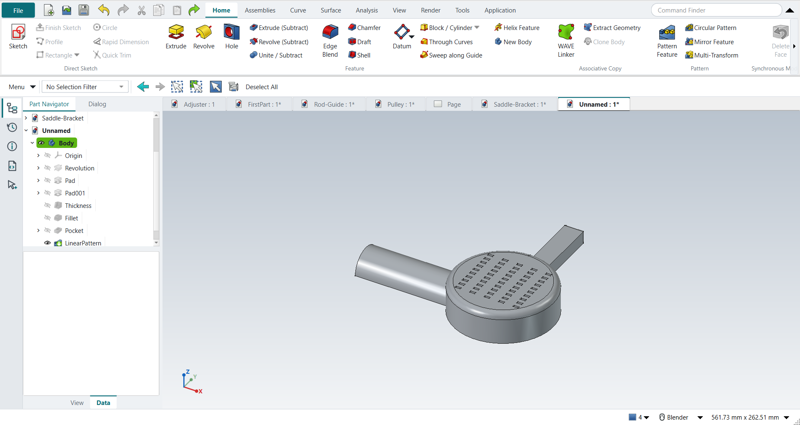

# Tutorial replay: NX textbook exercises in FreeCAD NX-Style

Six exercises from the NX notebook were replayed inside FreeCAD 1.1.4 with `python launch_nx.py --tutorial OUTDIR` (`--tutorials E,F` picks some), the way the books tell an NX user to work. The replay presses the same keys, clicks the NX-named ribbon buttons, clicks sketch points with MB1 in the graphics window, ends tools and accepts dialogs with MB2, and checks each feature by its volume.

Every part is metric, NXStyle's default (FreeCAD's Standard schema: mm, kg). The books work in inches; their sizes are typed in millimetres (2.5 in = 63.5 mm), and volumes are reported in mm³.

- **A, The Adjuster** (Shih, *Parametric Modeling with Siemens NX*, ch. 2). The step list came from NotebookLM; its slot placement was ambiguous, so the replay cuts a 1.00 in (25.4 mm) wide, 0.75 in (19.05 mm) deep slot into the top of the vertical leg (the part stays one solid).
- **B, First part**: a hollow cylinder (Ø50/Ø30 × 50 mm) and a revolved cone (R25 × 50 mm). NotebookLM attributed it to the KIT course but cited Shih and Tickoo; treat it as a synthesised exercise.
- **C, Rod-Guide** (Shih ch. 9): a filleted 3.00 × 2.00 × 0.75 block with four holes, an At Angle datum plane, an offset datum plane, and a hole drilled from that datum. The step order follows the book's text; its sizes appear only in figures, so they are NotebookLM's reading. The angled upper block (C9) is skipped because its profile is figure-only.
- **D, Pulley with drawing** (Shih ch. 11): a revolved half section, Mirror Feature, a pattern leader hole, a 5× circular pattern, then a drawing with a right base view and a section view. The profile sizes (Ø4.00 × 1.00, hub Ø1.50, bore Ø0.75, web 0.25, five Ø0.50 holes on a 2.50 pitch circle) are again NotebookLM's reading of the figures.
- **E, Saddle Bracket** (Shih ch. 4): the BORN technique (Datum CSYS first), a symmetric extrude, a circular end tied to a projected edge, renaming features in the Part Navigator, three design changes (width 2.5 → 2.0, Until Next → Through All, a fillet added to the first sketch), Assign Materials (steel) and the physical properties. The text gives 2.5, 0.5, 2.0, Ø0.75 and R0.25; the profile and the notch are figure-only, so the L-profile (3.00 long, 0.50 base, 0.75 × 2.00 upright, 1.00 × 0.75 notch) is the replay's own. NotebookLM's reading of these figures came back without citations and contradicted the text, so it was not used. Siemens documents that since NX 1926 a Symmetric Value distance is the total width ([KB PL8613151](https://support.sw.siemens.com/en-US/okba/PL8613151/Extrude-feature-is-not-generated-with-a-distance-value-specified-by-Symmetric-Value/index.html)); the book uses NX 2212.
- **F, Dryer Housing** (Shih ch. 12): revolve, extrudes, Edge Blend, Shell, a pattern leader and a two-direction rectangular pattern. The text gives R0.25, 0.5, 5.5, R0.15, 0.125, 0.15 and the pattern (5 × −0.58, 10 × −0.25); every profile is figure-only, so the housing is a simplified one of the replay's own (an R2.00 × 1.25 drum, a 0.75 wide handle, an R0.75 half nozzle). The swept cut along the rim (F27) is skipped: its guide and section are figure-only.

Dimension values are applied through FreeCAD's API, the equivalent of typing them into Rapid Dimension. Everything else is real UI input. In E and F each feature is checked against the same operation done directly with FreeCAD's Part API. The shell is the exception: `Part.makeThickness` returned shapes reaching outside the original part, so the shell is measured directly instead (outer box unchanged, points 1.6 mm inside every wall are material, points deeper in are hollow).

**same** = NX steps work as written. **differs** = it works, but the FreeCAD way is different (explained). **limit** = the book's way fails in FreeCAD itself; a workaround follows in the next steps. **skipped** = not replayed (reason given). **FAILED** = did not work. The final runs had no FAILED steps: A 13 same / 5 differs, B 13 / 2, C 11 / 3 / 1 skipped, D 13 / 7, E 15 / 10, F 16 / 9 / 2 limit / 1 skipped.

| # | NX step | How it was replayed | Result | Detail |
|---|---|---|---|---|
| A1 | File > New (Ctrl+N), Model template | Ctrl+N | **same** | new document ['Unnamed'] with a Body; its datum planes appear when a plane is picked (kept hidden otherwise: FreeCAD 1.1.4 hides the part when they stay on) |
| A2 | Units in the New dialog (the book picks inches) | metric part kept; book sizes typed in mm | **differs** | FreeCAD sets units in Preferences, not in the New dialog; NXStyle defaults to millimetres (document: Standard (mm, kg, s, °); 25.4 mm shows as 25.40 mm) |
| A3 | Extrude (X) with nothing selected | X key | **same** | FreeCAD asks for the sketch plane in the Dialog panel; NX asks in the graphics window |
| A4 | Pick the XY plane, accept with MB2 | plane row in the Dialog panel + MB2 click | **same** | picked XY-plane (Base plane); sketch in edit: Sketch |
| A5 | Profile (Z), six MB1 clicks for the L outline | Z key + MB1 clicks in the graphics window | **same** | tool active True; 6 curves drawn |
| A6 | MB2 ends Profile | MB2 click | **same** | tool ended = True |
| A7 | Rapid Dimension (D): 2.5 width, 2.5 height, 0.75 legs | D key, values applied | **differs** | D starts FreeCAD's Dimension tool. FreeCAD does not show NX's dynamic dimensions on click, and there is no 'scale the whole sketch to the first dimension?' prompt |
| A8 | Finish Sketch (Ctrl+Q) returns to the Extrude dialog | Ctrl+Q | **same** | Extrude dialog open = True; modals [] |
| A9 | Extrude: End = Value 2.5, Boolean None, OK | typed into 'lengthEdit', MB2 = OK | **same** | volume 130584.4 mm^3, expected 130584.4 |
| A10 | Extrude, pick the top face as sketch plane, Boolean Subtract | select face + ribbon 'Home › Feature > Extrude (Subtract)' | **differs** | FreeCAD has no Boolean option in Extrude: the subtracting extrude is its own button (Home > Feature > Extrude (Subtract)) |
| A11 | Rectangle (R), two MB1 clicks, MB2 | R key + MB1 clicks + MB2 | **same** | tool active True; 4 curves |
| A12 | Rapid Dimension: 0.50 from edge, 1.00 wide, 0.75 deep | values applied | **differs** | as in step 6: same tool, no NX dynamic dimensions |
| A13 | Finish Sketch returns to the (subtract) Extrude dialog | Ctrl+Q | **same** | dialog open = True |
| A14 | Reverse Direction into the solid | - | **differs** | not needed: FreeCAD's subtracting extrude cuts into the solid by default |
| A15 | Slot depth 0.75, OK | 'lengthEdit' = 19.05 mm, MB2 = OK | **same** | volume 121366.7 mm^3, expected 121366.7; 1 solid(s) |
| A16 | The finished part is shown in the graphics window | render of the graphics window | **same** | 26.7% of the view shows the part |
| A17 | Save (Ctrl+S) | Ctrl+S is bound to Save (tested by the self-test); file saved | **same** | saved as Adjuster.FCStd (FreeCAD format, not .prt) |
| A18 | Reopened part is shown | render of the graphics window | **same** | 26.7% of the view shows the part |
| B1 | File > New (Ctrl+N), Model template, mm | Ctrl+N | **same** | new document ['Unnamed'] |
| B2 | Extrude (X), pick the XC-YC plane | X key, plane row + MB2 | **same** | picked XY-plane (Base plane) |
| B3 | Circle (O): two circles at the origin, MB2 | O key + MB1 clicks + MB2 | **same** | tool True; 2 circles; ended True |
| B4 | Rapid Dimension: diameters 50 and 30 | values applied | **differs** | same tool; values typed in FreeCAD's dimension field |
| B5 | Finish Sketch, Extrude 0 to 50 mm, OK | Ctrl+Q, 'lengthEdit' = 50, MB2 = OK | **same** | volume 62831.9 mm^3, expected 62831.9 |
| B6 | Revolve (ribbon) | ribbon 'Home › Feature > Revolve' | **same** | nothing selected: sketch first, as with Extrude |
| B7 | Pick the YC-ZC plane | plane row + MB2 | **same** | picked YZ-plane (Base plane) |
| B8 | Line (L): right triangle on the axis, MB2 | L key + MB1 clicks + MB2 | **same** | tool True; 3 lines |
| B9 | Rapid Dimension: height 50, radius 25 | values applied | **differs** | same tool |
| B10 | Finish Sketch returns to Revolve; axis = Z, 0..360 deg | Ctrl+Q | **same** | dialog open True; default axis ['V_Axis'] (sketch V axis = Z) |
| B11 | Boolean Unite, OK | MB2 = OK | **same** | volume 95556.8 mm^3, expected 95556.8; features in one Body unite automatically |
| B12 | Hold MB2 and drag to rotate | MB2 drag | **same** |  |
| B13 | F8 snaps to the nearest standard view | F8 key | **same** | view Vector (0.0, 1.0, 0.0) |
| B14 | The finished part is shown in the graphics window | render of the graphics window | **same** | 11.3% of the view shows the part |
| B15 | Save (Ctrl+S) | file saved | **same** | FirstPart.FCStd |
| C1 | File > New (Ctrl+N), Model template | Ctrl+N | **same** |  |
| C2 | Extrude (X), pick the XY plane | X key, plane row + MB2 | **same** | picked XY-plane (Base plane) |
| C3 | Rectangle (R) by 2 points around the origin | R key + 2 MB1 clicks + MB2 | **same** | tool True; 4 curves; ended True |
| C4 | Sketch Fillet (F), R0.25 on the four corners | F key; corners applied as values | **differs** | F starts FreeCAD's sketch fillet; the radius is typed after picking, not before as in NX |
| C5 | Circle (O): four Ø0.25 circles on the arc centres, Equal Radius | O key; values applied | **same** | Equal constraint exists in both |
| C6 | Finish Sketch, Extrude 0.75, OK | Ctrl+Q, 'lengthEdit' = 19.05 mm, MB2 = OK | **same** | volume 70669.2 mm^3, expected 70669.2; 1 solid(s) |
| C7 | Datum Plane, At Angle: front face | select face + ribbon 'Home > Datum > Datum Plane' | **same** | the datum is attached to the face; FreeCAD's attachment dialog opens |
| C8 | Angle -30° about the vertical axis, OK | 'attachmentOffsetPitch' = -30°, MB2 = OK | **differs** | plane at 30.00° to the face. NX picks the Z axis as hinge; FreeCAD rotates in the attachment offset about the face's own axes |
| C9 | Extrude the angled upper block on the datum plane (Unite, Symmetric 1.0) | - | **skipped** | the profile's dimensions are only in the book's figures |
| C10 | Datum Plane, At Distance: top face | select face + ribbon 'Home > Datum > Datum Plane' | **same** |  |
| C11 | Distance 0.75, OK | 'attachmentOffsetZ' = 19.05 mm, MB2 = OK | **same** | datum plane at z = 38.10 mm (top face 19.05 + 19.05) |
| C12 | Hole, placed on the offset datum plane | select plane + ribbon 'Home › Feature > Hole' | **differs** | FreeCAD's Hole drills at circle centres in a sketch, so Hole starts a sketch on the plane (NX picks the point directly) |
| C13 | Place the hole centre at the WCS origin | O key + MB1 at the origin + MB2 | **same** | tool True; 1 curves; ended True |
| C14 | Hole: Simple, Ø0.25, Through Body, OK | dialog open True; 'Diameter' = 6.35 mm, 'Through all', MB2 = OK | **same** | volume 70065.9 mm^3, expected 70065.9; 1 solid(s) |
| C15 | The finished part is shown in the graphics window | render of the graphics window | **same** | 21.6% of the view shows the part |
| D1 | File > New (Ctrl+N), Model template | Ctrl+N | **same** |  |
| D2 | Revolve, nothing selected | ribbon 'Home › Feature > Revolve' | **same** |  |
| D3 | Pick the XY plane of the datum CSYS | plane row + MB2 | **same** | XY-plane (Base plane) |
| D4 | Profile (Z): closed half cross-section, MB2 | Z key + 9 MB1 clicks + MB2 | **same** | tool True; 8 curves; ended True |
| D5 | Rapid Dimension: profile sizes | values applied | **differs** | same tool; no dynamic dimensions |
| D6 | Specify Vector = X axis through the origin, 0..360°, OK | axis 'Base X-axis', MB2 = OK | **same** | volume 51079.3 mm^3, expected 51079.3; 1 solid(s); NX picks the axis in the graphics window, FreeCAD lists it in the dialog |
| D7 | Mirror Feature: select the revolved feature, MB2 to proceed | feature selected + ribbon 'Home › Pattern > Mirror Feature' | **differs** | selecting first and then starting Mirror Feature replaces NX's 'select, then MB2' |
| D8 | Plane = the back face (on the YZ plane), OK; Unite | plane 'Base YZ-plane', MB2 = OK | **same** | volume 102158.6 mm^3, expected 102158.6; 1 solid(s); inside a Body the mirror unites by itself, so NX's separate Unite step is not needed |
| D9 | Pattern leader: Extrude on the front face of the web, Subtract | select face + ribbon 'Home › Feature > Extrude (Subtract)' | **differs** | subtracting extrude is its own button in FreeCAD |
| D10 | Circle Ø0.50 on the 2.50 pitch circle | O key + MB1 clicks + MB2; values applied | **same** | tool True; 1 curves |
| D11 | Reverse Direction, End = Through All, OK | 'Through all', MB2 = OK | **same** | volume 101354.2 mm^3, expected 101354.2; 1 solid(s); no Reverse needed in FreeCAD |
| D12 | Pattern Feature, Layout = Circular | leader selected + ribbon 'Home › Pattern > Circular Pattern' | **differs** | NX has one Pattern Feature with a Layout list; FreeCAD has separate linear and circular buttons |
| D13 | Axis X, Count and Span: 5 over 360°, OK | axis 'Base X-axis', 'spinOccurrences' = 5, MB2 = OK | **same** | volume 98136.6 mm^3, expected 98136.6; 1 solid(s) |
| D14 | The finished part is shown in the graphics window | render of the graphics window | **same** | 12.6% of the view shows the part |
| D15 | File > Drafting (Ctrl+Shift+D) | Ctrl+Shift+D | **same** | TechDrawWorkbench |
| D16 | New sheet, A-size, 1:1 | ribbon 'Home › Drawing > New Sheet' | **differs** | FreeCAD's default template Default_Template_A4_Landscape.svg; an ANSI A sheet is one template choice away (Sheet from Template) |
| D17 | Base View: Right view of the pulley | body selected + ribbon 'Home › View > Base View'; dialog closed with MB2 | **same** | 1 view(s) on the sheet; direction set to Right (+X) |
| D18 | Add a projected view, select it, Delete key | Base View again + Delete key | **differs** | views 2 -> 1. NX drags projected views off the base view; FreeCAD's Projected View is a projection group, so a second Base View stood in for it |
| D19 | Section View through the centre of the base view | base view selected + ribbon 'Home › View > Section View', direction 'pbLeft', MB2 = OK | **same** | 1 section view(s), 42 visible edges |
| D20 | Drag the section to the right of the base view, MB1 to place | X/Y of the section set | **differs** | FreeCAD places the section on top of the base view; it is moved afterwards (placed at x = 224.7 mm, base at 148.5 mm) |
| E1 | File > New | Ctrl+N | **same** |  |
| E2 | BORN: Datum CSYS at the WCS, OK | ribbon 'Home > Datum > Datum CSYS', MB2 = OK, Yes to FreeCAD's question | **differs** | a FreeCAD Body already starts with its own origin (the BORN idea built in). With nothing selected FreeCAD asks 'no attachment mode fits the references, continue?'; NX places the CSYS at the WCS without asking |
| E3 | Extrude (X), XZ plane, OK | X key, plane row + MB2 | **same** | picked XZ-plane (Base plane) |
| E4 | Profile (Z): the L-shaped outline, MB2 | Z key + 7 MB1 clicks + MB2; sizes applied | **same** | tool True; 6 curves; ended True |
| E5 | Start = Symmetric Value, distance 2.5, OK | 'Symmetric', 'lengthEdit' = 63.5 mm, MB2 = OK | **same** | volume 107540.1 mm^3, expected 107540.1; 1 solid(s); width -31.75 .. 31.75 mm (NX 1926+ and FreeCAD both treat the symmetric distance as the total) |
| E6 | Extrude, bottom face as the sketch plane | select face + ribbon 'Home › Feature > Extrude' | **same** | Face1 |
| E7 | Project Curve: the bottom right edge, OK | ribbon 'Project Curve' + MB1 on the edge + MB2 | **same** | picked Edge2 in the graphics window |
| E8 | Circle: centre at the edge midpoint, through the top corner | O key + 2 MB1 clicks + MB2; midpoint and corner as constraints | **same** | solver result 0 (0 = solved); NX snaps to the midpoint and corner while drawing, FreeCAD records them as constraints |
| E9 | Finish the section: circle and projected edge | select the projected line + ribbon 'Convert To/From Reference' | **differs** | FreeCAD 1.1 projects a picked edge as defining geometry, so the profile had 2 curves and Extrude would report 'Wire is not closed'. NX builds regions from the circle and its diameter; in FreeCAD the projected line has to become construction geometry first |
| E10 | Reverse Direction, distance 0.5, Boolean Unite, OK | 'checkBoxReversed' on, 'lengthEdit' = 12.7 mm, MB2 = OK | **same** | volume 127650.1 mm^3, expected 127650.1; 1 solid(s); lowest point z = -0.00 mm |
| E11 | Rename in the Part Navigator: Base, Circular_End | select + F2, type, Enter | **differs** | NX: click the name twice or MB3 > Rename; FreeCAD: F2 or MB3 > Rename |
| E12 | Design change: Base distance 2.5 -> 2.0, OK, F5 | Base selected + ribbon 'Home › Edit Feature > Edit Parameters' (dialog True), 'lengthEdit' = 50.8 mm, MB2 = OK, F5 | **same** | volume 98902.5 mm^3, expected 98902.5; 1 solid(s); NX edits the value from MB3 > Show Dimensions, FreeCAD reopens the Extrude dialog. Circular_End follows the narrower base (its circle is tied to the projected edge) |
| E13 | Hole: Simple, Normal to Face, on the top face | select face + ribbon 'Home › Feature > Hole' | **differs** | FreeCAD's Hole drills at circle centres in a sketch on the face |
| E14 | Point: the centre of the top arc | O key + MB1 clicks + MB2; centre tied to the arc | **differs** | NX picks the arc centre directly; FreeCAD sketches a circle on it (Edge19 projected) |
| E15 | Diameter 0.75, Depth Limit = Through Body, OK | 'Diameter' = 19.05 mm, 'Through all', MB2 = OK | **same** | volume 95282.7 mm^3, expected 95282.7; 1 solid(s) |
| E16 | Extrude on the right vertical face of the upright | select face + ribbon 'Home › Feature > Extrude (Subtract)' | **differs** | Face5; subtracting extrude is its own button |
| E17 | Rectangle at the upper edge, MB2; three dimensions | R key + 2 MB1 clicks + MB2; sizes applied | **same** | tool True; 4 curves; ended True |
| E18 | Boolean Subtract, End = Until Next, OK | 'To first', MB2 = OK | **same** | volume 86064.9 mm^3, expected 86064.9; 1 solid(s); FreeCAD calls Until Next 'To first' |
| E19 | Rename the cut Rect_Cut | select + F2, type, Enter | **differs** |  |
| E20 | Edit with Rollback: End = Through All, OK | Rect_Cut selected + ribbon 'Home › Edit Feature > Edit Parameters', 'Through all', MB2 = OK | **same** | volume 86064.9 mm^3, expected 86064.9; 1 solid(s); FreeCAD's edit shows the model before the feature, like NX's rollback |
| E21 | Edit the Base sketch: Fillet (F) R0.25 on the inside corner, MB2 | sketch selected + ribbon 'Edit Parameters', F key; corner filleted at 0.25 | **differs** | NX: Edit with Rollback > Sketch Section; FreeCAD opens the sketch directly. The radius is typed after picking the corner |
| E22 | Finish Sketch, OK: the whole part updates | Ctrl+Q | **same** | volume 86504.5 mm^3, expected 86504.5; 1 solid(s); later features (Circular_End, hole, Rect_Cut) follow the edited sketch |
| E23 | Tools > Assign Materials: Steel, select the body, OK | body selected + ribbon 'View › Visualization > Assign Material', 'Steel-Generic', Close | **differs** | material Steel-Generic, density 7900.0 kg/m^3; the panel applies the choice at once and has Close instead of OK |
| E24 | Analysis > Measure, Solid Body, physical properties in the Information window | body selected + ribbon 'Analysis › Measure > Measure Bodies' | **differs** | mass 0.6834 kg from 7900 kg/m^3; FreeCAD's own Measure has no mass, so NXStyle adds Measure Bodies |
| E25 | The finished part is shown in the graphics window | render of the graphics window | **same** | 21.7% of the view shows the part |
| F1 | File > New, Model template | Ctrl+N | **same** |  |
| F2 | Revolve, YZ plane of the datum CSYS | ribbon 'Home › Feature > Revolve', plane row + MB2 | **same** | picked YZ-plane (Base plane) |
| F3 | Profile, then Fillet R0.25 between the top line and the side | Z key + MB1 clicks + MB2, F key; sizes applied | **differs** | the book's profile (an arc and stepped lines) is figure-only; a filleted rectangle stands in. The fillet radius is typed after picking in FreeCAD |
| F4 | Specify Vector = Z axis, 0..360°, OK | axis 'Base Z-axis', MB2 = OK | **same** | volume 254722.5 mm^3, expected 254722.5; 1 solid(s) |
| F5 | Dryer handle: Extrude (X), XY plane | X key, plane row + MB2 | **same** | picked XY-plane (Base plane) |
| F6 | Handle outline, seven dimensions | R key + 2 MB1 clicks + MB2; sizes applied | **differs** | the book's handle (three inclined lines, seven dimensions) is figure-only; a 0.75 x 3.5 bar stands in |
| F7 | Boolean Unite, End = 0.5, OK | 'lengthEdit' = 12.7 mm, MB2 = OK | **same** | volume 273230.4 mm^3, expected 273230.4; 1 solid(s) |
| F8 | Sketch on the YZ plane | ribbon 'Home › Direct Sketch > Sketch', plane row + MB2 | **same** | picked YZ-plane (Base plane) |
| F9 | Arc by centre and endpoints (180°), then a Line closing it | A key + 3 MB1 clicks + MB2, L key + 2 MB1 clicks + MB2; sizes applied | **same** | arc tool True, line tool True; the book projects the bottom edge first (shown in tutorial E); here the arc sits on the bottom line by its coordinates |
| F10 | Reverse Direction, End 5.5, Boolean Unite, OK | sketch selected + ribbon 'Home › Feature > Extrude', 'checkBoxReversed' on, 'lengthEdit' = 139.7 mm, MB2 = OK | **same** | volume 324426.0 mm^3, expected 324425.9; 1 solid(s) |
| F11 | Edge Blend, Circular, select the handle's edges | 4 edges selected + ribbon 'Home › Feature > Edge Blend' | **differs** | the book's 13 edges are picked from a figure; the outer edges of the handle's end stand in (FreeCAD's unrefined shape may split one). FreeCAD takes the edges selected before the command |
| F12 | Radius 1 = 0.15, OK | 'filletRadius' = 3.81 mm, MB2 = OK | **same** | volume 324249.4 mm^3, expected 324249.3; 1 solid(s) |
| F13 | Shell: pick the two flat open faces | bottom ['Face2'] + nozzle end ['Face9'] selected + ribbon 'Home › Feature > Shell' | **same** | FreeCAD calls Shell 'Thickness' |
| F14 | Thickness 0.125, OK | 'Value' = 3.175 mm, 'Make thickness inwards' on (default), MB2 = OK | **limit** | FreeCAD 1.1.4 does not shell the part after the edge blend (FreeCAD: 'Input error: Failed to make thick solid'); the same faces and thickness work before the blend (next steps). NX shells it in the book's order |
| F15 | Workaround: undo the shell and the blend | Ctrl+Z x2 | **differs** | back to the part before the edge blend |
| F16 | Workaround: Shell first, the same two faces | bottom ['Face10'] + nozzle end ['Face9'] selected + ribbon 'Home › Feature > Shell' | **same** | FreeCAD calls Shell 'Thickness' |
| F17 | Thickness 0.125, OK (before the blend) | 'Value' = 3.175 mm, 'Make thickness inwards' on (default), MB2 = OK | **same** | volume 75365.9 mm^3 (solid 324425.9); outer box kept True; 1.6 mm inside each wall is material [True, True, True, True], deeper in is hollow [True, True, True, True, True] |
| F18 | Workaround: Edge Blend after the shell, the handle's outer end edges | 4 edges selected + ribbon 'Home › Feature > Edge Blend' | **differs** | the book's 13 edges are picked from a figure; the outer edges of the handle's end stand in (FreeCAD's unrefined shape may split one). FreeCAD takes the edges selected before the command |
| F19 | Radius 1 = 0.15, OK (after the shell) | 'filletRadius' = 3.81 mm, MB2 = OK | **limit** | volume 75352.7 mm^3, 13.24 mm^3 rounded off; inside the previous box True; feature valid False; no Part API reference (it failed: class StdFail_NotDone BRep_API: command not done); FreeCAD 1.1.4 refuses this round on the shelled walls |
| F20 | Workaround: Edge Blend again with a smaller radius | 4 edges selected + ribbon 'Home › Feature > Edge Blend' | **differs** | the book's 13 edges are picked from a figure; the outer edges of the handle's end stand in (FreeCAD's unrefined shape may split one). FreeCAD takes the edges selected before the command |
| F21 | Radius 1 = 0.10, OK (after the shell) | 'filletRadius' = 2.54 mm, MB2 = OK | **differs** | volume 75284.3 mm^3, expected 75284.3; 1 solid(s); the workaround changes the design: R0.10 instead of the book's R0.15 |
| F22 | Pattern leader: Extrude on the top face, Subtract | select ['Face26'] + ribbon 'Home › Feature > Extrude (Subtract)' | **differs** | the book orients the view to Top first; FreeCAD's sketch opens looking at the face |
| F23 | Rectangle to the right of the CSYS: the small vent | R key + 2 MB1 clicks + MB2; sizes applied | **same** | the slot size is figure-only: 0.20 x 0.08 here |
| F24 | Reverse Direction into the solid, End 0.15, OK | 'lengthEdit' = 3.81 mm, MB2 = OK | **same** | volume 75251.5 mm^3, expected 75251.5; 1 solid(s); no Reverse needed: the subtracting extrude cuts inwards |
| F25 | Pattern Feature, Layout = Linear, select the cut, MB2 | leader selected + ribbon 'Home › Pattern > Pattern Feature' | **differs** | FreeCAD's Linear Pattern is the Linear layout of NX's Pattern Feature |
| F26 | Direction 1: X, Count 5, Pitch -0.58; Use Direction 2: Y, Count 10, Pitch -0.25; OK | X axis {'axis': 'Base X-axis', 'mode': 'Spacing', 'count typed': 5, 'spacing': 0.58, 'reversed': True}; 'enableCheckbox'; Y axis {'axis': 'Base Y-axis', 'mode': 'Spacing', 'count typed': 10, 'spacing': 0.25, 'reversed': True}; MB2 = OK | **same** | volume 73645.6 mm^3, expected 73645.6; 1 solid(s); feature counts {'Occurrences': 5, 'Occurrences2': 10, 'Offset': 14.732, 'Offset2': 6.35, 'SpacingPattern': '[14.732]', 'SpacingPattern2': '[6.35]', 'Spacings': '[-1.0, -1.0, -1.0, -1.0]', 'Spacings2': '[-1.0, -1.0, -1.0, -1.0, -1.0, -1.0, -1.0, -1.0, -1.0]'}; NX's negative pitch is FreeCAD's spacing with Reverse |
| F27 | Swept cut along the rim (section rectangle, Line-Arc guide), Subtract | - | **skipped** | the guide curves and section sizes are figure-only |
| F28 | The finished part is shown in the graphics window | render of the graphics window | **same** | 8.3% of the view shows the part |

## What the replay changed in NXStyle

- **Extrude-first workflow (NX):** Extrude (X) or Revolve with nothing selected starts a sketch on the plane or face you pick. Finish Sketch (Ctrl+Q) then continues straight into the Extrude or Revolve dialog. With a sketch already selected, the feature starts at once. Extrude (Subtract) and Revolve (Subtract) work the same way.
- **NX Model template:** a new, empty part starts with a Body (setting `new_part_datum`). Its datum planes appear when you pick a sketch plane.
- **MB2 ends the active sketch tool**, as in NX.
- **MB2 rotate/pan/zoom** now reads Shift/Ctrl from the mouse event. Before, a stale global modifier state after Ctrl shortcuts could turn MB2 rotate into a zoom.
- **Hole on a plane (C):** Hole with a datum plane or face selected starts a sketch there, and Finish Sketch continues into the Hole dialog, as Extrude does.
- **MB2 = OK on drawing sheets (D):** a still middle click on a TechDraw sheet now presses OK in the open dialog (Base View, Section View); MB2 drag still pans.
- **Measure Bodies (E):** FreeCAD's own Measure has no mass. Analysis > Measure Bodies shows volume, surface area, the assigned material and density, mass and centre of mass in an NX-style Information window, in mm³, mm² and kg as NX reports a millimetre part (for the Saddle Bracket: 86,504.5 mm³, Steel-Generic 7900 kg/m³, 0.6834 kg).

## Differences that remain (FreeCAD behaviour)

- Units are set in Preferences, not in the New dialog. NXStyle makes them metric (Standard: mm, kg) and switches an imperial schema back; set `"units": "freecad"` to leave FreeCAD's choice alone.
- Typed values keep their precision (3.175 mm stays 3.175). Setting a field's value from a script rounds it to the Decimals preference (3.17); the replay types, as a user does.
- FreeCAD asks for the sketch plane in the Dialog panel; NX lets you click it in the graphics window. Clicking the plane in the 3D view also works in FreeCAD.
- No NX dynamic dimensions on click, and no 'scale the whole sketch to the first dimension' prompt. Rapid Dimension (D) opens FreeCAD's dimension tool.
- Extrude has no Boolean option: subtracting is its own button, Extrude (Subtract). Features in one Body unite automatically. Reverse Direction is rarely needed because a subtracting extrude cuts into the solid by default.
- Files are .FCStd, not .prt.
- Datum planes: FreeCAD's At Angle plane rotates about the face's own axes in the attachment offset; NX lets you pick the hinge axis.
- Hole drills at circle centres in a sketch; NX places hole points directly.
- Mirror Feature: select the feature first, then start the command. Inside a Body the mirror unites by itself.
- NX has one Pattern Feature with a Layout list; FreeCAD has separate Linear Pattern and Circular Pattern buttons. The axis is chosen from a list in the dialog.
- Drawings: FreeCAD's default sheet is A4 (an ANSI A template is available). Projected View is a projection group rather than views dragged off the base view. A new section view lands on top of its base view and is moved afterwards.
- Datum CSYS with nothing selected: FreeCAD asks "no attachment mode fits the references, continue?"; NX places the CSYS at the WCS without asking. A FreeCAD Body already starts with its own origin.
- **Project Curve:** FreeCAD 1.1 projects a picked edge as defining geometry. A circle drawn on a projected edge then fails to extrude ("Wire is not closed") until the projected line is turned into reference geometry (Convert To/From Reference). NX builds regions from the circle and its diameter.
- Renaming: F2 or MB3 > Rename in the Part Navigator. Design changes reopen the feature's dialog (Edit Parameters) instead of editing a shown dimension. Later features follow the change, including a fillet added to the first sketch afterwards.
- Assign Material applies the choice at once and closes with Close, not OK. FreeCAD 1.1 also applies the material's appearance, so a steel body renders nearly black.
- Rectangular pattern: NX's negative pitch is FreeCAD's spacing with Reverse; Direction 2 is a tick box in the same dialog.

## FreeCAD limits found (Tutorial F)

- **Shell after Edge Blend:** with the handle's edges rounded first, as the book does, FreeCAD 1.1.4's Thickness fails ("Failed to make thick solid"). The same faces and thickness work when the shell comes before the rounds (F17). The workaround is Ctrl+Z, shell, then round.
- **Edge Blend after the shell at R0.15:** rounding the handle's outer edges at the book's 0.15 on the 0.125 walls fails ("BRep_API: command not done"); R0.10 works. So the workaround changes the design slightly.

Both are FreeCAD/OpenCASCADE behaviour, observed in the UI. The replay does not claim why OCC refuses them.

## Resolved: part missing from the 3D view

Earlier runs showed finished parts in the Part Navigator but not in the 3D view, on the hidden desktop and on a normal screen alike. Bisection traced it to the Body's origin planes. In **plain FreeCAD 1.1.4**, without NXStyle, a Body whose origin stays visible disappears from the view after a view fit. NXStyle's template had kept the origin on to mimic NX's datum CSYS. It now leaves the origin hidden, and FreeCAD still shows the planes while you pick one. The final run passes every step on the hidden desktop and on a normal screen.

A separate crash while closing a document came from a test-only probe that held Python references into FreeCAD's scene graph; that probe is gone.

## Resolved: runaway memory in Tutorial D

The first runs of Tutorial D made FreeCAD request about 19 GB at the Circular Pattern step. The cause was the replay's own field helper, not NXStyle: FreeCAD's occurrence count field is a `Gui::UIntSpinBox`, which stores unsigned values offset by 2^31 inside a Qt `QSpinBox`. Setting it from Python with `QSpinBox.setValue(5)` bypasses that mapping and stores 2^31 + 5, clamped to 2147483647 occurrences, so FreeCAD tried to build two billion pattern copies. Typing the number, as a user does, maps correctly. The replay now types and interprets the text, and refuses to press OK on a pattern whose count is not the one requested. Every `--tutorial` and `--smoke-test` run also has a 4 GB memory ceiling (`--max-memory-gb`); the full A–D replay peaks at about 2.7 GB. Each step start goes to `OUTDIR/progress.log` with FreeCAD's committed memory, so a run stopped at the ceiling still shows where it was.
